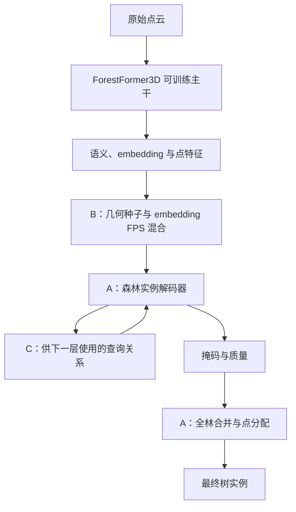

# 效果优先的 A+B+C 森林实例分割组合

日期：2026-10-19。用户明确接受组合公开架构与模块，当前目标是获得实际分割增益。本文给出可移植接口和第一轮实验安排，尚未实现或运行。

后续用户要求优先检索近期期刊模块，新增[期刊模块筛选与组合设计](recent_journal_modules_20261019_zh.md)。该文以同一个完整基线，提出局部几何增强与密度一致性训练的候选；本文保留为查询入口和查询交互的备选，避免一次叠加全部模块。

## 1. 固定一套组合

**A = 完整 ForestFormer3D；B = ForestMamba 风格几何/embedding 混合查询；C = CompetitorFormer 风格查询关系编码。**

| 部分 | 提供什么 | 放在哪里 | 待验证的作用 |
|---|---|---|---|
| A | 主干、语义/embedding 分支、实例解码、原生损失和全林推理 | 整体基线 | 建立完整模型起点 |
| B | 冠层几何峰值与 embedding 选点互补 | 实例查询生成入口 | 改变种子覆盖，尝试减少漏检 |
| C | 掩码重叠与相对质量关系 | 解码器的 query self-attention | 尝试减少重复掩码和碎片 |

B 与 C 分别修改“哪些查询进入解码”和“这些查询如何交换信息”，输出仍是 A 所需的查询、掩码和质量。组合使用一个主干、一套解码器，不把三个完整模型顺序运行或简单拼接其标签。

选 ForestFormer3D 作为第一轮底座的理由是模块接口接近：ForestMamba 同样使用 OneFormer3D 代码结构，CompetitorFormer 的早期论文已有 RRE/RCA 接入 OneFormer3D 的实验。PTv3/SaTv2 可以作为后续底座对照，第一轮先固定主干，降低接入成本。

来源：[ForestFormer3D 作者实现](https://github.com/SmartForest-no/ForestFormer3D)、[ForestMamba 作者实现](https://github.com/thanhhff/ForestMamba)、[CompetitorFormer 作者实现](https://github.com/DuanchuWang/CompetitorFormer)、[OneFormer3D 接入说明](https://arxiv.org/html/2411.14179v3)。接口近不代表依赖与张量能未经修改直接混用。

## 2. B 怎么接：用几何种子补充实例查询

ForestMamba 使用冠层峰值与 embedding FPS 的混合查询。这里借用查询选择部分，保留 A 的主干与解码器；不需要移植其 Mamba 编码/解码网络。[方法](https://arxiv.org/html/2606.01549v1)

第一版流程：

1. 在每个增强后的训练块或推理块内，使用坐标与模型预测的树点构建多尺度冠层表面并提取局部峰值。预测阶段不读取实例 GT。
2. 每个峰值明确落到一个真实树点/体素，保存 `seed_index`。第一版从这个锚点取查询特征；圆柱特征池化留作后续可选项，避免同时更改查询归属和特征聚合。
3. 总预算先保持与 A 相同。例如 A 使用 300 个查询时，几何种子最多占 60 个，余下至少 240 个由原 embedding FPS 提供。60/240 是本项目起始设置，不是论文结论。
4. 对重复体素索引去重，余下位置用原采样补足。无可用几何峰值时退回 A 的查询方式。保留大量 embedding 查询，是为了让没有独立冠层峰值的林下树仍有查询入口。
5. 训练时仅通过锚点的训练标签建立原有一对多实例对应；未知实例不作为背景。标签用于建立监督，不用于挑峰值或选择查询。推理只使用几何、预测分支和特征。

若有可靠地面高度，可以构建 CHM；没有时只使用局部冠层表面峰值，不套用依赖绝对树高的异速生长阈值。峰值不足、坡地误峰和大树多峰都可能降低效果，需要由 A+B 的实测判断。

读取作者当前代码时还发现一个需要注意的接口：圆柱池化查询没有天然的单个来源体素，归属标签和元数据必须另行处理。第一版保留真实锚点索引，避免仅复制池化特征却继续沿用不匹配的种子监督。[查询选择源码](https://github.com/thanhhff/ForestMamba/blob/main/oneformer3d/oneformer3d.py)

## 3. C 怎么接：让 query 感知竞争关系

CompetitorFormer 的 RRE 将掩码重叠和得分相对排名编码到 query self-attention。第一版移植这一思想，使用 A 的质量输出，不新增额外标注或强制唯一输出损失。[方法](https://arxiv.org/html/2411.14179v3)

第 l 层得到查询 `q`、掩码 `M` 和质量 `s` 后，为下一层计算查询对关系：

```text
overlap[i,j] = IoU(M[i], M[j])
relative[i,j] = sign(s[i] - s[j]) * overlap[i,j]
attention_logits = QK^T / sqrt(d) + alpha * relation_embedding(relative)
```

这是拟采用的简化 RRE 风格变体，不是对作者完整 RRE 公式或完整 CompetitorFormer 的逐项复现。

- 关系在粗尺度、带上限的掩码 token 上计算，再进入 self-attention，不在整片森林建立巨型查询对矩阵。
- 首轮无前层掩码时使用原 attention。初始掩码/质量不稳定时，关系分支逐步启用；残差系数 `alpha` 初值为 0。
- 初版关系计算停止梯度，不让原质量分支为了竞争排名而改变原质量监督的含义。
- 只提供关系信息，不根据重叠或排名直接删除弱 query；邻树冠层重叠不能直接当成同实例。
- 原有一对多正样本掩码目标继续保留，不要求同树多个查询里只有一个正样本。
- 第一版先接 RRE 风格偏置；QCL 和 RCA 另有接入要求，暂不一并移植。这样 C 是一个可单独开关的改动。

A 的迭代解码已经输出掩码和质量，并有 self-attention，能够提供此接口。[解码器源码](https://github.com/SmartForest-no/ForestFormer3D/blob/main/oneformer3d/query_decoder.py)

## 4. 整体数据流与训练



训练使用原生语义、实例 embedding、掩码、质量和辅助层监督，主干参与训练。B/C 第一版不额外堆叠损失权重。密度稀疏化和局部遮挡等增强作为所有组的共同设置，不能只给 A+B+C 组使用。

数据适配继续保留本项目忽略标签语义。若现有标签只有树/非树，语义头按可用类别重设；不能虚构 wood/leaf 标签，相关预训练头也不能假定尺寸兼容。可兼容部分加载相同官方初始化，各组采用一致的加载与训练方式。

第一轮沿用 A 的全林输出策略，四组使用相同阈值与合并设置；不默认接入此前 v1b 的分配后乘保留比例过滤。输出阶段另保存一份过滤前结果，便于解释损失发生在哪一步。

## 5. 实验顺序

| 顺序 | 组合 | 最先回答的问题 |
|---|---|---|
| 1 | A | 完整公开底座在本项目数据与评价下表现如何？ |
| 2 | A+B | 换查询后是否多找到有效树，而不是只增加候选？ |
| 3 | A+C | 查询关系是否减少重复/碎片 FP，同时保住 TP？ |
| 4 | A+B+C | 两个模块一起用是否仍然互补？ |

四组固定总查询预算、数据划分、训练预算、初始化来源和全林输出策略。首先使用一个随机种子得到方向；有效后再补重复种子。无须先展开大量结构搜索。

先看 F1、TP/FN、按 GT 树等权平均最佳 IoU Coverage，再看重复实例和未分配树点。B/C 只是作用假设：增加几何查询可能挤占原 embedding 查询，竞争关系可能把初始质量错误放大。两项正收益不能简单相加；若单项下降，就回到其失败环节修改。

Wytham 用于检查相同规则在该森林是否改善；它已经参与本项目分析，不把这轮组合试验再称为全新的独立测试。保留与用户当前评价协议一致的结果，也避免直接混用作者论文的加权 Coverage 数字。

## 6. 实施边界

这套组合不依赖 TreeLearn 的冻结特征和 vote，不需要再给树人工标注新属性。已有数据仍需适配完整模型的输入格式；旧冻结头权重不能直接充当新模型权重。

本轮只读取公开源码、论文与本项目文档，完成设计。没有克隆执行上游项目，没有修改模型，没有在本地训练、推理或运行测试。GitHub API 限流后改为只读作者 raw 源码，未据此宣称模型依赖或运行已验证。

后续代码交付需包含四组独立配置、默认关闭 B/C 的完整基线、断点恢复、统一评价和前台实时日志。所有实验由用户在服务器前台执行；本设计阶段不提供尚不存在的运行命令。
