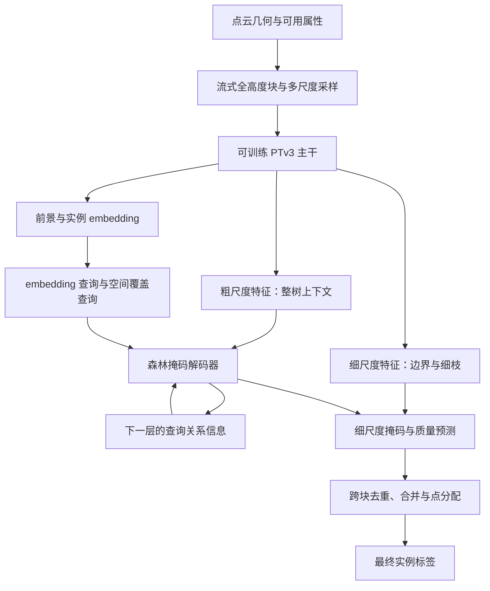

# 独立于 TreeLearn 的森林实例分割架构选择

日期：2026-10-19。本文是结合本项目结果和一手论文/作者仓库提出的设计建议，尚未实现、训练或验证。现有 v1/v1b 结果不能视为这些完整架构的复现结果。

## 1. 建议

最新用户要求：以实际效果为目标，允许直接组合公开架构和模块，不把方法新颖性作为前置要求。当前优先方案更新为 **完整 ForestFormer3D + ForestMamba 风格几何/embedding 混合查询 + CompetitorFormer 风格查询关系编码**，具体接口和实验顺序见 [A+B+C 实施设计](abc_forest_query_plan_20261019_zh.md)。

下文的 **可训练 PTv3 多尺度主干 + 森林实例解码器 + 查询关系建模** 保留为需要更换主干的备选设计；第 4 节描述的是这一备选，而非当前第一轮工程入口。

先做完整联合训练的基线，再加入一个查询竞争模块。树干/树冠结构查询、超点图、Mamba、自监督预训练分别作为后续选项，不一次叠加。

这条主线可以完全绕开 TreeLearn 的特征、offset 和聚类结果。保留本项目的数据划分、忽略标签规则、评价代码和流式读写经验。

**PTv3 加森林查询解码器这一组合已经有 SegmentAnyTreeV2；不能把它重新命名就当成新架构贡献。** 本项目可以在此类基线上研究森林特有的查询竞争或结构融合，但有效性和新颖性都需要另外证明。

## 2. 从已经完成的实验得到什么

| 观察 | 对架构设计的意义 | 尚不能推出的结论 |
|---|---|---|
| 源域 v1 的 1151 个 FP 中，891 个保留不足原掩码一半，907 个的最佳 GT 已被 TP 匹配 | 查询间重叠、分配后的碎片和置信度不匹配值得优先处理 | 两组有重叠；不能相加，也不能断言所有这些 FP 都是重复树 |
| 源域 v1b F1 达到 89.831%，但 Completeness 和 Coverage 仍分别低于原版约 1.652 和 1.504 pp | 后过滤能压低 FP，无法自动恢复整树和缺失点 | F1 上升不等于掩码或召回全面改善 |
| Wytham 原版 TP 596、过滤后 TP 447；F1 70.324% → 62.913% | 新架构要同时改善整树召回和跨域表现，不能只优化删实例 | 缺少本次过滤前标签，不能把净少的 149 个 TP 全归因于后过滤 |
| 当前 v1 用冻结的 TreeLearn 32 维特征、旧 vote 和概率；每块最多 4096 个上下文 token | 应让主干参与实例损失训练，并保存局部细节与较大范围上下文 | 冻结特征、token 数、vote 先验谁是主要原因，尚无独立因果对照 |

结果依据：[v1 原始统计](query_instance_decoder_v1_results_20261019.json)、[源域诊断](query_instance_decoder_v1b_diagnosis_20261019.json)、[Wytham 分析](query_instance_decoder_v1b_wytham_20261019_zh.md)。实现依据：[模型](../../tree_learn/query_segmentation/model.py)、[数据入口](../../tree_learn/query_segmentation/data.py)、[当前配置](../../configs/experiments/query_instance_decoder/v1.yaml)。

## 3. 值得结合的几种路线

下面“适合本项目”和“预期作用”都是设计判断，并非这些论文已经在本项目上验证的收益。

### A. PTv3 + 森林查询解码器 + 查询竞争：更换主干的备选

文献依据：SegmentAnyTreeV2 使用 PTv3 与森林实例解码器，论文将 Wytham 排除出训练并报告了外部测试改进。它是直接相关的参考基线；论文数字不能与本项目不同采样和评价条件下的结果直接比较。[论文](https://arxiv.org/html/2606.08206v2)

另一个可借鉴的来源是 CompetitorFormer：通过预测掩码关系和相对得分建模查询竞争，其模块包括 QCL、RRE、RCA。论文和作者实现提供的是通用 3D 实例分割证据，不能直接视为森林有效性证明。[论文](https://openaccess.thecvf.com/content/CVPR2026/html/Wang_CompetitorFormer_Mitigating_Query_Conflicts_for_3D_Instance_Segmentation_via_Competitive_CVPR_2026_paper.html)、[作者代码](https://github.com/DuanchuWang/CompetitorFormer)

建议组合的分工：

- PTv3 学习与实例目标适配的多尺度点云特征。
- 森林解码器用实例 embedding 选查询，直接生成整树掩码。
- 查询关系模块在解码中传递“谁与我重复、谁应保留完整解释”的信息，目标是减少最后分配才暴露的碎片。

**接法不能照搬全部模块。** CompetitorFormer 的早期 arXiv 版本在 OneFormer3D 上只接 RRE/RCA，说明查询机制会影响兼容性。森林的一对多正样本监督，也不宜直接叠加“其余查询必须为空”的损失。第一版建议只接可变查询数兼容的 RRE 风格关系偏置，保留原有掩码监督；RCA、QCL 或最终唯一输出监督另做后续选择。[方法与兼容性说明](https://arxiv.org/html/2411.14179v3)

RRE 风格移植属于本项目待验证的改造，不宣称是完整 CompetitorFormer 复现。竞争信号早期可停止梯度并逐步启用，防止初始质量误判被反复放大。相邻树冠重叠只提供关系证据，不能直接当“同一棵树”的真值。

### B. 稀疏 U-Net 或 PTv3 + ISBNet 动态卷积：替代主线

ISBNet 通过实例感知采样产生候选描述，用动态卷积解码掩码，并引入框的几何信息。它是区别于 Transformer 查询解码器的一条完整实例分割路线。[论文](https://openaccess.thecvf.com/content/CVPR2023/html/Ngo_ISBNet_A_3D_Point_Cloud_Instance_Segmentation_Network_With_Instance-Aware_CVPR_2023_paper.html)、[作者代码](https://github.com/VinAIResearch/ISBNet)

森林改造建议：候选核同时汇集不同高度的局部特征，预测树的范围供掩码使用。树框从训练实例标签计算，不需要另标框；推理框由网络预测。框只作为软几何条件，不能硬裁切偏冠和倾斜大树。

这条路线适合希望减少解码器复杂度、与当前查询系统建立不同机制对照的情况。动态卷积也可能产生重复候选和巨量掩码，并不天然解决最终分配；实际显存和速度必须在本数据上测量。

### C. Superpoint Transformer / SuperCluster + 实例图：不同范式的备选

SuperCluster 以超点图聚类产生全景实例，提供了不依赖一组查询掩码的路线。它与用超点作为 query 解码内存的 SPFormer 是不同方法，不能混称。[SuperCluster 论文](https://arxiv.org/abs/2401.06704)、[作者代码](https://github.com/drprojects/superpoint_transformer)、[SPFormer 论文](https://arxiv.org/abs/2211.15766)

建议的森林版本：先保守地形成细小超点，网络预测邻接超点属于同一树的关系，再由图分割得到实例；必要时加细点边界修正。训练边标签来自已有实例 ID，未知标签邻接对不参与监督。

其吸引力是把“这两团点属于同一棵树吗”变成显式任务，也适合大场景。主要风险同样明确：邻树枝叶一旦被提前合入同一不可拆超点，后端会受到限制。几何近、同属 wood/leaf 或竖直相邻，都不能替代同实例监督。因此不建议第一版同时引入超点预分割和全新查询解码器。

### D. 共享主干 + 树干支持查询 / 树冠查询：森林结构扩展

这是一项本项目设计假设：使用一个共享多尺度主干，分别从可靠的低层结构和树冠区域提取查询，送入同一个解码器，再让两种查询交换证据。它不要求两个完整主干。

预期分工是树干附近结构帮助区分交叠树冠，树冠证据帮助补全树形；但没有可见树干的树仍必须能由通用 embedding 查询覆盖。局部垂直线性和低位置只能作为软线索，不能硬性要求“一棵树必须有一根可见竖直干”。

可借鉴 ForestMamba 的多尺度 CHM 峰值加 embedding FPS 的混合查询思路。CHM 不能独占查询预算，否则可能漏掉林下树；坡地还需要处理地形，不能把绝对 Z 直接解释为树高。[ForestMamba 论文](https://arxiv.org/abs/2606.01549)、[作者代码](https://github.com/thanhhff/ForestMamba)

现有数据不一定有 wood/leaf 或树干标签。第一版不新增依赖这些标签的分支，也不把几何启发式生成的树干伪标签当成人工真值。此方向在基础模型召回改善后再考虑。

### E. 稀疏局部编码 + Mamba 长程分支：资源受限时再选

ForestMamba 同时研究了森林结构、混合查询和状态空间解码，作者已经提供代码。它适合作为完整备选模型或效率方向，不能把报告中的整体收益全归结为 Mamba。[作者仓库](https://github.com/thanhhff/ForestMamba)

如果主线确实被长程上下文显存限制，可将粗尺度上下文层换成序列建模，细尺度继续保留局部编码。当前问题主要体现为误检碎片与漏检，因此单纯更换序列模块没有直接解决这两个问题的保证。

## 4. PTv3 备选架构如何落地

目标：从原始几何独立预测树实例，让主干、查询和掩码共同训练。先控制在两个训练版本，而不是一次拼出五个新模块。

### 输入与主干

- 输入使用块内坐标及真实存在的属性。可靠地面高度存在时才使用归一化树高；缺少 RGB、法向或强度时不虚构这些属性。
- 不依赖 TreeLearn 的 tree probability、vote 或预测实例。这些旧输出最多用于后来明确标注的辅助对照。
- 采用多尺度编码及上采样连接，使细点特征也受到实例任务训练；不能仅把 4096 个冻结代表点换个名称。
- 工程起始预算建议为：特征维度 128，查询 256，解码 4 层；0.1–0.2 m 输入体素、每块约 6–12 万点作为待测范围。它们是本项目的资源起点，不是论文参数，也不承诺适配未知型号显卡。
- 用 AMP、batch size 1、梯度累积和分块掩码计算控制资源。不能为省显存反复缩小块到看不见完整树的范围；必要时同时保留粗尺度较大上下文。

PTv3 作者提供独立模型接入方式。[代码](https://github.com/Pointcept/PointTransformerV3) 森林模块可以从官方 ForestFormer3D 接口移植；其依赖与现有 TreeLearn 环境不同，应为新实现固定独立依赖，不在原环境里直接覆盖依赖包。[官方实现](https://github.com/SmartForest-no/ForestFormer3D)

### 查询与解码

- 第一版只保留 embedding 选点和空间覆盖两类查询，给低置信区域保留入口。
- 使用多尺度上下文、逐层掩码预测和深监督。注意力范围可由预测掩码与几何邻域共同约束，早期须留探索空间，避免错误掩码永久遮蔽目标。
- 主干与解码器联合优化；对已有预训练主干可用更低学习率，而非永久冻结。
- V0 是无新增关系模块的联合训练基线；V1 在完全相同的输入、训练数据和输出策略上加入 RRE 风格查询关系。只比较这两个版本即可开始判断方向。

### 训练与输出

- 先沿用森林种子对应的一对多掩码监督、embedding 和质量监督。忽略实例不作为空掩码负样本，也不为减重复强迫所有同树种子相互排斥。
- 前景监督先用现有可用标签构建，wood/leaf 语义分支等有相应标签再加入。
- 将密度稀疏化、局部遮挡、旋转和适度尺度变化用于源域训练；同一增强流程同步处理坐标、标签和几何目标。林下小树与大树均需要被采样到。
- 第一版沿用一个清楚的跨块去重与分配策略，并保存过滤前后结果。跨块同树证据融合与块内 query 竞争是两个问题；仅加入竞争层不能保证全林唯一身份。
- 默认不追加本项目 v1b 的 `quality × retention >= 0.4` 规则。若后来拒绝一个实例，需要明确其点是否能被其他有效实例接收，不能隐含地把这些点全部丢成背景。
- 后续若研究分配后质量学习，应监督最终实际输出掩码；粗块掩码质量不能直接当最终碎片质量。先别把这项改造塞进 V0/V1。

### 泛化与预训练

Sonata 提供自监督 PTv3 权重，可以作为可选初始化来源。[作者仓库](https://github.com/facebookresearch/sonata) 这不是已验证的森林初始化：输入属性、投影层和权重版本都要匹配。若缺少原预训练属性，需说明适配方式并允许主干继续训练。

同一架构也会因训练森林、密度和扫描条件不同而产生很大差异。先用本项目现有训练划分做 V0/V1；之后再把新增森林数据或自监督学习作为单独的提升来源。使用无标签 Wytham 做适配时，应明确改成目标域适配设定，不再称为未见目标域的泛化结果。

## 5. 推进顺序与现有代码边界

1. 如继续分析旧模型，可完成已经给出的 Wytham 关闭分配后过滤对照。它回答旧模型丢树发生在哪一步，不应阻塞新的架构设计。
2. 当前第一轮工程按 [A+B+C 实施设计](abc_forest_query_plan_20261019_zh.md) 推进。若后续选择 PTv3 备选，则先交付独立模型的数据入口、完整可训练 V0、统一评价和前台日志，再交付只加查询关系的 V1。官方预训练推理与本项目训练的模型不构成训练数据相同的因果对照。
3. 先看 TP/FN、F1、无权平均最佳 IoU Coverage 和同 GT 多预测情况；减少 FP 的同时确认没有再次明显损失整树。
4. 主线若改善，再从树干/树冠查询或局部实例关系中选一项。若长程建模或显存成为主要限制，再考虑 Mamba；若查询范式仍不适合，则切换 ISBNet 或 SuperCluster 备选。

本次只核验公开论文/仓库、阅读本项目实现与回传结果，并保存设计文档。**没有修改模型或实验入口，没有在本地运行训练、推理或测试。** 新模型代码尚未实现，因此本文不提供假定存在的运行命令；后续工程交付应包含可直接在服务器前台执行的命令。

## 6. 文献使用边界

- 截至本次检索，已核验 PTv3、ForestFormer3D、CompetitorFormer、ISBNet、SuperCluster、ForestMamba 和 Sonata 作者代码页面。SegmentAnyTreeV2 已核验论文及作者介绍，未核验到可以直接接入的官方 V2 实现，不能假定克隆一个同名仓库就可运行。
- SegmentAnyTreeV2 的对比包含训练数据版本变化，其 Coverage 表格使用点数加权指标；本项目当前是按 GT 树等权平均的最佳 IoU。数字接近也不代表同一评价条件。
- CompetitorFormer 的最终 CVPR 版本与早期 arXiv 版本标题、实验列表有变化；机制讨论以相应版本为准。森林移植不引用室内 AP 增益预测本项目 F1 增益。
- 算法组合是工程选择。能证明有效的森林结构设计、训练/推理一致性或跨域改进才有可能构成后续研究贡献。
