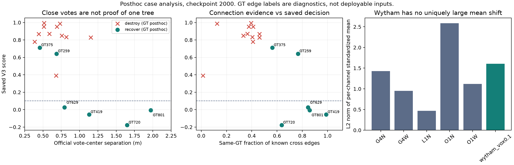
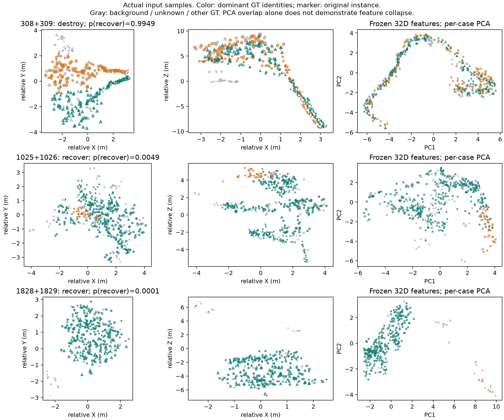

# V3 实际输入与动作空间审计：应转向局部拆分，而非继续整实例合并

## 结论

本次读取用户提供的 `casepack.zip`，重放其中六个森林的全部候选，核对原指标，
分析模型实际输入的抽样点、投票、冻结特征和已保存分数。没有加载网络或 checkpoint 张量，
没有运行训练、推理或单元测试，没有修改预测、阈值或训练签名。

**最重要的发现是动作空间与漏检类型不匹配。**
Wytham 官方基线漏检 281 棵。在当前 4,291 对候选中，只有 6 对并集能让原漏检树达到 IoU > 0.5。
即使取消候选图限制，穷举任意两个原实例的并集，也仍然只有这 6 棵有机会恢复。
允许任意多个原实例取并集，独立 IoU 可行的漏检树也只增加到 7 棵。
所以继续增加关系分类模块或扩大配对半径，无法改变这一主要限制。

相反，137 棵漏检树在某一个原预测实例内已经有超过一半的 GT 点：
如果能把属于它们的点从混合实例中正确分出来，单个子实例就有机会越过 IoU 阈值。
这支持优先研究局部拆分／点归属，而不是继续把整实例拼在一起。
这些是 GT 理想可行性，不是模型能够达到的改善数量。

## 数据、协议和复核

- 输入 SHA256、逐森林结果、逐对精确结果、案例指标见
  `assets/instance_relation_v3_case_analysis_20261022/analysis.json` 和同目录 CSV。
- 协议仍为 `aligned_voxels_ignore_negative_gt_iou_gt_0.5`：GT < 0 忽略，GT 0 为已知背景；
  先最大总 IoU 匈牙利匹配，再严格要求 IoU > 0.5。
- 五个源域森林的 4,676 对、Wytham 的 4,291 对全部进行 CPU 独立并集反事实重放。
  原基线和已保存 V3 联合动作的 TP、FP、FN、F1、完整度、误检率、覆盖率、点精度、点召回全部复现。
- 只有案例点云是 GT 事后选出的子集；整体候选计数和已有分数覆盖完整候选图。
  点云每个原实例最多 256 个点，不能据此断言完整点云缺少某个主干或接触区域。

| Wytham 候选范围 | other | recover | destroy | 总数 |
|---|---:|---:|---:|---:|
| 所有候选的协议反事实 | 3401 | 6 | 884 | 4291 |
| 标注足够、可作真实监督的候选 | 434 | 6 | 881 | 1321 |

标注不足的 2,970 对不能直接当作负样本；上表只是按现有已知标签进行事后指标重放。
所有候选中，安全恢复仍只有那 6 对，没有藏在标注不足候选中的额外恢复对。

## 整实例合并的上限有多低

对某棵 GT，设其点数为 G，原预测 i 的已知点数为 k_i，与该 GT 重合的点数为 j_i。
原实例点集互不重叠，并集的 IoU 为：

```text
IoU = sum(j_i) / (sum(k_i) + G - sum(j_i))
IoU > 0.5  <=>  sum(3*j_i - k_i) > G
```

因此无需生成所有 N² 个点集：对每棵漏检 GT 取两个最大的 `3*j_i-k_i`，
即可检查任意两原实例并集是否存在机会；累加全部正的 `3*j_i-k_i`，
可检查任意数量整实例并集的独立 IoU 可行性。这里使用全部精确点数，不依赖 256 点抽样。

| GT 理想操作范围 | 有机会恢复的原漏检 GT | 含义 |
|---|---:|---|
| 当前候选中的两实例并集 | 6 | GT259、375、419、629、720、801 |
| 任意两个原实例并集，取消候选限制 | 6 | 扩大配对半径不增加恢复机会 |
| 任意数量整实例并集，忽略图和安全冲突 | 7 | 仅额外增加 GT277；不保证可联合安全实现 |
| 从一个原实例内理想提取 GT 纯子集 | 137 | 单个混合实例已经包含该 GT 超过一半的点 |
| 对全部已分配前景理想重新划分 | 152 | 比上一行多 15 棵需跨原实例聚合的树 |
| 已分配前景中该 GT 点数不超过一半 | 129 | 仅重分现有实例点不够，还需要找回未分配点或修复前景 |

137 与 152 为包含关系；129 与 152 合计 281。不同操作行不可相加。
纯子集是假设已知正确点归属的 GT oracle，不能作为模型结果或部署输入。

原漏检 GT 中没有“原单实例 IoU 已 > 0.5，只因匹配未成功”的树。
因此，在固定原点集、当前候选、一次不相交双实例合并的条件下，
新恢复数量最多 6，完整度最多从 596/877 到 602/877，即 **68.6431%**。
该完整度上限不等于 F1 上限：其他不损失 TP 的合并仍可能通过减少 FP 改变 F1。

GT 选出这六对后，它们互不相交。联合精确重放结果：

| 项目 | 官方 | GT 理想六对合并 |
|---|---:|---:|
| TP / FP / FN | 596 / 222 / 281 | 602 / 210 / 275 |
| F1 | 70.3245% | 71.2848% |
| 丢失 / 恢复 | — | 0 / 6 |

**71.2848% 是使用 GT 选动作的示例，不是 V3 成绩，也不是可部署结果或全局 F1 上限。**

## 六对机会为什么仍然全部丢掉

| GT | 原实例 ID | 并集真实 IoU | 预测 recover 概率 | V3 分数 | 没有采用的原因 |
|---|---|---:|---:|---:|---|
| 259 | 1375 + 1376 | 0.5695 | 0.6522 | 0.6417 | 1376 被更高分配对抢走 |
| 375 | 1750 + 1751 | 0.6599 | 0.7166 | 0.7117 | 1750 被更高分配对抢走 |
| 419 | 1828 + 1829 | 0.6217 | 0.000136 | -0.0566 | 判为 other |
| 629 | 1549 + 1550 | 0.6684 | 0.0638 | 0.0273 | 判为 other |
| 720 | 1025 + 1026 | 0.8070 | 0.00486 | -0.1771 | 判为 other |
| 801 | 1080 + 1324 | 0.5144 | 0.000035 | -0.0058 | 判为 other |

分数为 `p(recover) - 3*p(destroy)`，默认阈值 0.1，同时要求最大类别为 recover。
降低分数阈值不会让后四对越过类别门；提高阈值也无法纠正配对排序。

- `[999,1376]` 分数 0.8680，高于正确配对 `[1375,1376]` 的 0.6417。
  单独合并会丢 GT437，不能恢复 GT259。
- `[1287,1750]` 分数 0.8141，高于正确配对 `[1750,1751]` 的 0.7117。
  它单独不丢树也不恢复树，属于 other，但仍抢占恢复所需的节点。
  因而不能把所有选择冲突都解释成“错误配对必然损害原 TP”。

V3 在标注足够的 Wytham 候选中，把 2 个真实恢复、5 个 other、14 个 destroy 判为 recover。
这既有分类错误，也有相互最优配对的排序错误，不能归结为阈值设错。

## 局部输入透露了什么

### 有害合并确实混合了不同树

11 个已接受有害合并的两端，按完整 GT 点数统计，主导 GT 均不同。
其中 8 对的两端都是原 TP。逐对身份重放确认：
`[229,230]` 一次丢失 GT525、GT768，其余十个有害动作各丢失一棵，合计 12 棵。

例如 `[308,309]` 两端主导 GT 为 51、436，已知点纯度约 96.1%、99.0%，
模型却给出 `p(recover)=99.49%`。并集仍能匹配其中一棵，不足以保留两棵。

这批有害配对的官方投票中心距离为 0.39–1.15m，中位数 0.68m；
六对真正恢复碎片的对应距离为 0.46–1.97m，中位数 0.96m。
下部质心距离也存在反向现象：有害配对中位数 0.88m，恢复对为 1.66m。
这些是经过选择的小案例统计，**说明接近不等于同树，不证明网络只依赖距离**。

### 连接标签有区分信息，但最终模型没有把它转成正确动作

按现有 4 个几何近邻 + 2 个投票近邻构图，并去重、排除未知标签后，
以原表示点数权重计算同 GT 连接比例：

| 案例组 | 全部已知跨实例边同 GT 比例中位数 | 双端下部边同 GT 比例中位数 |
|---|---:|---:|
| 六对恢复 | 80.6% | 98.3% |
| 十一个有害合并 | 39.4% | 0.0% |

它们是 GT 连接标签比例，不是已有连接头的预测精度，不能设成部署规则。
尤其 GT419 的已知跨实例边同 GT 比例为 98.9%，最终却有 98.1% 概率被判为 other。
说明不能仅用“这些抽样点完全没有连接信息”解释当前结果。

代码检查确认：连接分类器接受辅助监督，但其 sigmoid 输出没有直接作为邻接权重或合并门。
**连接隐藏特征仍参与最终分类**，并非连接分支完全没用；
现有包没有导出该边分类器的预测，尚不能判断是边分类本身错误，还是后续池化／分类未用好它。
即便这条路径修好，整实例合并的六棵上限仍在。

### 没有证据把主因写成“特征整体归一化崩溃”或“特征坍缩”

重建训练域统计后，Wytham 的标准化均值向量 L2 偏移为 1.61，
源域验证 O1N 为 2.58；Wytham 超过 ±10 的特征值比例约 **0.0234%**。
因此没有观察到普遍数值爆炸或大面积裁剪。此统计不是读取 checkpoint 实际缓冲区，
不能据此排除所有实现或归一化问题，也不能用均值正常证明分布完全一致。

对三个展示案例，冻结特征逐案例 PCA 的 PC1 与 Z 坐标相关系数绝对值约为
0.942、0.954、0.959。主要变化与高度关系很强；
不能把两棵树在二维 PCA 中重合直接说成“实例特征坍缩”。
官方冻结特征不是已经验证可直接按实例身份聚类的 embedding。





## 下一步：先检查混合实例的局部拆分证据

首轮应改成 **冻结官方模型 + 选择可疑混合实例 + 局部点连接／点归属拆分 + 保留未选中点集**。
不全场重聚类，暂不扩展语义前景，也不继续延长 V3 合并训练。
训练目标优先使用“两个点是否同树”或局部实例归属，
避免让小分类器直接把极少的“全局 TP 是否增加”正例作为唯一主要学习目标。

第一步不是立刻再训练，而是核实完整局部点云中是否存在可以学习、部署时可见的拆分线索。
以下 GT 仅用于选诊断案例，部署选择必须另用内部多峰投票、分层连通或独立下部支撑等可观测证据：

| 原实例 | 内含原漏检 GT | 对这些 GT 的点召回 | 优先检查原因 |
|---|---|---|---|
| 1767 | 38、292 | 98.96%、99.18% | 两棵树几乎都在一个实例里，该原实例不是 TP |
| 250 | 176、424 | 96.74%、98.50% | 两棵树都接近完整，原实例不是 TP |
| 262 | 622、129 | 95.08%、99.59% | 较小混合实例，可检查局部连接能否区分 |
| 1427 | 49、783 | 96.50%、94.02% | 两个目标均高召回，原实例不是 TP |

完整排序见 `wytham_vox0.1_gt_selected_split_cases.csv`。
排序中的“最少需分离多少非目标点”是 GT oracle 敏感性，不代表现实编辑很容易，
也不应围绕 0.5 边界挑点报提升。

若上述局部确有多主干／跨高度独立轨迹，才实现小规模局部拆分训练；
若连完整点云也没有这些区分线索，应改输入或候选机制，先不投入全量训练。
这些 Wytham 案例已参与设计诊断，后续改善属于探索结果，需要其他保留森林检验泛化。

这次数据分析改变了方向判断：**先前把整实例合并作为主修复动作，覆盖了太少的实际漏检。
下一版应从混合实例中分出已有树点，而不是继续合并更多原实例。**

## 复现

`tools/instance_relation_v3/analyze_cases.py` 独立读取导出包，依赖 NumPy、SciPy，绘图另需 Matplotlib。
没有导入 TreeLearn 模型代码，不读取服务器原始整场数据，不修改原包或已保存预测。

```bash
python -u tools/instance_relation_v3/analyze_cases.py /path/to/casepack.zip \
  --output work_dirs/instance_relation_v3_cpu_analysis --all-pairs --plots
```

本地已执行此包的 CPU 计数重放和数据分析，绘图已查看；未运行训练、网络前向或单元测试。
