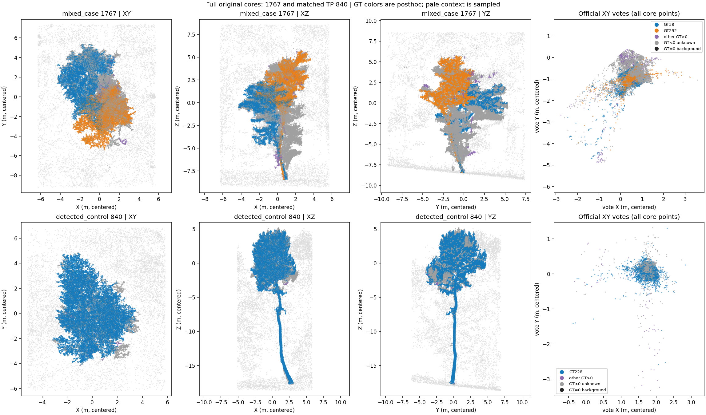
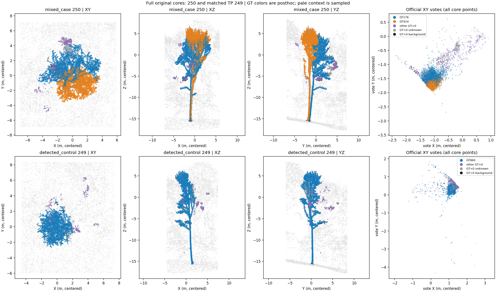
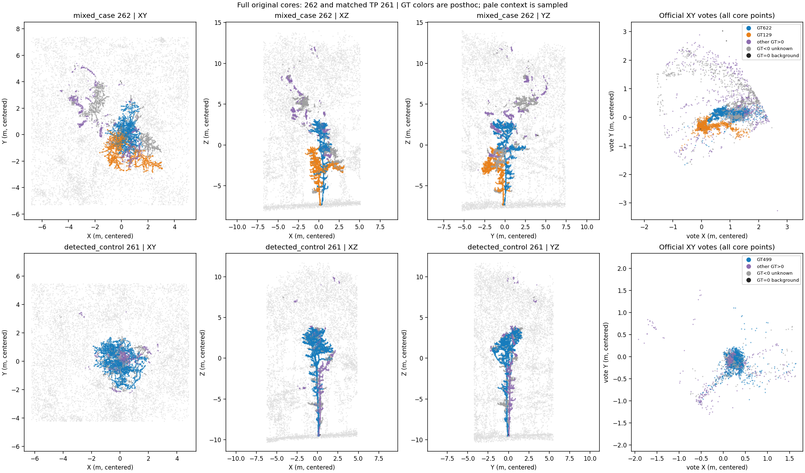
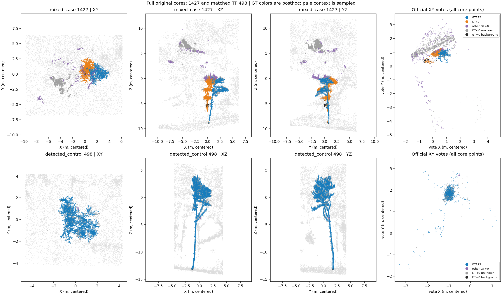
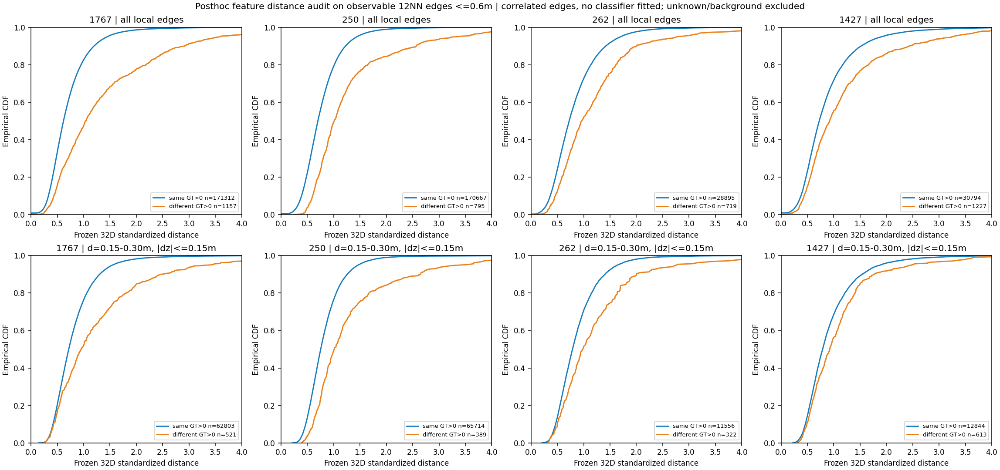

完整局部案例分析：优先验证 262 的投票种子和 250 的近邻双干；暂不强拆 1767

本轮在服务器完成了 4 个完整混合实例与 4 个正确对照的来源校验、CPU 几何／特征统计、
17 张图的生成和查看。没有训练、加载官方模型、执行网络前向或写入预测。
结论支持做一个小规模、可拒绝编辑的局部连接实验，**不支持直接把四例都自动拆开**。
目前最明确的可观测线索是 262 的细尺度双投票峰及相邻双干，以及 250 的跨高度近邻双干。
1427 有局部分离的支撑，但投票重合、冠层接触；1767 的下部目标支撑近乎贴合，可靠种子仍缺失。
这些是已选案例的可行性证据，不是分割成绩，也不代表 137 棵理想机会都能实现。

**执行和来源已经核对。** 起始分支 `codex/candidate-mask-mlp-step1`，HEAD `4f9711f`；
fetch 后与远端相同，无需合入提交。仓库及其祖先目录、相关子目录没有找到 AGENTS.md。
原有未跟踪的数据包和实验日志保留；官方预测、旧模型、训练签名及评价配置未改动。
使用现有 Conda `TreeLearn`：Python 3.10.19、NumPy 1.24.4、SciPy 1.15.3、Matplotlib 3.10.9；
没有升级／安装依赖，没有导入 torch 或占用 GPU。

先按要求运行 `test_instance_split_case_export.py`，4/4 通过。
已有完整导出位于：

```text
work_dirs/treelearn_instance_relation_v3_s42/split_case_analysis/
  export_20261022T191207_yd2dhtx5/
```

没有重新复制点云；复用前重新扫描全部 37,264,001 个原缓存点，重建 8 例完整 core 和
确定性分层上下文索引，核对每个选中点的全部可观测值和 GT。
另核对导出代码哈希、配置与特征来源请求、缓存文件大小／mtime、三个来源元数据哈希、
原监督精确计数、GT 案例／对照选择、每例文件 SHA256、ZIP CRC、包内文件集合及逐文件字节哈希。
扫描前后来源戳和元数据保持一致。没有给整场约 4.77GB 的特征数组重新计算内容哈希；
一致性证据是来源戳／元数据、紧凑计数和本次导出的所有选中值逐一相等。

复用 ZIP 为 22,663,826 bytes，SHA256：
`478ab5157bfee5da1d86d5eabee48bca798e0ac846c1a0d49803e21619f427d2`。
完整记录见 [verification.json](assets/instance_split_analysis_20261022/verification.json)。
基线精确计数复核为 TP596、FP222、FN281、877 GT、F1=70.3244838%。
协议保持 `aligned_voxels_ignore_negative_gt_iou_gt_0.5`：GT<0 忽略，GT=0 是已知背景；
先最大总 IoU 匈牙利匹配，再要求 IoU 严格大于 0.5。
本轮没有产生需要评价的新分割；源域官方宏平均 F1=88.1946% 沿用既有记录。

**八例点集的规模如下。** 每个 core 保留原实例全部点；每例另有 8,192 个上下文点，
来自 XYZ 框各扩展 2m 后的四层哈希抽样。上下文不是完整周边森林。
下表 GT 纯度只在已知点上计算；正确对照是原 TP，不保证没有少量别树点。

| 混合实例／目标 GT | 完整 core／未知点／背景点 | GT 点数；对整棵 GT 召回 | 正确对照／主 GT | 对照完整 core／已知点主 GT 纯度 |
|---|---:|---|---|---:|
| 1767／38、292 | 44,040／17,185／0 | 13,352；98.96% / 12,988；99.18% | 840／228 | 39,424／99.84% |
| 250／176、424 | 27,653／2,067／61 | 12,588；96.74% / 11,894；98.45% | 249／860 | 12,465／94.76% |
| 262／622、129 | 5,830／1,421／3 | 1,894；95.08% / 1,705；99.59% | 261／499 | 4,783／81.18% |
| 1427／49、783 | 6,374／1,520／57 | 1,983；96.50% / 1,997；94.02% | 498／172 | 6,399／99.57% |

`inputs.npz` 是可观测输入；`audit.npz` 与 `reference_counts.npz` 只作事后诊断。
GT<0 点保留在 core、可观测图和投票密度中，绝不改成背景／负例。
案例与对照本身是 GT 选出的，因此不能用这 8 例估算部署候选的精度或召回。

**图与统计使用的操作均有明确边界。** 几何图对完整 core 构建 12 近邻，
分别截断到 0.20/0.35/0.60m，再对无向化边求连通分量；这是有界近邻图，不是全半径图。
分层图将原始 Z 划为 1m 薄层，每层用 XY 8 近邻、0.35m 半径求分量，
保留至少 20 点的前六个分量；相邻层用至多 4 个近邻、3D 距离≤0.60m、至少 3 条接触边相连。
另检查最低 4m 的 0.5m 薄层，在 XY 半径 0.15/0.25/0.35m 下的支撑敏感性。
这些分量／边都先由输入构造，之后才附上 GT 组成。截断、稀疏扫描和分枝都会造成断连，
所以分量数不是树数，图中的连边也不是已知植物学连接。

投票在全部 core 点上形成 0.1m 网格密度图，Gaussian sigma 为 0.15/0.30/0.60m；
局部峰须达到最大密度的 20%、间隔至少 0.5m，最多保留六峰。
使用点索引哈希分成两半，在相同网格重复检测，峰位相差≤0.3m 记为内部复现；
并检查按点数划分的 Z 四分位层。它们不是独立扫描或独立森林复现。
这些固定诊断设置不是已经标定的拆分策略，也不能排除低于所设分辨率的肩峰。
坐标没有地形归一化，所有“下部”只相对当前 core 的原始 Z；有离群点时会偏移。

**1767／840：冠层有分离信息，下部种子不可靠。** XY 中 GT38 和 GT292 的冠层主要分居不同区域，
但下部处于很窄的相邻带。最底几个 1m 层的目标 GT XY 中位位置距离仅约 0.20–0.34m，
最近跨 GT 接触的 5% 分位约 0.08–0.11m，接近本缓存 0.1m 的体素尺度。
整段下四分之一高度的两个 GT 位置中位数仅相隔 0.157m；这个混合高度统计不能单独判断有几根干。
尤其最低三个 0.5m 层虽然出现两个几何分量，额外分量分别主要是未知点或 GT17，
主分量本身同时包含 GT38 和 GT292，不能把“两个分量”解释成两目标的两个种子。
三个半径的最大几何分量均接近整个实例，0.35m 时包含全部 13,352 和 12,988 个目标点。

两目标投票中位位置相隔 0.144m，三个 sigma 和两个哈希半样本均只有一个主峰；
约 88.4% 的全部 core 票位于细尺度主峰 0.5m 范围内。
按高度分层的主峰只有小幅漂移，没有观察到能稳定标识两目标的双峰。
39.02% core 是未知点，不能删掉它们来制造两个清楚的 GT 冠层。
840 有弯曲主干和多个冠层分枝，但仍是同一主 GT228；仅凭冠层两团也可能误拆它。
目前缺少不借助 GT 的可靠双种子／轨迹验证，应作为困难、可拒绝的案例。
从缓存还不能判断贴合来自近邻树、点归属标注、体素化或其他原因。



**250／249：有可见的近邻双干，投票已经合到一起。** YZ 和下部放大图显示两条可追踪的近邻干线，
最低几个 1m 层的目标中心距离约 0.38–0.41m，随后增至 0.51–0.65m，向上继续分离。
对应的横向 RMS 在非分枝段多为 0.12–0.15m，因而这里比 1767 更有两条轨迹的几何证据。
但最底 4m 在全部三个半径下每个 0.5m 层都只有一个几何分量，说明根部接近／接触，
不能用简单连通分量直接获得两干种子。
0.35m 最大分量占 98.05%，包含几乎全部两个目标；另一较大分量是旁侧碎片。
两个几何大分量不是两个目标树。

两目标的投票中位位置只相隔 0.199m，三个尺度都单峰，细尺度峰 0.5m 邻域含全部 core 的 96.03%。
纯投票重聚类很可能仍混在一起；值得验证的是细长轨迹在若干连续高度上的归属。
249 的同一 GT860 也有多根向上的大分枝，它们汇回下部主干；这是必须保留的反例。
250 可以作为“投票失效但几何轨迹仍可见”的试验例，不能据此承诺可安全拆开。



**262／261：四例中最明确的多输入候选线索。** 两条细干在最低部分靠近，在约 Z=-9m 层，
两目标中心距 0.457m、各自 XY RMS 约 0.057/0.061m；之后轨迹和冠层高度继续分离。
从最底往上的多个 0.5m 层会出现两个输入几何分量，事后分别对应两个目标，
但它们在最底层仍相接，冠层也有接触。
0.35m 最大分量仍同时包含 GT129 全部 1,705 点和 GT622 的 1,893/1,894 点。
其余几个大分量多来自其他树／未知点，不能把五六个分量都当成树。

两目标投票中位位置相隔 0.908m；sigma=0.15/0.30m 均有两峰，两个哈希半样本也均为两峰，
峰位都在 0.3m 内复现。0.30m 两峰密度比约 0.926，两个 0.5m 峰邻域各占全 core 的 37.4% 和 29.4%
（邻域可能重叠，不能当作子实例大小）。sigma=0.60m 则合成一峰。
第二个高度四分位层仍有两峰，最低层和更高层主要由一个方向贡献；
所以它不是全高度都稳定的双峰，但也不只是两个不相交高度团的简单投票漂移。
261 的 GT499 主树和少量邻树点也会形成细支／短暂双支撑，主 GT 纯度仅 81.18%；
“原 TP”不等于“每个点都正确”。建议先验证 262 的输入种子是否能在全 core、含未知／杂树点时保持稳定。



**1427／498：有低位分离支撑，完整独立根部仍不明确。** 约 Z=-12/-11m 两条窄支撑的中心距离为
0.82/0.87m，横向 RMS 约 0.11–0.24m，XZ 中能看见不同轨迹；更低处主要只有 GT783 轨迹，
GT49 的低端不完整，最底也有少量不同标签混合。不能据此确认两个独立根部。
Z=-8 至 -6m 冠层有明显跨目标接触；两 GT 的最小点距约 0.028m。
0.35m 最大分量含两个目标的全部点，分量数主要反映杂树／未知碎片。
两目标投票中位位置相隔 0.277m，全部三尺度为单峰；最高四分位层的附加峰不能自动视作
两目标的投票，因为那里还含别树与未知点。
498 的 GT172 纯度 99.57%，上部却明显分叉后形成不同方向的枝冠；这种形态必须保持同树。
1427 可作为次级困难例，验证跨高度归属，不能先假设“双冠＝双树”。



以下链接覆盖全部下部放大、投票密度和分层连接图，均已在服务器查看。
每幅图同时显示混合例和正确对照；几何图的浅灰点为抽样上下文，其余灰色为 core 内未知点。
分层图拓扑不使用 GT，节点颜色才是事后多数 GT。

| 案例／对照 | 下部放大 XY/XZ/YZ | 三尺度投票密度 | 几何连通与跨层接触 |
|---|---|---|---|
| 1767／840 | [lower](assets/instance_split_analysis_20261022/pair_1767_lower.png) | [votes](assets/instance_split_analysis_20261022/pair_1767_votes.png) | [connections](assets/instance_split_analysis_20261022/pair_1767_connections.png) |
| 250／249 | [lower](assets/instance_split_analysis_20261022/pair_250_lower.png) | [votes](assets/instance_split_analysis_20261022/pair_250_votes.png) | [connections](assets/instance_split_analysis_20261022/pair_250_connections.png) |
| 262／261 | [lower](assets/instance_split_analysis_20261022/pair_262_lower.png) | [votes](assets/instance_split_analysis_20261022/pair_262_votes.png) | [connections](assets/instance_split_analysis_20261022/pair_262_connections.png) |
| 1427／498 | [lower](assets/instance_split_analysis_20261022/pair_1427_lower.png) | [votes](assets/instance_split_analysis_20261022/pair_1427_votes.png) | [connections](assets/instance_split_analysis_20261022/pair_1427_connections.png) |

**几何、冻结特征和局部连接提供的信息不同。** 几何保留了细干轨迹、冠层空间区域和局部连续性；
投票对三例已经明显压缩两树之间的差异，262 仍保留可用的细尺度模式。
图中同树边占多数，但少数跨树接触边足以把两树连成一个分量；只有“近”不够，需要学习哪些近邻边可以切断。

冻结特征按既有 `normalization.json` 的训练样本均值／尺度标准化，没有检查 checkpoint 缓冲区，也没有更改模型归一化。
在完整 core 的 0.60m、12NN 几何边上，只选两端 GT>0 的边，比较冻结 32D 距离：
同树标签为相同正 GT，异树为不同正 GT；GT=0 和 GT<0 均不进入这项“树间距离”统计。
下面 AUC 是 `P(异树边距离 > 同树边距离)`，不是连接头预测、独立测试准确率或模型成绩。
边共享点且数量不均衡，不把它们当独立样本给显著性结论。

| 混合实例 | 0.60m 图中异树正标签边比例 | 特征距离中位数：同树／异树 | 特征距离排序 AUC | 限 d∈[0.15,0.30)m 且 \|dz\|≤0.15m 的 AUC；同／异边数 |
|---|---:|---:|---:|---|
| 1767 | 0.671% | 0.617／1.037 | 0.722 | 0.637；62,803／521 |
| 250 | 0.464% | 0.700／1.009 | 0.736 | 0.705；65,714／389 |
| 262 | 2.428% | 0.724／0.963 | 0.649 | 0.628；11,556／322 |
| 1427 | 3.832% | 0.725／0.924 | 0.611 | 0.573；12,844／613 |

原始特征在已知目标 GT 的局部邻域中并非完全混合。例如有界正标签样本（最多 8,000 点）的
6 近邻同 GT 比例：1767 两目标在 XYZ 中为 99.3%/99.1%、特征中为 98.5%/98.3%、投票中约 69%/69%；
262 对应为 98.7%/99.6%、94.3%/96.7%、89.6%/96.8%。
这是以 GT 审计已有表示的局部性，不说明能获得正确全局聚类；空间光滑特征也能产生很高近邻比例。
[summary.csv](assets/instance_split_analysis_20261022/summary.csv) 同时保留所有正 GT 的 micro/macro 统计，
其中 macro 会放大只占几个点的稀有 GT，不能直接拿正确对照与混合例的 macro 大小判优劣。

控制空间距离和高度差后特征距离仍有部分区分信息，尤其 250；1427 则明显较弱。
该控制只降低几何混杂，没有证明特征在几何之外的独立增益；需在保留森林上做消融。
完整 core 的特征 PC1 与 Z 的相关绝对值约为 0.096/0.740/0.934/0.814，案例间不同。
没有用二维 PCA 的重叠宣称特征坍缩，也不能将旧 256 点样本的高度相关性直接推广到所有完整 core。



**最小方案是冻结官方模型，加一个小连接分支，再在选中实例内做带种子的归属。**
本轮只提出以下方案，没有实现／训练网络，也没有生成一个新的拆分结果。

1. 候选完全由可观测输入产生。先找在多个细平滑尺度、两个哈希半样本中重复出现的投票模式，
   并要求它们在相同或连续高度上有点支撑；另一入口是多层中可追踪的两条细长几何轨迹，允许投票单峰。
   候选从全部原实例中产生，不能读取 `original_tp`、GT 纯度、目标 GT 召回或本报告的四个 ID。
   262 是第一入口的诊断例；250 是第二入口需要验证的诊断例。
   主峰数量、最低薄层分量数、冠层双团都不能单独触发编辑。最底层汇合不必然表示同树，250 已提示这一点；
   必须比较多层轨迹宽度、分离持续性和向下延伸，证据含糊时保留原实例。
   当前还没有部署候选器，以上只是待源域验证的规则，不能报告它们的召回／安全性。

2. 只给候选 core 构建有界图，初版用 12 个几何近邻、最大距离 0.6m，保存原点索引。
   用薄层相邻接触补充跨高度联系；不添加不受几何约束的投票近邻捷径。
   只读上下文可辅助检查支撑，却不参加可编辑点集；抽样上下文缺一条连接不能作为断开的证据。
   初版保持全部 core 节点，按边批次计算以限制内存；较大实例超出预设预算时拒绝编辑，不能静默截断。
   训练可以抽局部子图，但最终归属必须覆盖完整 core。

3. 点编码只把冻结 32D 特征映射为 16D。对无向边用对称输入
   `[abs(h_i-h_j), (h_i+h_j)/2, abs(x_i-x_j), ||x_i-x_j||, abs(v_i-v_j), min(p_i,p_j), max(p_i,p_j)]`，
   合计 40 维；一个 `40→64→32→1` MLP 预测同树概率。
   连同 `32→16` 点映射约 5.3k 参数，不增添新的大骨干、整场 decoder 或整实例合并头。
   边概率直接成为归属图的权重，不仅作为辅助损失后被池化丢掉。
   在有两个可信输入种子的实例中，用稀疏带种子随机游走／调和归属求两子实例。
   第一版最多二分；无可靠双种子、无种子连通块、第三个显著支撑或大面积模糊归属时整体撤回编辑。
   所有原 core 点（包括未知／背景标签点）恰好属于一个子实例，不删除点、不补前景、不跨原实例移动点。

4. 监督来自源域训练森林的官方缓存与已知 GT：同一正 GT 的边为正，不同正 GT 为负，
   已知背景 GT=0 与树点的边也可为负；0/0 边不给“同一树”正监督；任一端 GT<0 就屏蔽该边损失。
   保留真实混合实例，补少量空间相邻原实例的物理合理混合训练例，同时大量加入正确单树，
   特别是 249/498 所示同树多分支的对应源域例、弯干和接触枝。
   正边应包括同一树跨高度／跨枝的连接，不能只学最短距离；异树接触边须分层均衡采样，
   因为四例图中的异树边仅约 0.46–3.83%。训练均值／尺度只从训练森林生成并单独签名。
   首轮只用局部边监督，不再把稀少的全局 TP 增益作为唯一主监督，也不使用 Wytham 的标签训练／选阈值。

5. 防误拆依靠可拒绝策略和正确单树反例校准：两子实例都需有跨高度支撑、连接／归属置信度，
   在采样扰动和小幅尺度变化下保持稳定。对上部叉枝，要检查其是否明确回到单一细干；
   对贴近根部后向上长期平行的轨迹，则保留近邻双干假设，不能只按“向下相连”一票否决。
   所有阈值只在源域开发验证上确定并冻结，记录拒绝原因。
   这不能数学保证零误拆；真正的保障证据必须是原 TP 的 lost 计数及未选中点集逐点不变。

**目前缺失的是自动种子与安全策略证据，不是更多模块。** 现有 8 例没有证明候选器能在整场自动找出这些树，
也没有证明连接分支能切对跨树接触边。1767 的贴合下部需要更可靠的轨迹／支撑证据；
1427 需要确认短低端是截断主干还是单树分枝。若源域上的几何种子仍把正确叉枝当双树，
应先补完整下部局部上下文、必要时检查更细原始扫描或地面信息；在证据补足前继续拒绝编辑，
不因这 4 例有 GT 理想机会就增加注意力／合并模块或启动全量训练。

下一阶段按以下顺序做，均不在本轮执行：

1. 在源域缓存先实现 GT-free 候选与双种子导出，冻结设置，统计候选数量、预算、稳定性和拒绝原因。
   GT 只在之后审计：候选覆盖了多少真正混合实例，误选多少原 TP；分开记录投票入口和几何入口。
   如果候选／种子本身不可靠，停在这里补证据。
2. 在小规模源域训练子图上验证上述连接 MLP，比较几何边特征、几何+投票、几何+投票+冻结特征，
   并比较不学连接的同一图。按树／森林划分，报告跨树接触边的召回与同树误切率、校准、资源占用；
   不能随机拆分共享点的边来制造独立验证。
3. 固定候选／阈值后，仅运行局部缓存上的完整归属；所有未选中实例的点索引集合和标签必须逐点相等，
   选中实例满足子集互斥且并集等于原 core。归属失败或不确定就保留完整原 mask。
4. 使用原评价实现和完整点计数做整林匹配，报告 TP/FP/FN/F1、原 TP lost、原 FN recovered 及其 GT ID，
   同时报告 FP 增量、完整度、覆盖率、点精度／召回、编辑率／拒绝率；不能只评四个案例或独立子树 IoU。
   五个源域验证森林需逐林列出并核对宏平均与官方 88.1946% 基线，优先控制损失原正确实例。
5. Wytham 已参与本轮设计，后续在它上的改善只能称探索结果。
   现有源域验证集也用于策略开发，不能再包装成完全未见的测试；应另明确保留未参与设计／调参的森林或场地，
   冻结方案后只做最终评估。没有这样的数据时，明确泛化证据尚缺。

**复现材料。** 新代码为 `tools/instance_relation_v3/analyze_split_cases.py`，
公开汇总统计在 [analysis.json](assets/instance_split_analysis_20261022/analysis.json)，
紧凑表在 [summary.csv](assets/instance_split_analysis_20261022/summary.csv)。
完整逐层坐标、GT 组成和点邻域诊断保留在服务器：
`work_dirs/treelearn_instance_relation_v3_s42/split_case_cpu_private_20261022/analysis_full.json`，
不放入公开资产；详细检查日志同样留在该私有目录和原始 `logs/` 中。
图来自完整 core；特征近邻统计明确限为最多 8,000 个正标签点，其余局部边／层统计使用全部 core。
这套有界 CPU 分析只 mmap 读取整场输入，未复制整场特征，也没有改变官方缓存。

```bash
export PATH=/home/szu-stu/miniconda3/envs/TreeLearn/bin:$PATH
export OPENBLAS_NUM_THREADS=4 OMP_NUM_THREADS=4 MKL_NUM_THREADS=4
export MPLCONFIGDIR=/tmp/treelearn-split-mpl XDG_CACHE_HOME=/tmp/treelearn-split-cache
mkdir -p logs/instance_split_cases/analysis_20261022
set -o pipefail
python -m unittest discover -s tests -p 'test_instance_split_case_export.py' -v \
  2>&1 | tee logs/instance_split_cases/analysis_20261022/export_tests.log
python -u tools/instance_relation_v3/analyze_split_cases.py \
  work_dirs/treelearn_instance_relation_v3_s42/split_case_analysis/export_20261022T191207_yd2dhtx5 \
  --output docs/experiments/assets/instance_split_analysis_20261022 \
  2>&1 | tee logs/instance_split_cases/analysis_20261022/analysis_release.log
```

新增 4 项合成 CPU 测试覆盖：双峰在哈希半样本复现／粗尺度合并、正确叉枝的多层分量仍属同树、
构图与 GT 无关且未知不作负例、距离排序统计处理并列／无异树边。
导出与分析合计 8 项通过；最后修改下部审计后再次运行分析测试 4/4 通过并重跑完整分析。
第一次新测试有 Python 3.10 不支持的下标星号展开，已改用 `np.concatenate`；初始失败日志保留。
首次绘图出现只读字体缓存警告，最终运行显式使用 `/tmp` 缓存，正常完成。
全部过程前台显示进度并保存日志；精简日志副本见同资产目录 `run_logs/`，原始日志仍保留在 `logs/instance_split_cases/`。
提交内容只含分析代码、合成测试、报告、统计、日志和必要 PNG，不包含原始点云／ZIP／缓存／权重。

发布时自动审批拒绝向公开仓库上传完整 `analysis.json`，理由是包含逐层坐标、GT 对应关系和详细诊断，
超出被识别的公开发布授权。已采用更安全的发布范围：完整诊断留服务器，公开 JSON 只含每例汇总，
并排除详细检查日志；报告和必要图表按用户请求发布。公开提交不包含原始本地诊断提交的历史。
