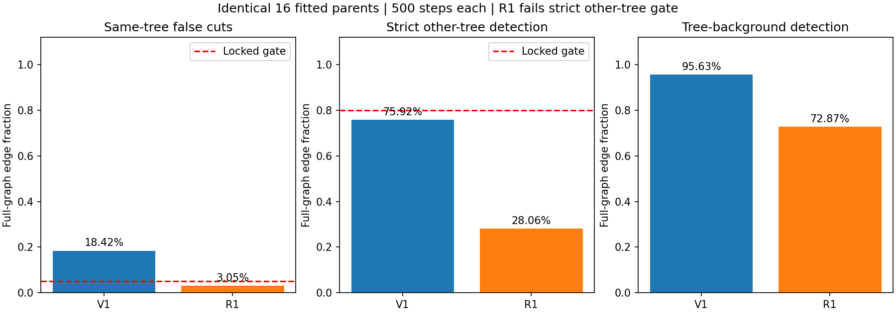
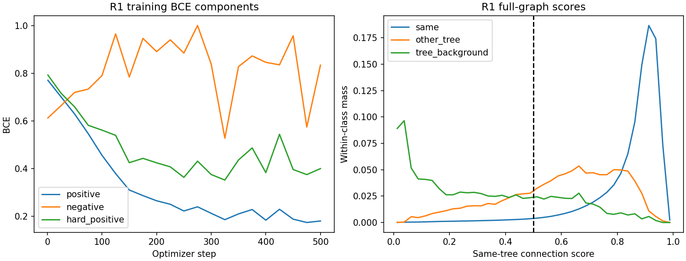

# E1-R1：同树误切降到3.05%，严格异树检出降到28.06%，停止升级

已按上一轮提出的单一设置，从头训练500步。**R1未通过E1，未运行E2或Wytham。**
困难正边重权重让更多同树边保持连接，同时让大量异树边也保持连接；
这次具体设置没有同时解决“保留同树”和“分开异树”。
原V1代码、配置、缓存、训练库、checkpoint和失败状态均保持不变。

## 1. 实际执行的唯一训练变化

起点为 `c9c6f1f`，分支为 `codex/candidate-mask-mlp-step1`，运行前fetch后与远端一致。
使用 [e1_r1.yaml](../../configs/experiments/local_split_v1/e1_r1.yaml) 和独立入口
[run_hard_positive_trial.py](../../tools/local_split_v1/run_hard_positive_trial.py)。
原 [full.yaml](../../configs/experiments/local_split_v1/full.yaml) 与原阶段入口没有修改。

| 项目 | 本轮执行 |
|---|---|
| 网络 | 原5,265参数连接分支；冻结32维官方特征，32→16投影与40→64→32→1边MLP不变 |
| 初始化 | 种子42，重新初始化；不从V1第500步继续训练 |
| 父实例 | 原8个混合实例＋8个正确多分支对照；后8个仍全部来自A1N |
| 标准化／训练库 | 直接复用V1已有训练森林标准化和同一批bank文件；运行前后校验 |
| 采样 | 与V1 E1相同：mixed/mixed/correct/correct四份，共8,192条边／步，使用相同随机序列 |
| 损失 | `0.5*(mean_BCE_pos+mean_BCE_neg) + 0.5*mean_top25pct_BCE_pos` |
| 困难正边 | 当前批次同正GT边中BCE最大的25%，数量上整、至少1条 |
| 优化 | AdamW，学习率3e-4，权重衰减1e-3，梯度裁剪2，共500步 |
| 运行环境 | 原TreeLearn环境，PyTorch 2.0.0／CUDA 11.8，RTX 4090；未升级依赖 |
| 评价 | 固定完整局部图、0.5边判别阈值；原候选、种子、调和归属和拆分验收不变 |

负边训练仍按原规则合并严格异树与树—已知背景；GT<0和0/0仍屏蔽。
本轮只改变损失项，不改变训练样本、网络容量或部署规则。
V1与R1分别执行500步，累计1,000步；R1无第二次初始化或其他超参数设置。

## 2. 完整图验收结果

以下统计覆盖固定16个父实例的全部有效边，不是bank抽样成绩。
严格异树只包含两端均为正GT且GT不同的边，背景分项不用于替代此门槛。

| 指标 | 原V1 E1 | E1-R1 | 门槛 |
|---|---:|---:|---|
| 同树误切 | 921,392／5,003,262＝18.4158% | **152,412／5,003,262＝3.0463%** | ≤5%；R1通过 |
| 严格异树检出 | 13,440／17,702＝75.9236% | **4,968／17,702＝28.0646%** | ≥80%；R1失败 |
| 树—背景检出 | 7,534／7,878＝95.6334% | 5,741／7,878＝72.8738% | 单独报告 |
| 拟合父实例恢复／损失 | 9／0 | 8／0 | 恢复≥1、损失0；R1通过此项 |
| E1最终结论 | 失败 | **失败** | 必须同时满足各项 |



R1的同树保留已达到原5%要求，但严格异树检出下降47.86个百分点。
不能用更低的总训练损失、同树误切改善或局部恢复覆盖这一失败。
逐父实例计数见 [parent_edges.csv](assets/local_split_e1_r1_20261022/parent_edges.csv)。

在R1完整图得分的0.025宽直方图上，若同树误切仍要求≤5%，全局边判别阈值必须低于0.6000；
在该范围严格异树检出率的保守上界只有**43.2945%**，仍远低于80%。
这是由得分单调性给出的界，不是新阈值选择，也没有另运行阈值设置。
推导输入与结果见 [threshold_bound.json](assets/local_split_e1_r1_20261022/threshold_bound.json)。
因此，仅重新校准一个全局边阈值无法挽救这份R1权重。



## 3. 整林匹配下的拟合子集结果

仅允许编辑原16个GT筛选训练父实例；在13个训练森林中保留其余实例，再做整林匹配。
这不是对全部自然候选或5个开发验证森林的成绩。
匹配协议不变：忽略GT<0、保留GT=0，先最大总IoU匈牙利匹配，再要求IoU严格大于0.5。

| 方法 | 接受父实例 | 分离点数 | 恢复／损失 | FP增量 | 13训练森林宏F1 |
|---|---:|---:|---:|---:|---:|
| 官方基线／全部不编辑 | 0 | 0 | 0／0 | 0 | 90.7435% |
| V1 E1，cut均值≤0.3 | 6 | 34,273 | 9／0 | -3 | 90.8492% |
| R1，cut均值≤0.5 | 5 | 30,375 | 8／0 | -3 | 90.8406% |
| 本轮重跑纯几何，cut均值≤0.1 | 3 | 14,958 | 6／0 | -3 | 90.8229% |

拆分验收阈值仍只比较`不编辑、0.1、0.2、0.3、0.4、0.5`，沿用V1排序；
它与前节固定为0.5的**逐边判别阈值**是两个不同参数。
完整候选阈值结果均已保存，不因E1边门槛失败而隐藏局部表现。
摘要内部复用的整林恢复统计出现`passed=true`，只表示该拟合子集的整林恢复条件成立；
顶层E1门槛明确为`false`，`eligible_for_advancement=false`，不会生成后续阶段通行标记。

| 发生编辑的森林 | 基线TP／FP／FN | R1 TP／FP／FN | F1变化（百分点） | 恢复GT ID | 损失GT ID |
|---|---|---|---:|---|---|
| A1N | 386／113／80 | 391／111／75 | +0.7851 | 63、73、80、228、247 | 无 |
| G2N | 460／89／36 | 461／89／35 | +0.1070 | 473 | 无 |
| LG1 | 392／25／15 | 394／24／13 | +0.3695 | 233、244 | 无 |

其余10个训练森林逐点保持原标签，完整13森林结果见
[forest_metrics.csv](assets/local_split_e1_r1_20261022/forest_metrics.csv)。
纯几何恢复其中6个GT；A1N69、A1N450、LG1265的跨子组边为空，属于几何断连，
这6棵不能归功于连接学习。R1相比几何多恢复A1N80、G2N473两棵。

8个混合候选最终编辑5个，拒绝3个，候选拒绝率37.5%。
A1N575、G2W252因模糊归属拒绝；G1W343平均跨组得分0.5212，超过最高允许阈值0.5，拒绝。
后者原V1可接受，是R1比V1少恢复一棵的对应案例。
16个拟合父实例整体编辑率31.25%，不能当作全部自然实例编辑率。

8个正确多分支对照均没有形成自动双种子，因此没有进入拆分；其标签全部保留。
这验证了这些对照被候选器拒绝，**不构成连接分支能保护所有正确叉枝的证据**。

对R1实际编辑的A1N、G2N、LG1，以及纯几何编辑的A1N、LG1，均另外构造完整森林标签，
直接从原始逐点GT重新计算匈牙利匹配，TP／FP／FN、F1、覆盖率、点精度、点召回率及恢复／损失ID
与缓存计数增量评价一致。R1三森林共42,164,638点，检查分离点集恰等于实际变更点集，
前景及所有未编辑标签逐点不变。

## 4. 复现、产物与停止

```bash
set -o pipefail
/home/szu-stu/miniconda3/envs/TreeLearn/bin/python -u tools/local_split_v1/run_hard_positive_trial.py \
  --stage run 2>&1 | tee logs/local_split_e1_r1/run.log
MPLCONFIGDIR=/tmp/treelearn-local-split-mpl \
  /home/szu-stu/miniconda3/envs/TreeLearn/bin/python -u tools/local_split_v1/report_hard_positive_trial.py \
  2>&1 | tee logs/local_split_e1_r1/report.log
/home/szu-stu/miniconda3/envs/TreeLearn/bin/python -u tools/local_split_v1/verify_hard_positive_trial.py \
  2>&1 | tee logs/local_split_e1_r1/verify.log
```

实际结果已存在，禁止直接重跑训练。尝试标记会拒绝再次消费500步；
只有已训练但尚未开始评价时可使用`--stage evaluate`，不会调用优化器。
所有命令前台运行，完整日志保存到`logs/local_split_e1_r1`；交付包保存日志副本。

- 输出根目录：`work_dirs/treelearn_local_split_e1_r1_s42`。
- 原V1签名：`4ff5c28159dcddf8ee322166f40ffac0e385a89e28f97bd261f70a06f1470e44`，前后不变。
- R1签名：`51e80fc39c083f72ceae0082142bca140d87cac5a9034e61fd769099cd449c5b`。
- R1权重SHA256：`c7ee611bb6a127836d00ad55edf710697f74142a15daec252f2fb2954055cd1e`。
- `deployment/learned`和`deployment/geometry`保存父ID、完整原点索引、种子、分离点集和拒绝原因；
  `selected_policy.json`记录按父ID排序、从整林最大ID加1分配的新ID，标明未获部署准入；
  `audit`单独保存GT指标。点云、bank和权重不提交。
- [训练输入配对检查](assets/local_split_e1_r1_20261022/training_input_equivalence.json)确认两轮标准化完全相同，
  第500步保存的NumPy采样器状态和Torch随机状态也完全相同，与保持采样序列的实现一致。
- 原E0的18森林GT来源戳、候选payload哈希、全部bank哈希和原E1权重在运行前后校验；
  大型坐标／特征数组检查来源戳，不宣称重新做了数GB文件的全量内容哈希。
- 32项局部拆分测试＋4项完整core导出测试通过。其中新增7项覆盖困难正边梯度、取上整、
  非法监督拒绝及严格异树门槛，测试未执行优化器更新；两张图均已实际查看。

本轮失败定位到：**该困难正边重权重设置主要改变了正负取舍，没有得到可同时满足两项门槛的得分分离。**
这不能证明所有边MLP或全部冻结特征方案都不可行，也不能据此直接增加模型模块。
后续若继续，先审计训练库中严格异树、树—背景的负监督组成与难度，再约定一个新的单变量对照；
本轮没有启动R2、扩大训练预算、访问Wytham或修改门槛。

完整结构化结果见 [brief.json](assets/local_split_e1_r1_20261022/brief.json) 和
[summary.json](assets/local_split_e1_r1_20261022/summary.json)。
