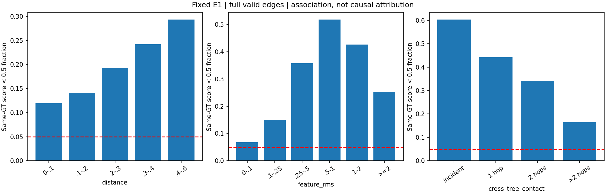
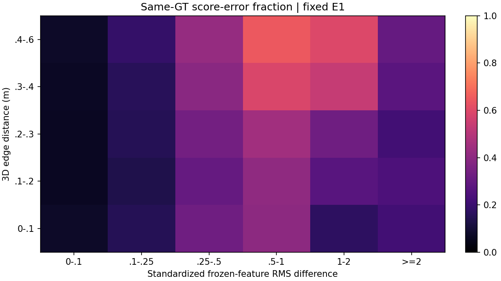
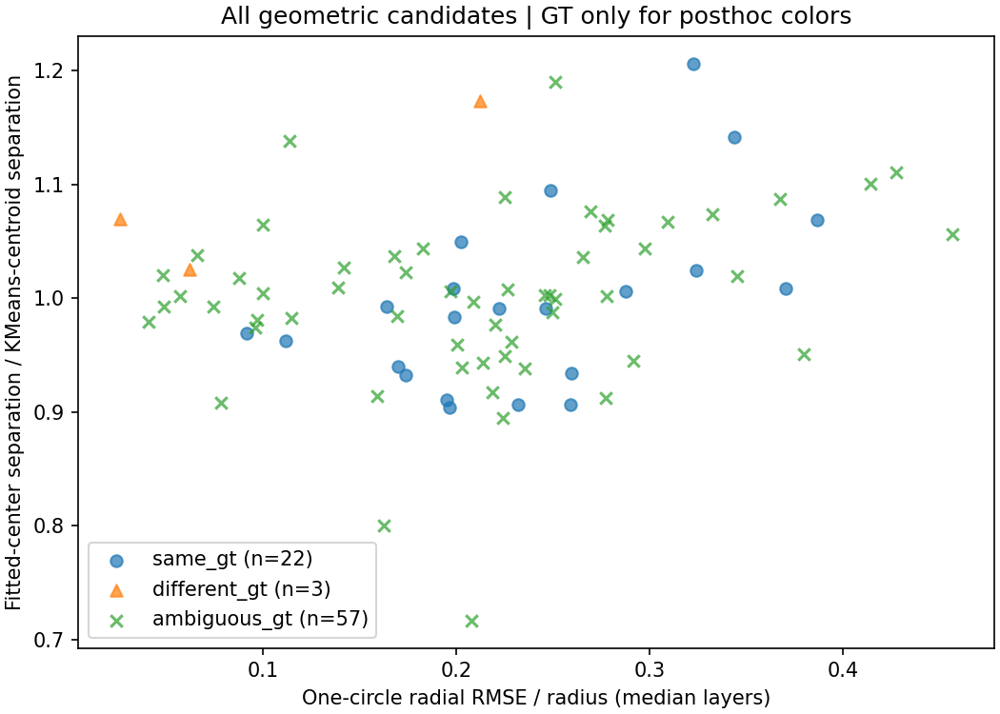
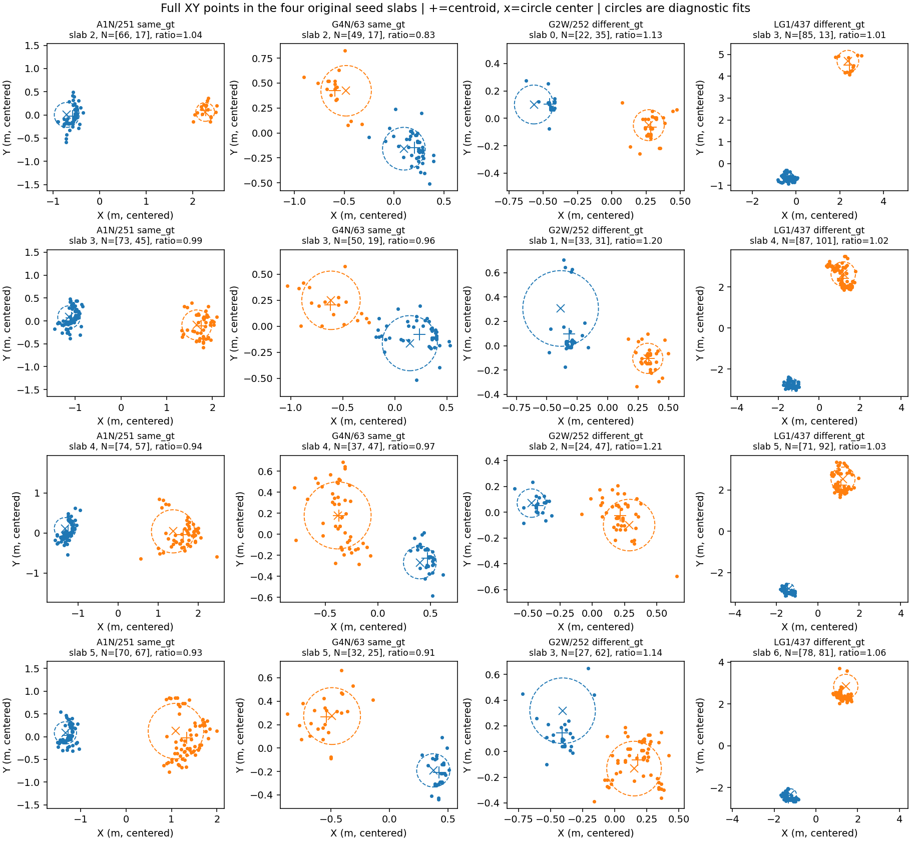

# 局部拆分下一步：先加强同树难正边，暂不增加几何拆分模块

本轮在锁定的V1 E1结果上完成CPU诊断：16个训练父实例的完整局部图，以及全部82个几何入口候选。
新增优化步数为0，没有运行E2、Wytham、官方网络或修改预测。V1代码、配置、checkpoint和实验签名保持不变。

结论是：下一项最小训练对照应只改变同树难正边损失，保持5,265参数分支、16个父实例、种子和图不变。
不能靠继续扫连接阈值解决现有错误；本轮数据也不支持增加“圆柱／双干”判据。
新对照尚未训练，不能报告预期恢复数或F1提升。

## 1. 同树连接问题并非只发生在跨树接触附近

完整图复核得到5,003,262条同树边，其中921,392条连接得分低于0.5，误判率18.4158%；
严格异树边检出13,440/17,702＝75.9236%，树—背景边检出7,534/7,878＝95.6334%。
GT<0与0/0没有进入上述类别；严格异树边始终要求两端为不同正GT。
按严格异树指标重述原门槛，两项都未通过，未对V1门槛、checkpoint或统计作追溯修改。

以下“接触节点”仅指**当前原实例core的0.6m、12近邻加相邻薄层图中，跨正GT边的端点**。
这是GT事后诊断分组，不是部署输入，也不等于完整森林的生物学接触边界。

| 到该类节点的图联系 | 同树边数 | 得分低于0.5的比例 | 占全部同树误判 |
|---|---:|---:|---:|
| 直接相接 | 79,267 | 60.31% | 5.19% |
| 最近1跳 | 125,496 | 44.24% | 6.02% |
| 最近2跳 | 163,316 | 34.06% | 6.04% |
| 两跳以外 | 4,635,183 | **16.45%** | **82.75%** |

两跳以外本来就占92.64%的同树边，不能只凭82.75%的误判份额宣称错误偏向内部。
真正的证据是：这部分同树边仍有16.45%被判成低连接，明显高于5%的保留门槛。
模型对跨树接触附近的同树边更难，但问题不局限于这些边。

## 2. 距离、特征差和高度都有可量化的错误差异

| 同树边3D距离 | 边数 | 误判率 |
|---|---:|---:|
| 0–0.1m | 462,414 | 11.98% |
| 0.1–0.2m | 2,077,566 | 14.09% |
| 0.2–0.3m | 1,199,924 | 19.21% |
| 0.3–0.4m | 539,850 | 24.18% |
| 0.4–0.6m | 723,508 | 29.31% |

即使最短的边也没有达到5%门槛，不能简单用缩小邻域解决。
这里的距离段采用左闭右开区间，最后一段包含因浮点表示而略偏移的0.6m边。

冻结特征差定义为 `sqrt(mean(((f_i-f_j)/training_scale)^2))`，使用原E1训练集标准化尺度，
不重新拟合尺度、不使用GT归一化。

| 标准化32维特征RMS差 | 同树边数 | 误判率 |
|---|---:|---:|
| 0–0.1 | 1,019,996 | 6.73% |
| 0.1–0.25 | 2,902,970 | 14.97% |
| 0.25–0.5 | 848,920 | 35.80% |
| 0.5–1 | 183,333 | 51.77% |
| 1–2 | 40,774 | 42.60% |
| ≥2 | 7,269 | 25.34% |

RMS差≥0.25的同树边只占21.59%，却贡献45.38%的同树误判。
同一距离段内也能看到类似变化，见二维图。
这说明应该让训练更重视“特征变化但仍属于同树”的正边；
它只是当前得分与特征差的关联，不能证明冻结特征坍缩或单一输入造成错误。

最低四分之一相对高度的同树边误判率为28.24%，其余三个高度段分别为13.09%、19.76%、16.67%。
高度相对完整core的Z最小／最大值计算，没有地形归一化，不能把最低段直接称为根部。
按高度差和父实例类别的完整分解均保存在
[edge_groups.csv](assets/local_split_failure_mechanisms_20261022/edge_groups.csv)。




## 3. 修正“同干两侧表面”的解释，不加入圆柱判据

82个几何候选中，22例的两组种子均以≥90%纯度对应同一正GT，3例对应不同正GT，57例GT组成不够纯或支持不足。
57例不能简单归为假种子；它们包括有意义但混杂的支撑。

上轮报告将A1N251、G4N63描述为“同一主干两侧表面”，这是对较粗投影图的过强解释。
本轮检查原4个0.5m薄层中的全部种子点，并分别拟合两组点的圆心和两组合并的一个圆：

- 理想单圆柱被KMeans分成两半时，两组均值可以分离，但两组拟合圆心应趋于重合；合成测试验证了这一点。
- 实际同GT候选的“拟合圆心距离／两组均值距离”中位数为0.991，范围0.904–1.206。
- 3个不同GT候选对应值为1.025、1.070、1.173；与同GT组明显重叠。
- A1N251、G4N63分别为0.963、0.934，**不支持把这两例解释成理想同一圆柱的两半**。




正确表述应是：当前几何规则确实能在同一标注树中选出两组分离的下部支撑，但这些支撑可能涉及同树多干、
分枝、不完整局部扫描或标注归属；现有诊断没有确定物理成因。
XY薄层圆拟合本身还受主干倾斜、非圆截面和稀疏采集影响，不能作为植物学判断。
因此本轮没有加入“同圆心则拒绝、异圆心则拆分”等自动规则，也没有改变V1候选器。
区分这些案例仍需完整上下连接或更明确的树实例证据，增加“数圆柱”的模块不能自动解决标签归属。

## 4. 下一项最小训练对照：E1-R1，只改变难正边损失

详细规格存于 [next_trial_spec.json](assets/local_split_failure_mechanisms_20261022/next_trial_spec.json)，状态为**拟议、未执行**。

| 项目 | 固定选择 |
|---|---|
| 比较对象 | 现有V1的500步checkpoint；新增一个R1，从同一种子42重新初始化 |
| 输入、参数量 | 原冻结缓存、同一标准化、同一5,265参数MLP |
| 数据 | 原8个混合父实例＋8个正确多分支父实例，保持原采样器和训练库 |
| 唯一训练变化 | 原 `0.5*(L_pos+L_neg)` 加 `0.5*L_hard_pos` |
| 难正边 | 每批同正GT边中BCE最大的25%，数量取上整且至少1条；不以当前特征差作硬部署规则 |
| 预算 | 提议新增最多500步，单种子、单设置，无自动扩展；本轮未消费该预算 |
| 准入 | 完整同树边误判≤5%；严格异树边检出≥80%；拟合案例恢复≥1且损失0；边阈值固定0.5 |
| 图与归属 | 原候选、原种子、原图、碎片保留及完整点守恒不变 |
| 失败处理 | 保存诊断并停止，不降低门槛，不自动继续E2或访问Wytham |

训练库抽样正边本身仍有16.87%误判，因此这轮优先检查能否保留已经见过的难正边，
而不是只扩大正边覆盖数量。新增项会提高难正边的梯度权重；
**能否改善排序并同时保住严格异树检出仍是待验证假设**，也可能只把所有连接推高而无法通过80%门槛。

R1必须把严格异树与树—背景指标分开用于准入，避免背景检出率掩盖异树错误。
这是指标实现澄清，两项阈值5%／80%和原森林匹配协议都不改变；
原V1统计和未通过状态保持原样。
这16例仍是GT筛选的拟合检查；通过也只能进入下一阶段自然候选验证，不能报告为泛化改善。

## 5. 执行与复核

本轮起点 `f5f0df9`，分支 `codex/candidate-mask-mlp-step1`，fetch后与远端一致。
只新增诊断工具、测试和报告，并为上轮图像解释补充更正；没有改V1训练、几何、评价或配置代码。
原签名保持 `4ff5c28159dcddf8ee322166f40ffac0e385a89e28f97bd261f70a06f1470e44`，
E1权重SHA256保持 `49d02948f7eac89b23997ea485c4172d66dc8c2ae3fbbb682d9c0dc9d56b1f4e`。
源缓存、候选payload和checkpoint在运行前后校验；没有对数GB特征数组重新计算全文件哈希。

```bash
conda activate TreeLearn
set -o pipefail
MPLCONFIGDIR=/tmp/treelearn-local-split-mpl python -u tools/local_split_v1/analyze_failure_mechanisms.py \
  2>&1 | tee logs/local_split_failure_mechanisms/analysis.log
MPLCONFIGDIR=/tmp/treelearn-local-split-mpl python -u tools/local_split_v1/plot_seed_sections.py \
  2>&1 | tee logs/local_split_failure_mechanisms/seed_sections.log
```

诊断目录已存在时主工具会拒绝覆盖，应使用新`--output`目录。
新增7项合成测试验证分组边界、GT<0／背景隔离、图联系计数、单柱两半／双柱圆心与退化情况。
本轮4张图均已在服务器查看。
