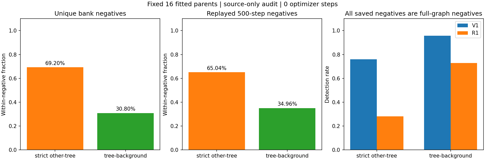
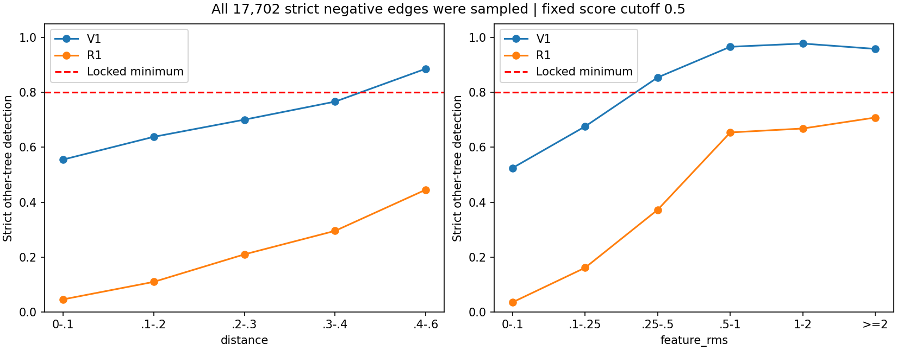

# E1负监督审计：异树边已全部见过，背景没有占据多数负损失

本轮完成CPU审计，没有优化器更新、预测编辑、E2或Wytham执行。
**17,702条严格异树边全部进入原训练库，500步中每条至少被采样3次；
按批次负损失组成计算，严格异树占63.47%，背景占36.53%。**
因此，不能把R1失败归因于异树边没采到，或背景负边占主导。

下一项建议对照是保持正负总权重相等的双侧困难边损失，规格已保存，尚未训练。
当前V1和R1均维持E1未通过状态。

## 1. 如何确认实际见过哪些负边

起点为`d3d5649`，分支`codex/candidate-mask-mlp-step1`，运行前fetch后与远端一致。
使用原16个E1父实例、原bank及原V1／R1第500步权重，在CPU加载的网络只有5,265参数局部连接分支。
官方网络没有加载执行；原候选器、图、模型、配置和部署规则没有修改。

审计先重建完整core图，再仅提取不同正GT、树—已知背景两类负边。
用原`raw_edges`函数重建72列float32输入，与bank负边做**字节精确的一一匹配**。
16个案例负边池各有339–2,950条，均小于每类4,096条的bank上限；
原bank对这些负边全部采入，没有截断。匹配未发现重复负边输入或GT类别／GT对歧义。

随后按原`mixed/mixed/correct/correct`采样器回放500步，仅计数、不前向训练、不反传。
回放结束的NumPy随机状态与V1、R1权重中保存的实际采样状态完全一致。
再次用两份冻结局部分支权重检查所有完整负边，计数复现原报告。

| 边类别 | 完整图中数量 | bank中数量 | 实际500步见过的不同bank行 | 每行采样次数：最少／中位／最多 |
|---|---:|---:|---:|---|
| 严格异树 | 17,702 | 17,702 | **17,702** | **3／38／125** |
| 树—已知背景 | 7,878 | 7,878 | **7,878** | 2／43／134 |
| 同正GT | 5,003,262 | 65,536 | 65,536 | 2／45／137 |

同树正边完整图远大于bank，本轮不把“bank正边全部见过”写成“全部同树边见过”。
原bank使用`target=1`表示同正GT，`target=0`表示有效负边；GT<0和0/0没有进入有效负边。
新审计sidecar的`kind`另用`0=同树、1=严格异树、2=树—背景`，只供GT审计，不改原bank的`target`。

逐父实例覆盖及采样计数见 [parents.csv](assets/local_split_negative_audit_20261022/parents.csv)。

## 2. 背景并未占据多数负损失

| 统计口径 | 严格异树 | 树—背景 |
|---|---:|---:|
| 不同负边数量 | 17,702，69.20% | 7,878，30.80% |
| 500步累计负边出现次数 | 681,260，65.04% | 366,135，34.96% |
| 每批负边内比例，再对500批平均 | **63.47%** | **36.53%** |

500步共回放4,096,000次边采样，其中3,048,605次为同树正边。
原损失对每批正、负边分别取均值，再赋相等权重；
因此，判断负损失内的类别系数时应看逐批平均63.47%／36.53%，不是只看累计出现次数。
这仍不是梯度范数贡献；不同边的误差大小、输入及参数导数也会影响梯度。



部分父实例确有大量背景负边，例如LG1265只有21条严格异树边与452条背景边；
A1N12、A1N23没有0.6m图中的严格异树边。
但不能据局部案例推断整个E1训练被背景负边主导。
完整同森林空间相邻实例的synthetic库未进入E1／R1；本轮结论只适用于固定16例，
没有扩展为对全部289个bank记录或未来E2混合比例的审计结论。

## 3. R1在已经见过的异树边上发生单向退化

固定连接得分阈值0.5，17,702条严格异树边逐边比较：

| V1到R1的变化 | 边数 |
|---|---:|
| 两者都检出为低连接 | 4,968 |
| V1检出，R1改成高连接 | **8,472** |
| V1未检出，R1新检出 | **0** |
| 两者都未检出 | 4,262 |

这解释了严格异树检出从75.92%降到28.06%；不存在漏采边可单独解释这8,472条退化。
树—背景边也有1,793条从V1检出变为R1未检出，反向新检出同样为0。
这里只说明固定0.5判别下的集合关系，不表示所有分数都增加了同一常数。

| 完整严格异树边分组 | 边数 | V1检出率 | R1检出率 |
|---|---:|---:|---:|
| 8个真实混合父实例 | 10,176 | 71.89% | 30.07% |
| 8个原TP多分支对照 | 7,526 | 81.37% | 25.35% |
| 每个core已知正GT点最多的两个GT之间 | 9,905 | 75.34% | 24.93% |
| 其余正GT组合 | 7,797 | 76.67% | 32.05% |

“原TP”表示整林IoU匹配成功，不表示core没有其他GT点；
“点数最多两个GT”是事后标签统计，不是自动种子GT，也不进入部署。
混合案例和主要GT对也明显退化，不能只归咎于正确对照中的少量异树接触。

## 4. 空间距离近、冻结特征相近的异树边更难

| 异树边3D距离 | 数量 | V1检出率 | R1检出率 |
|---|---:|---:|---:|
| 0–0.1m | 373 | 55.50% | 4.56% |
| 0.1–0.2m | 3,820 | 63.80% | 10.94% |
| 0.2–0.3m | 4,234 | 70.05% | 20.97% |
| 0.3–0.4m | 3,243 | 76.63% | 29.54% |
| 0.4–0.6m | 6,032 | 88.61% | 44.55% |

距离段左闭右开，最后一段含0.6m浮点边界。
冻结特征差采用原训练标准化的32维RMS差，不重新拟合尺度。
特征RMS差<0.25的9,838条异树边，R1仅检出1,448条，14.72%；
它们的特征相近不能直接解释成同一棵树。



R1严格异树边平均负BCE为1.0662，背景为0.4779；V1对应0.4905、0.1840。
这说明最终R1权重在已见严格异树负边上误差仍大。
同树bank误切则由11,057／65,536＝16.87%降至2,088／65,536＝3.19%。
现有证据与单侧加强正边后更偏向连接的取舍一致，不能据此断言冻结特征完全不可分、
GT标注错误，或只要扩大模型就会改善。

对全部91,116条bank行还检查了端点交换等价的原始输入，未发现相同输入对应相反target的精确冲突。
这只排除了此bank中的精确输入冲突；不证明近似输入可分，也不排除32→16学习投影丢失信息。
完整GT对及分组BCE见 [gt_pairs.json](assets/local_split_negative_audit_20261022/gt_pairs.json) 和
[difficulty_groups.csv](assets/local_split_negative_audit_20261022/difficulty_groups.csv)。

## 5. 下一项单设置对照：E1-R2，保持正负总权重的双侧困难边损失

规格见 [next_trial_spec.json](assets/local_split_negative_audit_20261022/next_trial_spec.json)，
状态为**拟议、未执行**。本轮没有新增训练步数。

与V1比较，只替换损失为：

```text
L_R2 = 0.25 * (mean_BCE_pos + mean_top25pct_BCE_pos
             + mean_BCE_neg + mean_top25pct_BCE_neg)
```

每类独立选当前批次BCE最大的25%，数量上整且至少1条。
负边仍使用原有效负边全集，保留背景；不按GT亚类另筛选数据。
与V1一样，正、负两侧总系数均为0.5，总损失系数为1。
与R1单独追加正边项区分开，以检验在不增加正边总权重的条件下，双侧困难边强调能否改善排序。
这不是对R1继续追加负边项，也不沿用R1权重继续训练。

保持原16个父实例、bank、标准化、采样序列、5,265参数分支、候选、种子和图不变，
种子42重新初始化，提议新增最多500步，AdamW 3e-4、权重衰减1e-3、梯度裁剪2、每步8,192条边。
仍以同树误切≤5%、严格异树检出≥80%、拟合实例恢复≥1且损失0为联合门槛。
逐边判别阈值0.5及拆分验收候选阈值不变；只运行一个设置，不自动进入E2或Wytham。
这个设置也可能只重现原取舍而失败，不预报恢复数或F1收益。

## 6. 运行、测试与保存

```bash
set -o pipefail
MPLCONFIGDIR=/tmp/treelearn-local-split-mpl \
  /home/szu-stu/miniconda3/envs/TreeLearn/bin/python -u tools/local_split_v1/audit_negative_supervision.py \
  2>&1 | tee logs/local_split_negative_audit/audit.log
MPLCONFIGDIR=/tmp/treelearn-local-split-mpl \
  /home/szu-stu/miniconda3/envs/TreeLearn/bin/python -u tools/local_split_v1/summarize_negative_supervision.py \
  2>&1 | tee logs/local_split_negative_audit/summary.log
```

输出已存在，工具拒绝覆盖。重复审计须同时指定新的`--output`与`--sidecars`路径。
完整负边GT分类sidecar另存于`work_dirs/treelearn_local_split_negative_audit_s42/subclasses`，
不含新增部署输入，不改动V1／R1原产物，也不提交大型数组。
来源及sidecar哈希见 [subclass_manifest.json](assets/local_split_negative_audit_20261022/subclass_manifest.json)。

38项局部拆分测试通过，新增6项验证字节精确匹配、漏边／重复边拒绝、GT对歧义拒绝、
端点对称冲突及原采样器随机调用顺序。两张图均已在服务器查看。
原E0的18森林GT来源戳、候选payload、全部原bank哈希及V1／R1权重在运行前后校验；
原V1签名仍为`4ff5c28159dcddf8ee322166f40ffac0e385a89e28f97bd261f70a06f1470e44`。
大型坐标／特征数组核对来源戳，没有重新计算所有大文件内容哈希。
本轮仅CPU审计，优化器更新为0，累计V1＋R1训练仍为1,000步。
