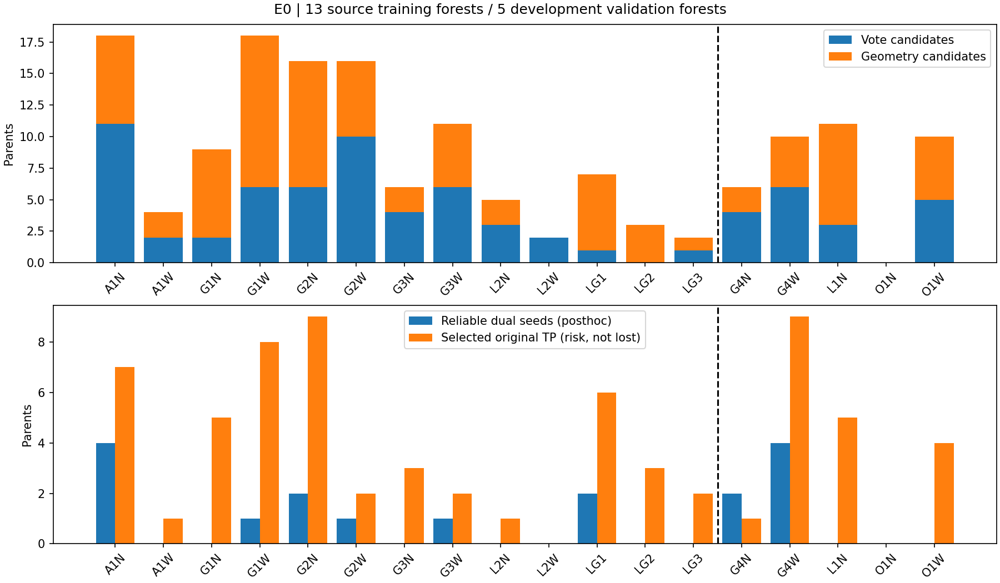
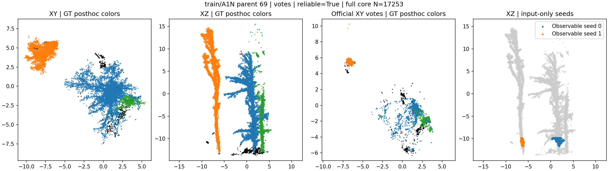
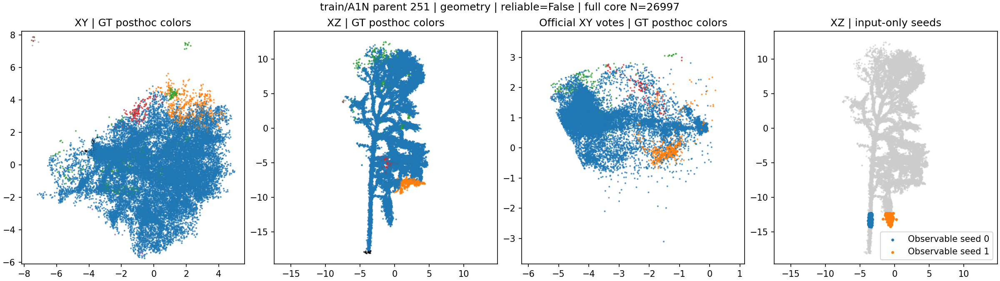
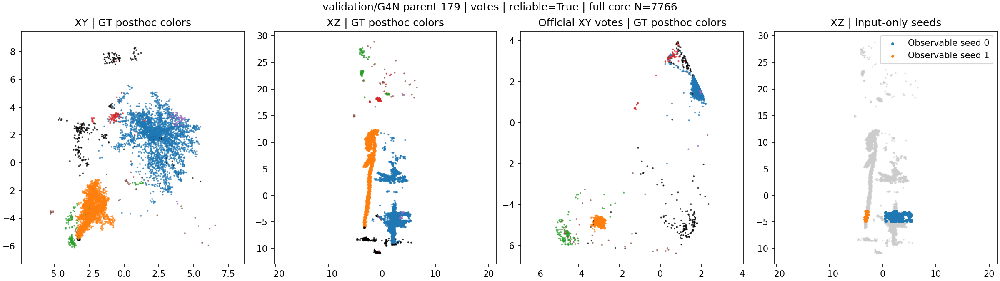
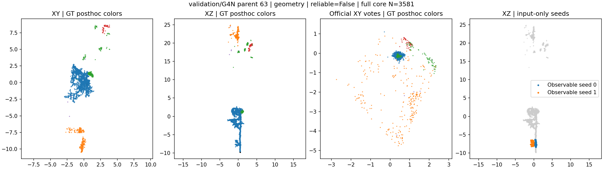
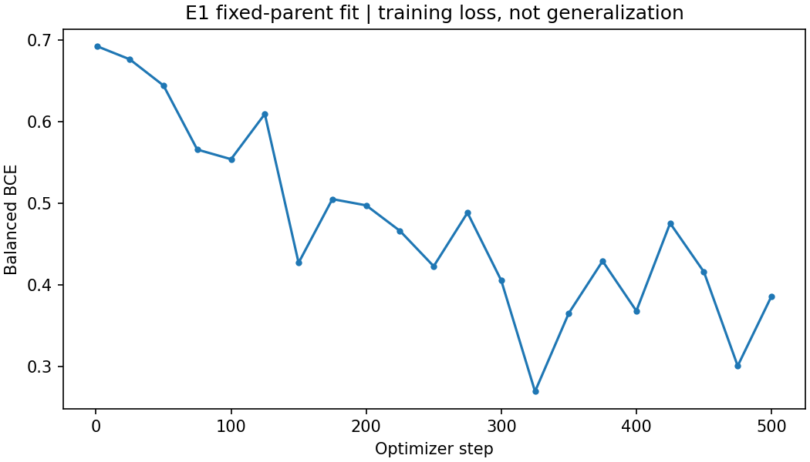
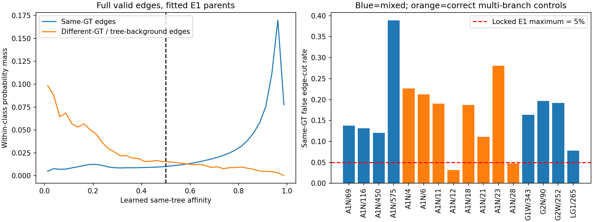

# Local Split V1：E0通过，500步E1因同树边误切未通过，停止升级

后续单变量对照已记录在 [E1-R1报告](local_split_e1_r1_20261022_zh.md)，原V1数据与结论保持不变。

已实现独立的局部拆分原型，并按预先约定执行到第一个失败门槛。
**E0通过；E1同树边误切率18.4158%，超过5%上限，因此没有运行3000步E2或Wytham E3。**
没有修改官方模型、前景、旧预测、旧训练签名或原评价配置，没有安装／升级依赖。

E1的GT筛选训练案例上，学习分支完整森林匹配后恢复9棵、损失0棵；
相同候选／种子／图的纯几何对照恢复6棵、损失0棵。
**这些是拟合案例表现，不是自然候选部署成绩、五森林验证成绩或独立泛化证据。**
尤其E1只允许编辑预选的8个训练混合实例，不能用9棵恢复替代对全部自然候选的验证。

## 实现与固定边界

入口为 `tools/local_split_v1/run.py`，配置为
`configs/experiments/local_split_v1/full.yaml`，核心实现独立放在
`tree_learn/local_split_v1/`。提供 `prepare、audit、overfit、train、validate、external、all` 阶段。

- `prepare`不导入torch，也不打开GT。完整扫描所有正原实例，通过多尺度／哈希复现的双投票峰，
  或下部6m、0.5m薄层中的连续双轨迹产生种子。投票入口优先；第三稳定支撑、预算不足或无种子时拒绝。
- 完整core构建12近邻、半径0.6m的无向图，补充相邻薄层内至多4近邻联系；不静默抽掉可编辑点。
- 官方冻结32维特征只经过训练集标准化和32→16映射；对称40维边输入经过40→64→32→1 MLP。
  **新增5,265个参数**。图权重直接使用空间衰减乘连接得分四次方，不把连接分支仅作辅助损失。
- 双种子图块使用带Jacobi预条件的共轭梯度求调和归属，容差1e-6、最多2000次迭代。
  单种子块随该种子，无种子碎片留在原ID；只分离一个新ID，不删除点或补前景。
- 种子哈希两半与0.5m图半径分别扰动；分离集合Jaccard至少0.95，模糊归属至多5%，
  每个子实例至少50点且至少占core的5%。跨子实例连接得分阈值只搜索预注册的0.1–0.5及不编辑对照。
- 纯几何对照的图权重只有空间核；其验收分数也使用空间核，并明确标记`spatial_kernel`。
  学习分支使用`learned_affinity`。两者在源域使用相同阈值网格独立选择，数值不解释为同一种校准概率。
- 所有部署payload保存完整原点索引、种子、分离索引、候选入口和拒绝原因。GT审计另存。
  新ID按父ID排序分配；未编辑实例标签逐点保持不变。

资源上限为25万core点、400万无向边、400万投票网格单元。
官方checkpoint仅校验MD5 `38266e515dc387ac5ca32619e791cc20`，从未加载到网络执行。

## E0：全部源域原实例上的自动候选审计

| 数据 | 原实例数 | 投票候选 | 几何候选 | 总候选 | 可靠双种子 | 可靠且具备漏检恢复机会的候选 | 被选中原TP |
|---|---:|---:|---:|---:|---:|---:|---:|
| 13训练森林 | 6,808 | 54 | 63 | 117 | 11 | 9 | 49 |
| 5开发验证森林 | 2,595 | 18 | 19 | 37 | 6 | 6 | 19 |

可靠性只在候选固定后用GT诊断：每组至少20个已知点、纯度至少90%、主GT不同。
11个可靠训练候选覆盖6个森林，满足至少8例／2森林的门槛；验证有6例恢复机会，满足至少1例的门槛。
训练可靠候选中投票入口8例、几何入口3例；验证可靠候选全部来自投票入口。
训练／验证分别因第三支撑拒绝221／91例；没有实例触发本轮点数、边数或网格预算上限。

上述“恢复机会”要求种子对应的某个原漏检GT，在父实例中已保留超过一半GT点，仍然是GT诊断。
被选中原TP表示风险集合，**不等于这些TP已损失，也不意味着这些候选一定不应拆分**。
五个验证森林的官方宏平均F1复核为88.1946165%；本轮没有产生它们的新模型F1。
逐森林表见 [forests.csv](assets/local_split_v1_20261022/forests.csv)，完整审计见
[e0_summary.json](assets/local_split_v1_20261022/e0_summary.json)。



四个来源明确的源域案例展示了成功种子和错误种子。它们按训练／验证、可靠／不可靠类别的第一个案例固定选取，
不是用来估计整个数据集的性能。图使用完整core；GT仅在事后着色，种子始终来自可观测输入。
主GT颜色映射记录在 [figure_manifest.json](assets/local_split_v1_20261022/figure_manifest.json)；
黑色为已知背景，灰色为未知或未列入前六主GT的点。

| 来源／父实例 | 入口 | 两组种子的事后主GT与纯度 | 原TP | 观察 |
|---|---|---|---|---|
| train/A1N/69 | 投票 | GT228：324点、100%；GT247：163点、100% | 否 | 两棵树的输入票和空间支撑可区分 |
| train/A1N/251 | 几何 | 两组均为GT57：283／186点、100% | 是 | 同一标注树内的两组下部点被选成双种子，物理成因待核实 |
| validation/G4N/179 | 投票 | GT224：959已知点、94.37%；GT222：82点、100% | 否 | GT222有恢复机会，但种子可靠不等于完整分割正确 |
| validation/G4N/63 | 几何 | 两组均为GT75：168／108点、100% | 是 | 同一标注树内也能产生持续双轨迹 |






这支持一个具体结论：“下部双簇持续存在”本身不足以保护同一标注树。
初次将两例解释为“同一主干两侧表面”过于确定；
[后续原始薄层诊断](local_split_failure_mechanisms_20261022_zh.md)未证实该物理解释，已更正。
两组同GT种子的空间分离可靠，但它们涉及多干、分枝还是局部扫描／标注问题仍未确定。

## E1：固定16个训练父实例的500步检查

训练库由81个真实混合、104个正确多分支、104个同森林物理相邻实例并集构成；没有平移点或冻结特征。
E1仅取8个可靠、具备恢复机会的混合实例，以及8个正确多分支实例；8个正确对照均来自A1N。
标准化用13个训练森林各65,536个按索引哈希抽取的前景点，共851,968点，不使用GT选择标准化样本。
E1按混合／正确各50%采样；E2预配置的50%／25%／25%混合只在将来的完整训练阶段使用，本轮未执行。

使用AdamW、学习率3e-4、权重衰减1e-3、梯度裁剪2，每步8,192条边，总计500步。
同一正GT为正边；不同正GT、树与已知背景为负边；任一端GT<0以及0/0均屏蔽损失。
每批分别平均正／负损失，连接得分因此不是自然边总体中的校准后验概率。

| E1检查 | 结果 | 门槛／解释 |
|---|---:|---|
| 完整同树边 | 5,003,262 | 不只检查采样训练边 |
| 连接得分<0.5的同树边 | 921,392／18.4158% | ≤5%，**未通过**；这是边得分错误，不是点删除率或实际切边率 |
| 全部负边检出 | 20,974／25,580＝81.9937% | 包含异树和树—已知背景；严格异树分项另见诊断JSON |
| 严格异树边检出 | 13,440／17,702＝75.9236% | 两端均为不同正GT；也未达到80% |
| 树—已知背景负边检出 | 7,534／7,878＝95.6334% | 不能用容易的背景边代替异树边 |
| 学习分支接受编辑 | 6个父实例，34,273点分离 | 只允许编辑GT筛选的E1训练子集 |
| 学习分支恢复／损失 | 9／0 | 拟合案例完整森林匹配结果 |
| 纯几何对照恢复／损失 | 6／0 | 同样的E1候选、种子、图和稳定性条件，CPU事后对照 |
| E1最终门槛 | **失败** | E2、E3自动停止，不能靠其他指标覆盖失败项 |

学习分支阈值为0.3；几何对照为0.1。恢复GT为：A1N的63、73、80、228、247，G1W的229，
G2N的473，LG1的233、244。所选8个混合父实例中有5个原TP，实际编辑其中3个原TP，均未丢失其匹配GT。
8个另选正确多分支对照未通过候选器，因而它们的零损失主要由候选拒绝保障，
**不能据此宣称归属分支已学会在这些正确叉枝上安全拒绝拆分**。

完整边误差按类别分解：混合实例同树误切22.4705%，正确多分支对照16.9842%；
8个混合实例均超过5%，8个正确对照中6个超过5%。问题并非只集中在某个孤立案例。
详见 [e1_edge_errors.csv](assets/local_split_v1_20261022/e1_edge_errors.csv) 和
[e1_diagnosis.json](assets/local_split_v1_20261022/e1_diagnosis.json)。




进一步只读检查发现，连训练库中实际被采样的65,536条正边也有16.8716%低于0.5，
因此不能把全部失败归因于训练采样没有覆盖完整图。
完整边0.025宽直方图中，同树累计误切率在0.15–0.175得分区间跨过5%；
若满足同树误切≤5%，阈值必须低于0.175，此时全部负边检出率的保守上界为48.5927%。
这证明**固定当前模型时，仅调整一个得分阈值无法同时满足5%／80%的正负边门槛**；
本诊断没有修改任何阈值或门槛。边界推导和输入摘要哈希见
[e1_score_audit.json](assets/local_split_v1_20261022/e1_score_audit.json)。

学习分支在拟合案例上比几何对照多恢复3棵，说明当前连接权重可能提供了额外信息；
它没有证明模型在自然候选、开发验证森林或Wytham上有效。
当前证据也不能区分是优化、目标／采样权重、输入信息还是5.3k分支表达能力限制，
不能将其概括为冻结特征“坍缩”。

实现中的`different_detection_rate`按训练负类统计，含树—背景边；事后另按两端均为正GT
复核了严格异树指标。它也未达到80%，因此本轮停止结论不受该命名差异影响。
后续版本应把这两个字段和自动准入条件分开，避免背景边掩盖异树连接错误。

## 执行、修正与复现

分支为 `codex/candidate-mask-mlp-step1`，起点 `5c44507`，fetch后无远端新增提交。
仓库、相关子目录和祖先目录未发现AGENTS.md。保留了原数据包、未跟踪日志和全部旧实验。

首次准备完成后，复核发现几何入口过早接受双轨迹，可能漏检更高薄层的第三支撑；
在任何优化步骤执行前主动中止训练库准备，修正为扫描完整下部窗口后再接受。
同时补上CUDA确定性训练所需的cuBLAS环境变量及中断后禁止静默重花训练预算的保护。
初次源码快照、准备产物、未完成训练库分别保留在
`work_dirs/treelearn_local_split_v1_s42_initial/` 和 `data/treelearn_local_split_v1_s42_initial/`，
首次中断日志另存。原超参数和门槛没有修改，最终重新完整执行E0。

最终运行签名：`4ff5c28159dcddf8ee322166f40ffac0e385a89e28f97bd261f70a06f1470e44`。
E1 checkpoint为 `work_dirs/treelearn_local_split_v1_s42/e1/step_500.pth`，SHA256：
`49d02948f7eac89b23997ea485c4172d66dc8c2ae3fbbb682d9c0dc9d56b1f4e`。
仅新增局部分支执行了500次优化；CUDA冒烟检查只做前后向、0次优化。
没有E2／E3目录，没有执行Wytham候选准备或网络前向。

```bash
conda activate TreeLearn
set -o pipefail
python -u -m unittest discover -s tests -p 'test_local_split_v1.py' -v \
  2>&1 | tee logs/local_split_v1/tests_final.log
python -u tools/local_split_v1/run.py --stage all \
  2>&1 | tee logs/local_split_v1/pipeline.log
```

以上为首次完整运行命令。现在已有完成的E1尝试，`overfit`不会静默重跑；
`train`会因E1未通过而拒绝。后续新试验应使用新输出目录并重新约定预算，不能覆盖本轮。

新增18项测试及原有8项案例导出／分析测试通过。覆盖GT删除／替换后输入与归属不变、
未知点损失屏蔽、正确叉枝、接触双干、后出现的第三支撑、碎片保留、求解失败、
连接得分实际影响归属、局部点集守恒、预算中断保护及全量／增量计数一致。
IoU恰好0.5不计TP的边界也已核对。

评价仍为 `aligned_voxels_ignore_negative_gt_iou_gt_0.5`：GT<0忽略，GT=0保留为已知背景，
先最大总IoU匈牙利匹配，再要求IoU严格大于0.5。所有恢复／损失均对完整森林重新匹配。
运行后重新校验18个缓存的来源戳、元数据及所有候选payload哈希，旧GT监督来源校验通过；
没有重新计算数GB特征数组的全文件内容哈希，这不是对全部原始输入字节的重新校验。
见 [verification.json](assets/local_split_v1_20261022/verification.json)。

E2训练、五森林新预测验证、锁定Wytham评价的代码已实现，但因门槛未通过而没有实数据运行，
其端到端运行行为仍需后续阶段验证。不能将“入口存在”写成“这些实验已完成”。

## 下一阶段只处理已经暴露的两个瓶颈

1. **固定这16个训练父实例，先定位正边拟合不足。** 当前训练库本身的正边误切已达16.87%，
   先按距离、跨高度／分枝和输入类型分解误差，检查类别平衡目标与保留同树连接之间的矛盾。
   再预注册小规模训练目标／输入消融；不要直接扩大完整训练预算或继续扫验收阈值。
2. **区分单根干两侧表面与两根独立干。** 以A1N251、G4N63等源域反例检查截面／轨迹证据，
   验证几何种子能否减少同树假双种子，避免只增加更多投票／注意力模块。
3. 新版本先重新通过E1，再在全部自然候选的5开发验证森林上检查
   恢复数>3×损失数、宏平均F1提升、至少4/5林不下降。通过后才允许锁定Wytham探索评价。

Wytham已参与此前结构设计，今后结果也只能称探索结果；现有源域验证森林用于开发，
独立泛化证据仍需另一个未参与设计和调参的数据集。
