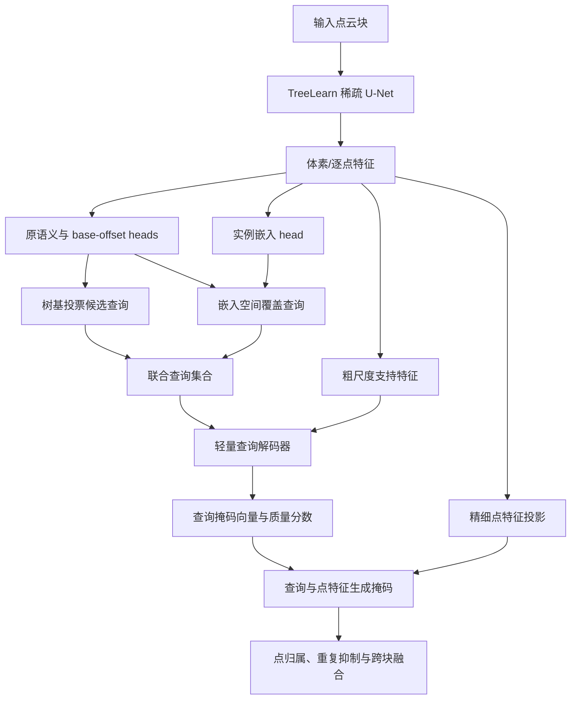

# OneFormer3D、ForestFormer3D 对 TreeLearn 原版的改进启发

日期：2026-10-15。本文依据论文、作者代码和本地 TreeLearn 实现整理。本文中的迁移架构、初始超参数和实验顺序属于待验证设计，不代表已经实现或获得性能增益。

## 1. 核心判断

优先改变实例形成与点归属的学习方式：保留 TreeLearn 稀疏 U-Net，将其几何投票信息用于初始化树查询，再让查询直接预测树掩码。若先做成本较低的验证，可以保持候选生成，增加候选条件掩码细化。

两条路线应独立解释：候选细化主要改善已有实例的点归属；加入独立查询来源的直接掩码预测，才有机会改变遗漏、粘连造成的实例数量错误。不能把只为每个已有候选输出一个掩码的结构，描述成能普遍找回漏检树。

## 2. 论文机制与版本差异

OneFormer3D（CVPR 2024）将稀疏 U-Net、体素/超点池化、查询解码和掩码预测结合，统一处理语义与实例任务。它提出从池化特征初始化实例查询，以及利用查询来源约束匹配的 disentangled matching；论文的该策略最终为每个 GT 选择最小代价候选，无需匈牙利算法。[论文 §3](https://arxiv.org/pdf/2311.14405)

因此，不宜将其概括为“随机查询＋匈牙利匹配”。官方实现按数据集采用不同设置：ScanNet 使用特征查询和超点；S3DIS 使用不同的查询及语义输出设置。讨论具体基线时应给出配置。[作者仓库说明](https://github.com/filaPro/oneformer3d)

ForestFormer3D（ICCV 2025）针对森林增加实例与语义感知查询选择（ISA）、一对多监督和按质量分数进行跨块掩码融合。ISA 用树/非树预测排除背景，并在学习到的五维实例嵌入中做 FPS；一对多监督允许同树多个查询学习同一目标；融合结合掩码排序、重复抑制和边缘处理。[论文 §3](https://arxiv.org/html/2506.16991v1#S3)

代码进一步表明：`One2ManyMatcher` 直接读取查询与 GT 的关联；质量监督中 `get_iou_with_crop` 会通过裁剪内实例比例修正 IoU 分母。论文简述和实际训练实现有细节差异，应以选定版本复现。[ForestFormer3D criterion](https://github.com/SmartForest-no/ForestFormer3D/blob/main/oneformer3d/instance_criterion.py)

官方 ForestFormer3D 配置为 300 个实例查询、6 层 decoder、256 维隐藏表示、8 个注意力头，使用半径 16 m 的柱状裁剪及最多 640000 点；这些参数不能直接当成适合本项目显存与数据密度的配置。[官方配置](https://github.com/SmartForest-no/ForestFormer3D/blob/main/configs/oneformer3d_qs_radius16_qp300_2many.py)

## 3. 本地原版路径的可改进位置

| 现有机制 | 可能限制 | 可迁移方向 |
|---|---|---|
| semantic 与 base-offset 逐点监督 | 没有直接优化整棵树掩码的完整性和纯度 | 增加 BCE/Dice 实例掩码监督 |
| 根据语义、verticality、offset-z 筛选种子 | 少树干点、遮挡和预测漂移会影响候选形成 | 用实例感知查询补充几何种子 |
| 在 base-vote XY 空间聚类 | 相邻树投票重叠时可能粘连，分散时可能碎裂 | 让几何投票辅助查询，最终归属由掩码学习 |
| 对剩余树点使用近邻分类 | 树冠交叠处，近邻投票可能不对应正确树体 | 候选/查询条件下学习逐点归属 |
| 先融合重叠块的点级预测，再聚类 | 不直接产生各块独立树掩码 | 仅在采用块内掩码输出后引入跨块掩码排序 |

代码依据：

- [主干及已有 heads](E:/code/TreeLearn/tree_learn/model/tree_learn.py:176)
- [逐点 32 维特征与 head 输出](E:/code/TreeLearn/tree_learn/model/tree_learn.py:343)
- [点级分块融合](E:/code/TreeLearn/tree_learn/util/pipeline.py:236)
- [种子与实例聚类](E:/code/TreeLearn/tree_learn/util/pipeline.py:314)
- [剩余点近邻分配](E:/code/TreeLearn/tree_learn/util/pipeline.py:549)
- [原有语义与偏移损失](E:/code/TreeLearn/tree_learn/util/train.py:230)

当前仓库已有多项扩展，默认配置不等于原版。对照需明确官方权重、`legacy` anchor、原损失、单 anchor 分组、关闭所有扩展及相同评估协议；可参考 [原版训练配置](E:/code/TreeLearn/configs/experiments/train_t0_original.yaml:1) 和 [原版推理配置](E:/code/TreeLearn/configs/experiments/pipeline_a0_original.yaml:1)。官方 checkpoint 基线与自行重训原版应分开报告。

## 4. 路线 A：候选条件掩码细化，作为较小改动试点

固定 TreeLearn 主干、原 heads 和候选生成，使用候选及相邻区域的特征预测二值树掩码。

每个候选聚合一个描述向量 q；逐点输入包含主干特征、相对坐标、相对投票位置、树概率和当前成员标记。用 q 条件化逐点 MLP，或让 q 对局部点特征做一层 cross-attention，输出候选对应的成员概率。

学习目标为 BCE＋Dice；增加质量头时，其目标为停止梯度的预测掩码 IoU。候选与 GT 的匹配只用于构造训练监督；推理查询、候选区域和几何量全部从预测生成。忽略未标注点，不能将其视为负样本。

与既有实例评分的区别：这里真正改变点归属。首轮关闭额外的低分实例删除，单独检验边界改善；之后再比较质量评分的贡献，避免把删除难例误当成掩码更准确。

限制：一个候选只输出一个掩码，缺少第二个查询时不能一般性地将合并的两棵树拆开；局部区域外的树点也无法恢复。先测候选覆盖率及区域可达上限。若该上限过低，应进入路线 B，而不是继续堆叠细化层数。

## 5. 路线 B：几何投票与实例嵌入共同生成查询，作为完整主线

以下是结合 TreeLearn 的设计假设，并非两篇论文原样实现。

### 5.1 查询来源

几何查询复用 TreeLearn 已能识别的树基投票簇；嵌入查询在预测前景的学习特征空间中采样，使没有可靠树基簇的树也可能获得查询。两类查询共同使用同一个掩码 decoder。

每个查询保留一个明确的原始点/体素来源及其索引，便于训练时关联 GT。投票簇中心未必是实际点，不能直接把中心坐标当作训练实例标签；可保留簇内代表点作为关联来源。混合体素或标签冲突需要明确的忽略/归属规则。

可将低置信前景或未筛选空间中的少量查询作为单独对照，检验硬前景筛选是否排除了弱树。不能凭空假设加入这些查询一定增加召回而不增加假阳性。

新增 embedding head 必须进入查询选择或归属流程；在冻结主干旁训练一个不影响输出的辅助头，不会改善现有实例结果。

### 5.2 真正面向实例的注意力

Q 为树查询，K/V 为点云支持特征；cross-attention 学习当前树查询应从哪些点读取信息。query self-attention 用来交换候选信息，输出经投影后与精细点特征计算掩码：

`m_ki = sigmoid(phi(q_k)^T psi(f_i))`

这里的注意力直接参与树掩码形成。TreeLearn 原有投票可作为查询初始化或软几何提示；若将注意力范围永久限制在原候选掩码内，就仍然无法补回候选外的真实树点。

### 5.3 训练

初期冻结 backbone 与 BN，训练 embedding、查询投影和 decoder。硬 FPS 本身不提供连续梯度，embedding head 需要独立的实例判别监督，不能只依赖最终掩码损失。

采用基于查询来源的一对多监督：同树多个查询预测同一 GT 掩码，背景查询学习空掩码和低质量分数。对每棵树的查询损失作归一化，避免大树因为查询多而支配训练。GT ID 仅用于训练关联与评估。

损失可由以下部分构成，权重在验证集确定：

`L = lambda_mask (BCE + Dice) + lambda_score L_IoU + lambda_emb L_discriminative`

若后续解冻部分主干，则加回原语义、offset 损失并降低主干学习率；冻结阶段不必把无法更新任何参数的原始损失当成新增训练信号。保留 offset 监督是否有益，应通过对照验证。

先在完整标注的局部区域训练，保证目标定义清晰。块边缘树若用裁剪内 IoU，会高估不完整树的质量；可用完整 GT 点数构造裁剪比例修正，或者对边缘树单独定义质量监督。训练数据没有完整树范围时，不能假装拥有该信息。

### 5.4 轻量初始配置

| 部分 | 试点初值 |
|---|---|
| 主干特征 | 复用现有 32 维输出 |
| embedding | 5 维 |
| decoder | 2 层、64 维、4 heads |
| 查询数 | 128，总容量需由每块树数和覆盖率验证 |
| attention 支持点 | 最多约 4096，单独检查小树是否被下采样丢失 |
| mask 输出 | 精细点上分块计算；训练采用实例均衡采样与邻树难负样本 |
| batch size | 1 起步，实测峰值显存 |

这些数值用于启动实验，不保证能在 24 GB 显存内运行。既要限制 attention 的支持点数，也要控制查询数×掩码点数的训练激活。不能仅减少支持点就假定显存问题已经解决。

## 6. 路线 C：掩码质量与跨块处理，作为 B 的后续组件

采用块内树掩码后，使用质量分数排序，在统一的原始点 ID 空间计算点集重叠并抑制重复。三维包围框或树冠投影重叠不能直接代表同一棵树。

需要足够滑窗重叠，使边缘不完整掩码能由其他块的完整预测接替。对森林外边界或所有块都不完整的树，不宜无条件删除。未被任何掩码覆盖的点必须统计并明确处理，不能通过强制分配给最近树来掩盖漏分。

原版 TreeLearn 已进行点级跨块融合，所以此项不宜作为原聚类流程上的首个独立改动。

## 7. 建议实验顺序与可信结论

| 实验 | 保持不变 | 只检验什么 |
|---|---|---|
| A0 原版 | 权重、预处理、评估协议 | 可复现基线 |
| A1 候选条件 MLP 掩码 | 原候选与主干 | 直接掩码监督是否改善归属 |
| A2 候选条件 attention 掩码 | A1 的输入、区域、训练数据和预算 | 注意力是否优于参数相近 MLP |
| B0 查询掩码基线 | 同一轻量 decoder | 只有几何查询时的能力 |
| B1 查询来源对照 | K、decoder、损失、训练预算一致 | 几何、空间 FPS、实例嵌入、混合查询的覆盖差异 |
| B2 监督策略对照 | 选定查询及 decoder | 受来源约束的单匹配与一对多监督差异 |
| C0 质量及跨块融合 | 固定掩码模型 | 去重和边缘处理的独立作用 |

优先记录：每树是否被查询覆盖、重复查询比例、小树覆盖率、粘连/碎裂数量、Detection F1、Completeness、Commission、点级 Coverage，以及峰值显存和推理时间。查询覆盖率与最终分割 Coverage 是两种不同指标，不能混称。

冻结主干只是一阶段诊断。若当前特征不能支持掩码边界，先比较参数受控的局部微调，不宜将失败自动归咎于查询结构。单块实验只证明局部分割能力，不能代替完整森林评价。

现有 [最终实验记录](E:/code/TreeLearn/docs/experiments/thesis_finalization_zh.md:15) 显示，M4 Window Attention 在五森林验证上相对 B1 仅增加 0.066 pp macro F1，未通过既定 Gate；Wytham 日志也未显示总体改善。因此目前证据支持将新研究重点放在实例监督与形成方式，不能据论文名称推断“再加一层注意力就有效”。

Wytham 已参与既有方法判断，只能继续作为开发或回顾性结果；新增方法应使用固定验证森林选择结构，并增加未参与开发的外部区域。评估必须统一体素、实例匹配、边缘树和统计口径。ForestFormer3D 论文表格的训练集和 TreeLearn 训练设置与本地不同，不能用其表中数值直接计算本项目的提升幅度。

从论文贡献角度，ISA、查询 decoder、一对多监督和质量 NMS 都已有前人工作。潜在研究点应表述为：几何投票与实例嵌入查询是否互补，能否在保留原本正确树的同时改善弱树查询覆盖和冠层归属。只有相应消融与外部验证成立后，才能将其作为有效贡献；新颖性仍需进一步文献检索确认。
