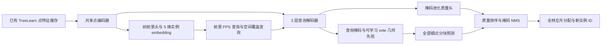

# TreeLearn 查询实例解码器 v1：服务器运行说明

日期：2026-10-18，2026-10-19 更新。按用户“先做出一个有效果的架构”的最新要求，先实现完整模型并直接训练，MLP 对照、多 seed 和严格晋级门槛后置。本地只做静态检查，单元测试、训练、点云预测由服务器执行。服务器已完成 12000 step 及最终评价；最优权重在第 2000 step，五森林 macro F1 为 **69.531%，相对原版 -18.663 pp**，FP 从 275 增到 1151，v1 未改善原版。详见[完整结果与 CPU 诊断命令](query_instance_decoder_v1_results_20261019_zh.md)。此前的单块成员上限中断已修复，历史见[运行修复](query_instance_decoder_v1_runtime_fix_20261018_zh.md)。

## 1. 本次实际实现

复用 A1 导出的原版 TreeLearn 32 维主干特征、坐标、base-vote 和树概率；不重新运行主干，不使用原候选 ID 作为输入。



| 部分 | v1 配置与作用 |
|---|---|
| 块输入 | XY 半径 16 m、全高度，中心步长 8 m；查询锚点位于半径 12 m 内，保留上下文处理边缘树 |
| 上下文点 | 0.4 m 体素选真实代表点，优先较高树概率；空间/高度分层限制到最多 4096 点 |
| 点编码 | 32 维特征加相对 XYZ、相对 vote XY、树概率，共 38 维；训练森林估计特征归一化 |
| 查询 | 最多 256 个，其中保留 32 个空间覆盖名额；其余在前景中 FPS，名额不足用覆盖查询补足 |
| 查询采样 | 前 500 step 使用原版树概率与 XYZ；随后 1500 step 渐变到学习的前景概率和 5 维 embedding |
| 解码器 | 隐藏维度 128，3 层，每层为查询到上下文的交叉注意力、查询自注意力、FFN；4 个 attention head |
| 掩码 | 查询特征与逐点特征内积，并加入 vote 距离先验；可学习调整先验中心、宽度和强度，初始宽度 1 m |
| 质量 | 查询与预测软掩码池化特征共同预测整实例质量，用于过滤、排序和冲突优先级 |
| 训练 | 12000 次单块更新，AdamW、学习率 1e-4；每 2000 step 评价完整五森林，以 macro F1 保存 best |
| 推理 | mask 阈值 0.5、质量阈值 0.4；块内和全林 NMS：IoU >=0.5 或较小掩码被包含比例 >=0.8 时抑制 |

每个查询的监督目标是其**真实锚点所属 GT 树**，同树可有多个查询，不做原候选 IoU 筛选；同树查询分摊权重，降低大树重复查询的影响。背景锚点学习空掩码和质量 0；未知标签锚点不参加查询掩码/质量损失。逐点前景损失忽略未知标签，embedding 损失仅使用 GT 树点。

每块共享抽样 8192 个已标注细点，按 GT 实例及背景分层，并用逆采样权重恢复各层总体点数。损失为逐层 BCE + Dice、质量 MSE、前景 BCE、实例 embedding 紧致/分离损失。质量目标使用**总体加权的抽样交集/预测大小与全林 GT 树点数计算 IoU 估计**，因此会降低被块边界截断的预测质量；它不是精确遍历全部细点得到的 IoU。

训练和预测都允许原版语义背景点参与。预测流程不读取 GT、原 baseline 实例标签或候选监督，只在预测完成后打开标签计算评价。推理按 8192 个细点分块，全部点都可被掩码覆盖；4096 限制只作用于 attention 上下文。块内抑制后将掩码成员写磁盘，全林按质量去重并优先把冲突点分给较高分实例，输出重新编号的实例 ID。

这是一套借鉴 OneFormer3D 查询解码、ForestFormer3D 实例感知采样与质量排序的工程实现，包含新的 vote 先验，**不是两篇论文的原样复现**。与此前[完整设计协议](treelearn_query_decoder_design_20261018_zh.md)相比，v1 不先跑 MLP、覆盖率 gate 或多 seed，直接联合训练 embedding 与解码器，使用代表点上下文和抽样质量估计；这些差异服从用户最新要求。

## 2. 一次启动

在 Linux 服务器仓库根目录执行：

```bash
cd ~/projects/zrx/code/TreeLearn
git switch codex/candidate-mask-mlp-step1
git pull --ff-only
conda activate TreeLearn
bash tools/query_segmentation/launch.sh
```

启动器会自行后台运行，返回 `PID` 和唯一 `RUN_DIR`，无需再加 `nohup`。它与旧外部评价/诊断共用任务锁；有任务占锁时，新运行目录的状态为 `LOCKED`，不会覆盖正在运行的 `latest`。

默认依次执行：12 项合成数据测试 → 为已有 A1 缓存建立空间索引 → 8 step GPU smoke 训练 → 一个块的 smoke 预测 → 正式训练 → best checkpoint 的完整五森林评价。测试失败或程序错误时会停止；**没有 F1/Coverage 晋级门槛**。smoke 指标仅验证流程，不用于判断效果。正常结束的 `DONE` 仅表示程序流程完成。

已有数据应为 `data/candidate_mask_mlp_a1/manifest.json` 及其引用的各森林缓存；训练/验证名单直接沿用 A1 的 13/5 划分。`prepare` 只建立新的非重叠空间索引和训练 GT 总数，不生成原始点云 tiles、不重新运行 TreeLearn。索引一次只处理一片森林。

## 3. 查看进度与恢复

```bash
cat logs/query_instance_decoder_v1/latest/status.txt
tail -n 20 logs/query_instance_decoder_v1/latest/console.log
tail -n 5 logs/query_instance_decoder_v1/latest/train.log
```

只有进入正式训练后才有 `train.log`；更早阶段查看 `tests.log`、`prepare.log`、`smoke.log` 或 `smoke_evaluate.log`。正式训练第 1 step、每 20 step、相邻 step 日志间隔超过 30 秒时均打印 loss 分项、查询数、质量分数、数据/计算耗时和内存；完整验证时改为逐森林及逐块预测进度。单步或索引本身超过 30 秒时，资源监控仍每 20 秒采样，不能仅凭日志暂未变化判断进程死亡。

运行目录还包含 `pid.txt`、`commit.txt`、`resources.log` 以及每阶段的 GNU time 记录。训练每 500 step 保存 `last.pth`，并在完整验证前先保存当前 step，验证成功后更新最优 `best.pth`。验证失败的 checkpoint 标记 `pending_validation`，恢复时先重试该次验证，再继续训练。中断后先确认旧进程已退出，再执行：

```bash
bash tools/query_segmentation/launch.sh resume
```

恢复入口也先运行当前 12 项测试。兼容此前没有 `pending_validation` 字段的 checkpoint；本次原版第 2000 step 验证报错时尚未保存该步，按默认周期应从第 1500 step 恢复，启动日志中的 `start` 为实际读取值。

若中断发生在首次正式 checkpoint 保存之前、只完成了部分 smoke，可单独恢复 smoke 后重新启动默认流程：

```bash
python -u tools/query_segmentation/run.py train --smoke --resume
bash tools/query_segmentation/launch.sh
```

仅在存在 smoke 的 `last.pth` 且没有 `best.pth` 时需要上面第一条命令。正式训练尚无 `last.pth` 时直接重新默认启动即可。不要同时启动两套训练。重启会建立新的日志运行目录，保留旧日志。

## 4. 回传哪些结果

```bash
cat work_dirs/query_instance_decoder_v1_s42/training_summary.json
cat work_dirs/query_instance_decoder_v1_s42/evaluation/summary.json
```

先看五森林 macro F1、Completeness、Commission、Coverage 及相对原版的变化，再看各森林 TP/FP/FN、丢失/恢复的 GT、原前景被丢弃点数、从原背景恢复的 GT 树点数。训练 loss 下降或预测实例数增多都不能单独证明改善。完整森林预测的质量分数范围、候选数、NMS 后实例数和耗时记录在每片森林 `prediction.json`。

完整验证输出保留在 `validation/step_XXXXXX/`；最优时点见 `best_validation.json`，最终评价使用该时点的 `best.pth`。新的实例标签在 `evaluation/<plot>/refined_labels.npy`，与已有缓存细点一一对应，不是原始输入点云的导出文件。

若预测为空，先看 `quality_min/max/mean`、mask loss 和质量目标，而不是把零 Commission 解释为提升。可单独检查较低质量阈值，输出独立目录；不必重训：

```bash
python -u tools/query_segmentation/run.py evaluate --quality-threshold 0.3
# 结果：work_dirs/query_instance_decoder_v1_s42/evaluation_q0.3/summary.json
```

## 5. Wytham 与资源

源域完整训练结束后，可直接复用先前准备好的 Wytham 特征缓存：

```bash
bash tools/query_segmentation/launch.sh external
# 结果：work_dirs/query_instance_decoder_v1_s42/external_evaluation/summary.json
```

不会重新生成 Wytham 的 2009 个原始 tiles，也不会加载 A1/A1b 的 MLP 权重；使用本轮源域最优查询解码器。Wytham 不参加训练。它此前已用于开发分析，此处结果是探索性跨域评价。

没有添加新依赖，复用服务器环境中的 PyTorch、NumPy、SciPy、PyYAML。上下文、查询和点 chunk 都有限额。`max_block_memberships=20000000` 现表示单块掩码成员的内存缓存预算：超出后自动暂存到磁盘，不丢点、不删查询、不改变 NMS；日志打印 `block_masks_spilled`，结果记录 `spilled_blocks` 和单块最大成员数。临时文件随块处理完成释放，全林抑制前的提案文件仍受 `max_forest_memberships` 磁盘预算约束。首轮日志的训练峰值约为 CPU RSS 3.04 GiB、GPU 分配显存 336 MiB，这不是完整验证/全林推理的资源峰值。主干保持冻结是本版成本与适配能力的取舍；若完整实例解码后仍无改善，再根据结果决定是否微调主干。

主要文件：[模型](../../tree_learn/query_segmentation/model.py)、[损失](../../tree_learn/query_segmentation/loss.py)、[推理](../../tree_learn/query_segmentation/inference.py)、[训练入口](../../tools/query_segmentation/run.py)、[配置](../../configs/experiments/query_instance_decoder/v1.yaml)、[服务器测试](../../tests/test_query_segmentation.py)。
