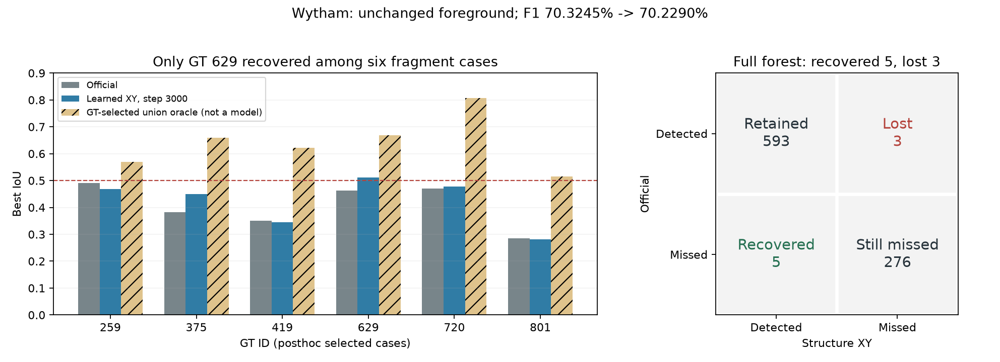

# 结构投票 3000 步：逐树诊断结论与下一版边界

日期：2026-10-22。输入为用户回传的完整 `brief.json` 文本，来自已保存最终预测的 CPU 诊断。开发机没有本轮服务器全林预测，本文核对回传字段与前次官方案例统计，没有执行模型、训练、推理或单元测试。

**本版恢复 5 棵、丢失 3 棵，六个定向碎片案例只恢复了 629。下一版应以官方原预测为起点，直接学习局部实例的保持 / 合并决策，停止全场 XY 修正这条实验。**

原始回传：[received_brief.json](assets/structure_voting_audit_20261022/received_brief.json)。输入文本 SHA256：`c565d5f00aeda204e58bc2478cfe7ab1e85e229d9827b9da4b55900b5804b5a1`。

## 1. 净增 2 棵的实际组成

| 原官方状态 → 当前状态 | GT 数量 |
| --- | ---: |
| 都检出 | 593 |
| 原检出、当前漏检 | 3 |
| 原漏检、当前检出 | 5 |
| 都漏检 | 276 |

四类相加为 877。`593+3=596`，`593+5=598`，恢复减丢失为 2，与原始计数一致。原正确树的检测保留率为 593/596=99.50%。三个丢失实例中，一个成为其他 IoU 不足，两个成为高召回低纯度；五个恢复实例原先分别属于其他 IoU 不足 1、低纯度 2、碎裂 2。

全林 TP 596→598、FP 222→228、FN 281→279；F1 70.3245%→70.2290%，下降 0.0955 个百分点。所有实例总数 1862→1878，其中 ignored-only 1002→1012，不能把新增 16 个实例全部解释为新增 FP。低纯度漏检总量为 117→117，不能由这个相同总数认定两组 GT 完全相同。

本次 brief 包含 16 棵 watchlist，不包含另外四个恢复实例和三个丢失实例的完整 ID。完整名单已存在服务器诊断目录的 `all_gt_trees.csv`，本文不补写未知 ID。当前证据足以结束这一版实验，无需再跑网络或延长训练。

## 2. 六个已有修复机会的实际变化

| GT ID | 官方最佳 IoU | 结构 XY 最佳 IoU | 当前检测 |
| --- | ---: | ---: | --- |
| 259 | 0.4916 | 0.4678 | 仍漏检 |
| 375 | 0.3823 | 0.4505 | 仍漏检 |
| 419 | 0.3512 | 0.3456 | 仍漏检 |
| 629 | 0.4624 | 0.5116 | **恢复** |
| 720 | 0.4706 | 0.4778 | 仍漏检 |
| 801 | 0.2850 | 0.2817 | 仍漏检 |

图中斜线柱来自前次官方预测的 GT 辅助双碎片合并计算，用于表示具体机会，不是另一个自动模型成绩，也没有在本轮执行这些合并。六棵是事后选例，不是随机样本，1/6 不能外推为所有碎片树的恢复率。

629 的最佳掩码目标召回从 49.41% 提高到 55.22%，纯度维持约 87%，IoU 才跨过 0.5。它说明 XY 分支对个别碎片实例确实产生了有利变化，但未形成稳定的修复能力，当前无法由最终掩码判断它具体改变了哪一个 seed 或 HDBSCAN 分支。

### 375 显示了“多收一些点”与“正确恢复一棵树”的差别

| 最佳掩码统计 | 官方 | 结构 XY |
| --- | ---: | ---: |
| 属于目标 GT 的点 | 1931 | 2429 |
| 已知外来点 | 266 | 607 |
| 目标召回 | 40.36% | 50.76% |
| 预测纯度 | 87.89% | 80.01% |
| IoU | 38.23% | 45.05% |

这些计数可由完整 GT 点数和回传的 precision/recall 精确还原。两个最佳掩码不保证是包含关系，因此 498 个目标点和 341 个外来点的增加是两掩码的净计数差，不能解释成只新增这些点、从未移除别的点。

目标召回提高到了半棵以上，但外来点也变多，最终仍未检出。543 也出现类似现象：目标召回从 76.84% 提高到 78.89%，纯度从 57.76% 降到 56.28%，IoU 从 0.4920 降到 0.4891。下一版需要同时判断完整度和纯度，不能只优化收拢或召回。

419 的最佳掩码纯度仍约 99%，召回仍约 35%，是更直接的同树碎片关系对象；在官方原预测上，前次已核实两片合并的 IoU 可达 0.6217。此信息只作修复设计证据，部署决策不得读取 GT。

## 3. 保住前景与保住实例是两层约束

前景变化点数为 0。原 596 个 TP 中，只有 15 个完整点集完全不变，581 个至少有一点变化，占 97.48%。但原来仍被检出的有 593 棵，实际只丢失 3 棵。

因此不能把 581 解释成 581 棵漏检、严重破坏或发生了大范围点变动。完整掩码一致性是严格的逐点标准，一点变化也会计入；当前 brief 没有修改点数分布。它能说明这是一种影响面广的全场修正，尚未做到只修改少数失败候选。

还应关注未跨检测阈值的质量退化。唯一 z 跨度 ≥30 m 的 GT 组仍被检出，但其最佳 IoU 从 0.9996 降到 0.8774，召回从 0.9997 降到 0.8775，纯度仍接近 1。结合前次同缓存全 GT 表，该组唯一实例为 GT 75，z 跨度 30.61 m。这是单实例的完整度下降，不能只因 TP 不变就当作保护成功，也不能外推到所有大树。

前景缺失的 152、347、507 均未恢复，前景保留率逐项不变；全林多数点未分配的 118 棵、完全无分配的 11 棵也未因重新排列 XY 获得足够前景。低于半棵 GT 的固定前景使任意单实例 IoU 上界低于 0.5。这类漏检需要独立的前景补漏路径。

## 4. 从实现与结果能够解释到哪一步

当前损失是点级 XY Smooth L1、局部边同树分类、同树投票一致性和残差正则，见 `tree_learn/structure_voting/loss.py`。新连接直接查询半径 1.2 m 的邻域；原特征仍来自冻结 U-Net，不能把整个模型概括成只有 1.2 m 感受野。

最终实例由原 seed 规则、HDBSCAN 和剩余点分配生成。训练没有直接监督“合并哪两个最终实例”，也不经过完整聚类优化最终 TP/FP。当前结果符合点级目标与实例级目标不完全一致的解释：部分归属改善，部分纯度或完整度退化，实例数与 FP 没有被直接控制。

这不是证明某个损失项是唯一失败原因，也没有证明中间特征坍缩、连接 MLP 完全没有学到东西、或某个 HDBSCAN 参数必然错误。回传资料不含中间特征、实际 seed、逐层投票轨迹或消融结果。

## 5. 下一版的具体实施范围

以**官方权重和官方原预测**作为固定起点，本版 XY 分支保留作实验记录。首轮新增一个独立实例关系头，只输出保持 / 合并，不同时引入拆分、语义重训或新骨干。

1. 从原预测实例构造空间邻近候选对，不使用 GT 筛选“FP 对”。每个实例按高度分层采样，提取点的 3D 连接、投票分布与下部结构关系；可加冻结特征。下部几何是证据，不强制树竖直、单干或完整可见。
2. 网络同时预测同树关系与合并质量。监督在有标签的训练森林上构造，直接判断 union 对完整度、纯度及 IoU 是否有利；将紧邻的两棵真树、原正确实例与污染候选作为重要负例。未知 GT 不作负例。
3. 默认保持原点集，只接受足够可靠、互为优先的局部候选对，一轮中一个实例最多参与一次合并。禁用 A–B–C 的自动连锁合并；不再全场重新聚类。未选中的原实例点集必须完全相同，可直接验证。
4. 训练可知道哪些原实例是 TP，并惩罚破坏它们的编辑；部署只能依靠预测质量与结构证据，不能读取 TP 标记。对被规则判为稳定的实例锁定点集，不声称这个规则能事先识别全部真实 TP。
5. 完整评估继续记录 recovered/lost、FP、Coverage，以及原正确实例的点集改变范围。不能只报净 TP 或只报四棵正确对照。优先验证是否保留原正确树，同时恢复碎片；不预先承诺分数上涨。

两个原 FP 合并为一个 TP、且其他匹配不变时，可以同时增加一个 TP、减少两个 FP。这是训练实例关系、显式控制编辑动作的目标；它不是现成部署时能利用的 GT 条件。

该设计针对少量有证据的碎片问题，不会覆盖所有 281 个漏检。前景补漏仍需后续独立设计，保持只向原 0 点新增实例、避免把已检出树的残余低分点再造为新树。

这轮诊断已结束。下一步进入局部保持 / 合并模块的实现与验证；本次提交只记录诊断、图和上述实现边界，没有实现或启动该关系模型，也没有更改训练代码、配置、预测、缓存或权重。
