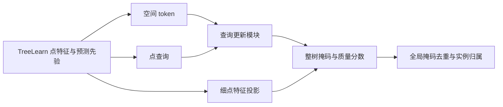

# TreeLearn 查询实例解码器：设计与验证协议

日期：2026-10-18。状态：方案设计，尚未实现新模型或运行实验。用户要求结合 OneFormer3D、ForestFormer3D 和 A1/A1b 失败结果重新设计。本地工作限于论文、代码、回传结果与静态文档核对；服务器负责后续数据处理、测试和训练。

## 1. 选择的主线与可检验假设

主线为 **保留 TreeLearn 特征提取器，新增查询实例解码器，学习整树掩码及实例质量，再进行掩码级去重与归属**。第一阶段替换实例生成部分，基线 A0 独立保留作对照。初版复用现有特征缓存；随后用在线冻结/微调对照检验主干适配。它是新的实例分割方案，不是给 A1b 继续增加一个 loss。

三个假设分开验证：

1. 查询点对应的整树监督、背景查询监督和实例质量评分，能否改善最终 F1/Commission？
2. 在查询、监督、质量头、融合和预算一致时，查询注意力是否超过无注意力的 MLP？
3. 对新增掩码任务适配主干，是否超过相同在线输入下冻结主干？

A1/A1b 是历史后处理参照，不能替代第 2 项的公平控制组。其失败也不作为禁止完整解码器实验的条件。新增方案的效果、注意力的效果和主干微调的效果是三个不同结论。

## 2. 设计依据与机制对应

| 已观察问题 | 本方案的响应 | 如何检查 |
|---|---|---|
| A1b 新增 FP 110 个，其中 98 个来自原不计 FP 的未匹配候选 | 每查询输出整掩码质量；背景查询显式教成空掩码/零质量；推理先筛实例再处理点 | FP 状态转移、分数校准、质量分数推理消融 |
| A1b 丢弃 1305510 个 GT 树点 | 原语义背景点也能参与训练和预测，不以 baseline ID 硬限制输出范围 | 原前景树点保留率、baseline==0 区域树点恢复率、最终 Point recall |
| 固定原候选 ID 限制新增/拆分实例 | 查询从点生成，每查询可输出新实例，不依赖 HDBSCAN 候选描述或 ID | 查询覆盖率、原误合并中恢复实例的案例与数量 |
| 固定 mean/max 描述无法随预测更新 | 查询与空间 token 交互，多层更新实例表示 | 同条件 MLP 与注意力比较 |
| 独立成员概率直接比较，缺少整实例有效性判断 | 整实例质量排序、掩码 NMS、按实例分数确定冲突优先级 | 重复掩码率、互斥分配前后 IoU 与掩码裁切量 |
| 局部验证 BCE/Dice 低不代表完整森林 F1 高 | 用预先固定的完整实例指标规则选模 | 记录每次完整开发集评价，不事后扫全部 checkpoint |

以上是待验证的响应，不是已证明的根因或收益。原不计 FP 的评价状态与训练筛选状态不同，不使用 GT 状态决定部署候选。

来源关系：OneFormer3D 提供查询更新、受位置约束的匹配及实例排序/NMS思路；ForestFormer3D 提供查询点关联、实例质量监督和跨块排序思路。本方案使用紧凑解码器及分阶段主干适配，**不是两篇论文的等价复现**。论文与官方实现见第 12 节。

## 3. 数据、空间块与内存组织

### 3.1 第一阶段输入

复用 `data/candidate_mask_mlp_a1` 的对齐数组：坐标、32 维主干特征、预测 XY vote、预测树概率。训练单独读取 `labels.npy`；预测路径不打开 GT、旧 `supervision.npz`、候选描述或 baseline ID。A0 标签只在预测结束后的配对评价中读取。

输入包含原 `baseline==0` 的点。GT -1 是未知，损失和评价按既有协议忽略；GT 0 是已知背景；GT >0 是树实例。查询选择、空间 token 和推理不依赖 GT。原 A1 缓存、权重和运行代码保持独立，不复写它们。

训练/开发森林仍为已有 13/5 个，N/W 成对地块不跨拆分。13 个训练森林等概率抽取，再从该森林的非空空间网格抽取块；不按 GT 树位置选择块，不排除纯背景块。32 维归一化统计仅由训练森林估计。

### 3.2 首版固定几何

- 上下文：半径 16 m、全高度的圆柱块；推理中心网格步长 8 m。
- 查询只从中心半径 12 m 内选取，掩码可覆盖完整 16 m 上下文。训练和推理使用相同查询区域，外环提供邻树上下文。
- 所有输出仍对应原 0.1 m 对齐体素；不将粗 token 分辨率冒充最终评价分辨率。
- 每块先按 0.4 m 空间格池化 mean/max 特征并记录原点索引。相对 XYZ、vote XY 和树概率参与编码；坐标以块中心和块内 Z 中位数居中，按当前上下文半径 R 缩放，首版 R=16 m。
- 上下文最多 8192 个 token。超出时，先保留查询所在 token，再按 XY/高度各 4 m 的非空分层保留代表，并在剩余额度内确定性抽样。分层和查询必选集合超额时明确报错，不静默截断必选项。记录压缩比例及空间覆盖。
- **仅压缩注意力上下文，不截断细点输出**；细点掩码头继续使用每个原始对齐点的特征。查询池先于上下文压缩建立，避免小树查询随上下文抽样一同消失。

缓存特征阶段只做块中心抽样、点/空间 token 抽样等与缓存一致的操作。不旋转坐标却沿用未旋转输入产生的缓存特征。在线主干阶段如加入几何增强，须重算相应特征，并在配套冻结对照中使用同样增强。

### 3.3 流式处理

森林数组 mmap；空间索引和块元数据可缓存，重叠块的特征不整批复制到 RAM。一次读取/处理一个块，默认 DataLoader worker=0。输出保存稀疏的全局点索引与掩码分数；不得构造“全森林点数 × 全森林查询数”的稠密矩阵。

## 4. 查询初始化与训练前可表达性审计

### 4.1 首版查询

每块最多 256 个点查询，均保留到原细点的索引：

- 224 个前景查询：从预测树概率 >=0.5 的点代表中做 XYZ FPS。
- 32 个覆盖查询：从中心区全体点代表中做 XYZ FPS，包含可能被原语义漏掉的区域。
- 前景池不足时取其全部，其余额度转入覆盖池；排除重复锚点。点少于查询数时按实际数量并 padding/mask。
- 空间格代表点依据几何和预测信息选择，GT 标签不参与。FPS 起点、相等距离与点顺序使用固定索引规则；记录实际锚点索引。
- 查询初始表示由锚点的归一化 F32、相对 XYZ、vote XY、预测树概率投影到 128 维。原候选 ID 和 GT ID 不是输入。

因此两个落在原同一 HDBSCAN 候选内、实际属于不同树的查询，可以获得两个独立目标和输出 ID。是否确实恢复原误合并由实验判断，不由结构保证。

### 4.2 S0：先检查覆盖与裁剪能力

只读检查训练森林和已有 pilot；开发集只报告，不用其 GT 改变逐块规则。统计所有 GT，包括小树：

1. 在固定滑窗并应用中心查询区后，有至少一个锚点的 GT 比例，目标 >=95%。
2. 原 A0 已匹配 GT 的锚点覆盖比例，目标 >=99%。
3. 每棵 GT 在最佳上下文块中的可见比例；目标 >=99% 的 GT 至少有一块包含其 80% 点。
4. 按树大小报告覆盖率、每树查询数、背景查询比例，记录上下文压缩的额外风险。覆盖是采样审计，不是分割效果。

若第 3 项在训练森林不足，只允许一次预定几何升级：半径 24 m、步长 12 m、中心查询半径 18 m，其他模块固定并重做资源审计。若查询覆盖不足，则先实现第 9 节 ISA 查询模块，而非在查询天然漏树时盲目训练解码器。若这两种预定改动仍不足，报告预算/表示限制并停止当前配置，不使用 GT 直接补查询。

这些默认值是本方案起点，并非论文已证明最优的参数。

## 5. 解码器、掩码与实例分数

**注意力版本 T：** 128 维、3 层、4 头、FFN 隐层 512。每层为查询对空间 token 的 cross-attention、查询 self-attention、FFN 与残差/LayerNorm。初版各层使用完整压缩上下文，不额外引入预测掩码门控注意力，避免空掩码导致查询失活。

每层预测 `p(q,i)=sigmoid(<Wq*q, Wf*f_i>/sqrt(128))`；细点投影保留自身 F32 和相对几何。质量头从最终查询输出一个 sigmoid 分数 `s(q)`，表示该掩码对锚点所属整树的 IoU 质量；它不是某个点的成员概率。背景查询的质量目标为 0。

**无注意力版本 M：** 查询、细点头、质量头、辅助损失及推理相同；用固定 mean/max 上下文池化和逐查询 MLP 更新替代 cross/self-attention。调整 MLP 隐层使总可训练参数与 T 差异 <=5%，在服务器检查并锁定。固定层数、输入和训练更新预算，记录两者实际算量、时长、显存；参数接近不等于 FLOPs 相等。

## 6. 监督：每个已知标签查询都有明确目标

### 6.1 查询到实例的关联

查询锚点 GT=g>0：目标为该树在块内的所有已标注点；同一树的多个查询都接受该树监督。GT=0：目标空掩码、质量 0。GT=-1：该查询不参与掩码/质量损失，不将未知当背景。

取消 A1 的候选 best-IoU/purity 主候选筛选，不因预测候选质量差而丢掉已知标签查询。GT 只产生训练目标和审计统计；部署时不读锚点 GT。原 owner 排序项不进入初版。

### 6.2 掩码损失

一个训练块共享最多 16384 个监督点。从块内全部已知标签按 GT/背景分层抽样，每层至少 16 次抽样，其余按人口分配；每层使用 `N_group/n_draws` 反采样权重，保持 BCE/Dice 面向完整已标注块。抽样可重复、不能将抽样平衡当成人口占比；未知点排除。层数超预算时明确报错，不能忽略小树。

正查询按“每个 GT 树等权、同树查询再等权”平均 BCE+Dice，避免大树因获得更多查询占据更多权重。背景查询只用 BCE，空目标不计算 Dice：

`L_mask = mean_GT(mean_queries(BCE_weighted + Dice_weighted)) + 0.25 * mean_background_queries(BCE_weighted)`。

组为空时对应项为 0。所有 arm 使用同一块顺序、同一查询初始化及相同的监督点抽样种子。共同的点投影、掩码/质量头从同一初始 state 复制；仅设置相同 seed 不足以保证不同模型构建顺序下这些层的初值相同。

### 6.3 质量目标与裁剪

质量标签由当前预测掩码生成，停止梯度。按最终层 0.5 二值掩码，在完整细点块上分块计数：

`IoU_target(q) = I(q,g) / (P_labeled(q) + G_forest(g) - I(q,g))`。

I 是块内与锚点目标 g 的交集，P_labeled 是预测掩码中的已标注点数，G_forest 是该树在对齐森林 GT 中的总点数。这样边界截断掩码不能只因块内纯净就拿到整树高分。原 GT 本身若不完整，目标仅表示当前标注协议下的质量，不声称物理整树完整性。

质量目标必须由**完整细点人口**以 no_grad 流式计算，不用类平衡抽样直接算 IoU；否则分数可能针对人工抽样分布校准。背景锚点质量目标 0；正查询只对锚点对应树计算，不能靠转向另一棵树获得高质量标签。

质量损失按 GT 等权，背景组权重 0.25，归一化后 MSE。最终：

`L = L_mask_final + 0.5*(L_mask_layer1 + L_mask_layer2) + 0.5*L_quality_final`。

这些权重预先固定；首轮不追加 owner ranking、边界损失或多个几何正则。损失下降只用于训练健康检查，最终推进看完整实例指标。

## 7. 推理：先评估实例，再安排点归属

1. 每块对全体细点分块预测，不以旧 baseline>0 作为评分条件；成员阈值固定 0.5。
2. 实例质量阈值固定 0.4，去掉空掩码，不另设删除小树的最小点数阈值。
3. 掩码映射至同一套全局细点索引，按实例分数进行全局 mask NMS，IoU 阈值 0.5；用空间包围盒索引跳过不可能相交的比较。
4. 保留实例按质量分数降序占据其掩码点，后续实例只获得尚未占用的点；相等分数按块/查询索引稳定排序。未被任何掩码覆盖的点为背景 0。记录分配前后掩码大小与裁切比例，检查分数对裁切后质量是否仍可靠。
5. 输出新实例 ID、最终标签、预测质量、原始/最终掩码点数、重复抑制原因等；GT 仅在此后进入评价。

第一版不硬删除所有触碰裁剪边缘的掩码，避免大树在每个块中都被删掉；用中心查询区、裁剪感知质量和全局去重处理边界。是否加入论文式边界剔除需独立验证。也不混入逐点 A0 回填，以免重现“新掩码＋旧实例碎片”难以归因的问题；A0 始终作为独立对照。两项均为以后可单独定义的变化，不在当前运行中自动切换。

## 8. 首轮实验与选模

### 8.1 固定训练起点

| 项目 | 首版值 |
|---|---|
| 数据 | 原 13 训练森林 / 原 5 开发森林 |
| seed | 42；后续确认使用 42/43/44，报告均值与各次结果 |
| 主干 | 第一阶段冻结，读取同一份已保存特征 |
| 优化器 | AdamW，lr=1e-4，weight_decay=0.01，grad clip=1.0 |
| batch | 1 块，首轮不通过改 batch 改变 M/T 比较 |
| 预算 | 最多 12000 次优化器更新；固定线性衰减，前 500 次 warmup |
| 开发集检查 | 每 2000 次更新一次完整五森林评价，最多 6 个预定 checkpoint |
| 解码配置 | R=16 m，K<=256，N_token<=8192，D=128，3 层/4 头 |
| 点预算 | 训练监督点<=16384；完整掩码与质量目标计数按 8192 点分块 |
| 推理 | mask=0.5，quality=0.4，NMS IoU=0.5；首轮不扫阈值 |

### 8.2 实验矩阵

| 名称 | 变化 | 可支持的结论 |
|---|---|---|
| A0 | 原版 TreeLearn，同缓存同评价 | 真实基准 |
| M | 新查询/监督/质量/融合，MLP 更新 | 完整闭环的非注意力对照 |
| T | 相对 M 只替换查询更新模块为注意力 | 注意力是否提供额外收益 |
| T-score | 同一个 T checkpoint，预先规定用掩码内平均成员概率替代质量分数排名/筛选 | 仅检验推理时使用学习质量分数的作用；不能证明质量训练项的作用 |
| T-nms | 同一个 T checkpoint，关闭 mask NMS，其余固定 | 仅检验该 checkpoint 的去重作用 |

score/NMS 对照是本协议预先设计的机制实验，不用于反选主配置。比较质量监督本身需要另训 `T-no-quality-loss`；只有主方案值得继续时才安排，不以同权重推理对照冒充训练消融。A1/A1b 结果列为历史参照，不据此声称纯注意力收益。

### 8.3 选模及推进条件

用完整五森林指标选模，不再只按候选 BCE/Dice。符合全部原 source gate 的 checkpoint 中选择 macro F1 最高者，依次以 Coverage 更高、更新步更早打破平局。若没有符合者，仍保存 F1 最高 checkpoint 作失败分析，标记未通过，不能包装成成功。候选时点只有上表 6 次，不扫描所有中间权重。

沿用相对 A0 的原 gate：Coverage >=+0.5 pp、F1 不下降、Completeness 下降<=0.5 pp、Commission 增加<=0.5 pp、至少 3/5 森林 Coverage 不下降。此外，T 要宣称注意力收益，需相对匹配 M 的 macro F1 至少 +0.3 pp；单 seed 仅作继续条件，三 seed 的均值和配对差值均需报告，不挑最佳 seed。原五森林已用于开发，gate 是工程推进标准，不是独立泛化证明。

若 M/T 均有增益但 T 未超过 M，优先保留 M，并将贡献归于监督/评分/融合。若冻结版本均失败，仍允许第 9 节预先规定的一次在线冻结/局部微调对照；不能因冻结特征失败就宣称端到端方案无效。该额外阶段也失败则停止本配置，不追加无上限搜索。

## 9. 后续模块：有顺序、有边界

**ISA 查询模块：** 若 S0 发现几何查询覆盖不足，先在相同训练森林上训练 5 维实例 embedding，以同树紧致/异树分离监督。前景查询的 FPS 空间由 XYZ 改为该 embedding；覆盖查询仍保留。该模块固定后 M/T 共享同一查询初始化器，防止“注意力差异”实际来自不同采样。没有覆盖问题时先完成 M/T，再将 ISA 作为单模块增强。embedding 不使用部署 GT，训练后冻结并记录独立哈希。

**在线主干适配：** 缓存特征来自重叠 tiles 的集成，单块在线特征与其不完全相同。因此必须成对运行 `Online-Frozen` 和 `Online-LastStage`：相同原始输入、体素映射、几何增强、查询锚点、头部初始权重、优化预算与评价规则，仅后者解冻最末主干解码 stage/输出层。teacher vote/概率先验与查询锚点仍来自冻结的原版模型。旧缓存特征不能当作更新后主干输出继续使用。

实现时先列出解冻参数白名单、冻结 BatchNorm 行为，验证掩码梯度实际到达被解冻层。局部主干 lr=1e-5，实例头 lr=1e-4，预算最多 6000 更新、每 2000 次完整开发评价。在线冻结对照也使用同样步数与同样输入；若两者都未改善，结束本阶段。全主干端到端训练只在局部适配有明确收益、资源测量允许后另定协议，不自动启动。

**确认及跨域：** 候选通过后运行匹配方法的三 seed 确认。Wytham 已参与开发，只能作锁定方案后的探索性跨域评价，不调阈值或选 checkpoint。最终泛化需要另一个未参与设计、且核实未被原 TreeLearn 权重预训练使用的森林/传感器数据；当前尚未确认该数据源，不能预先声称存在独立测试。

## 10. 服务器执行顺序、资源与停止规则

1. **S0 数据/几何审计：** 复用缓存，流式建块索引；检查对齐、查询覆盖、裁剪上限、未知标签及输入哈希。完成后才决定是否需要预定的半径/ISA变更。
2. **S1 功能验证：** 服务器单元测试、一个块的前向/反向、背景块/未知标签/空掩码、分块不变性、保存加载和无 GT 推理测试。
3. **S2 小样本拟合：** 对固定四个训练块最多 1000 更新，记录有查询 GT 的覆盖；目标为这些目标的平均 Dice>=0.9、质量 MAE<=0.1，同时无非有限 loss/梯度。它检验实现可训练，不用于声称分割提升。失败则先修实现或解释表示限制，不启动完整训练。
4. **S3 冻结缓存实验：** 先 M，再 T，预算固定；记录所有预定 checkpoint 的五森林完整指标和选模原因，再运行预定推理消融。
5. **S4 条件扩展：** 按第 9 节执行 ISA 或成对在线适配；不同时混入新查询、解冻和新推理阈值。
6. **S5 确认：** 三 seed、锁定探索性 Wytham、独立数据。是否具备后两项条件分开说明，不能用增加 seed 替代独立数据。

硬件型号/显存尚未得到确认，因此不给训练 ETA 或已验证显存承诺。首个服务器 smoke 测总峰值；冻结缓存阶段 CPU RSS 预算 24 GiB，GPU 峰值预算不超过该任务获准使用显存的 80%。首版每层若显式存储全部 cross-attention 权重，约为 `4*256*8192*4 byte=32 MiB`；这只是一个张量，不能作为整模型显存估算。超预算时先检查流式/分块实现，资源参数需改动则同时变更 M/T 并建立新协议版本，不静默删点降预算。

运行入口必须使用唯一 run ID、独占锁、独立日志、PID、状态、心跳、GNU time 和进程树 RSS；获得锁后才更新 latest，避免重复启动覆盖原日志。每 20 step 或最长 30 秒输出数据加载/计算状态、loss 分项、查询数量、质量分布和显存。状态需区分运行失败、完整评价未过 gate、正常完成；仅存在 RUNNING 文件不能证明进程存活。

## 11. 实施拆分与交付物

新代码拟放置 `tree_learn/query_segmentation/` 和 `tools/query_segmentation/`，旧 `mask_refinement/run.py`、A1b 签名文件和原基线不修改。

- 第一批：块索引与点映射、查询覆盖/裁剪审计、GT-free 数据接口、服务器测试。输出输入 manifest、资源报告及 S0 JSON。
- 第二批：M/T 模型、掩码/质量损失、完整细点质量目标、流式预测、NMS、现有对齐评价适配、日志/恢复。输出训练摘要、checkpoint、五森林评价与质量/重复诊断。
- 第三批：满足条件后实施 ISA、在线冻结/局部微调成对实验。每批有独立配置、代码哈希和 checkpoint 目录，不覆盖原实验。

评价同时报告原协议的 TP/FP/FN、F1、Coverage、Completeness、Commission、Point precision/recall，以及全部未匹配预测数、重复率、质量校准、语义漏检恢复、小树分层、原匹配 GT 丢失/恢复、互斥裁切量、资源和耗时。原 FP 资格规则保持不变，补充指标用于解释而非改写主结果。

本次提交只有设计文档。上述新入口尚未实现，当前没有可复制执行的新训练命令；现有服务器权重和结果无需重跑。

## 12. 依据

- [OneFormer3D 论文，§3.2–3.4](https://arxiv.org/pdf/2311.14405)：查询更新、受位置约束的匹配、实例排序与 matrix NMS。
- [OneFormer3D 官方查询解码器](https://raw.githubusercontent.com/filaPro/oneformer3d/main/oneformer3d/query_decoder.py)：查询交叉注意力、自注意力与逐层预测。
- [ForestFormer3D 论文，§3](https://arxiv.org/html/2506.16991v1)：ISA 查询选择、直接查询关联和跨块排序。
- [ForestFormer3D 官方配置](https://raw.githubusercontent.com/SmartForest-no/ForestFormer3D/main/configs/oneformer3d_qs_radius16_qp300_2many.py)：解码器、one-to-many criterion 和推理组件。
- [ForestFormer3D 官方实例损失](https://raw.githubusercontent.com/SmartForest-no/ForestFormer3D/main/oneformer3d/instance_criterion.py)：关联树/背景查询的掩码及裁剪感知质量监督。
- [本项目 A1b 完整失败诊断](candidate_mask_mlp_a1b_results_20261018_zh.md)：本方案的问题依据；不能用新设计修改旧实验结论。
