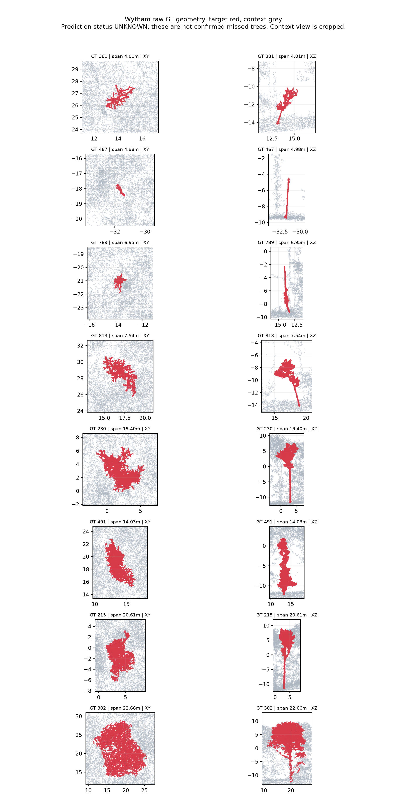

# 从原版 TreeLearn 的漏检实例选择修复对象

日期：2026-10-22。本轮不修改正在训练的结构投票分支、训练配置、checkpoint、缓存和评价实现。只读取数据、提取诊断样本，新增独立 CPU 工具。没有运行模型、推理、训练或本地单元测试。

## 1. 本地已完成的提取

核对了两份本地 `wytham_vox0.1.laz` 的文件头：54,592,456 点、相同坐标范围，字段含原始实例 `treeID`，没有官方预测实例。当前服务器使用的过滤后 37,264,001 点缓存及 `baseline.npy` 不在开发机。

复用 2026-10-20 已提取的三个半径 16 m 原始标注点云块，累计读取 4,409,622 个块内点，允许块间重叠。只保留整个 GT 包围盒完整位于块内、与圆形块边界至少相隔 2 m、块内目标点数等于此前全量扫描点数的实例。去重后有 37 棵，按垂直跨度和下部邻树接近程度选出 8 棵，保存目标/周围点云和 XY/XZ 图。

这些是**完整 GT 几何小样本，尚不是已确认的原版漏检名单**。原始 ID 与服务器缓存 ID 也没有在本轮证明一一对应。

| 原始 GT ID | z 跨度 | 完整标注点数 | 下部代理点数 | 观察 |
| --- | ---: | ---: | ---: | --- |
| 381 | 4.01 m | 699 | 54 | 有细干与较小冠部形态 |
| 467 | 4.98 m | 202 | 41 | 整体以细杆状结构为主，图中没有明显冠层 |
| 789 | 6.95 m | 524 | 56 | 下部与其他已标注树较接近，中位最近距离约 0.29 m |
| 813 | 7.54 m | 2,841 | 332 | 有可见干冠形态，下部样本未见 0.3 m 内的其他已标注树点 |
| 230 | 19.40 m | 16,642 | 873 | 较大实例，下部存在邻树点接近 |
| 491 | 14.03 m | 12,512 | 1,719 | 竖向延伸明显，与邻树下部较分离 |
| 215 | 20.61 m | 21,024 | 1,111 | 有较完整干冠结构 |
| 302 | 22.66 m | 176,856 | 11,190 | 大冠层、高点数实例对照 |

“下部代理”是目标 z 的第 5 百分位 + 0.5 m 以下点，不是树干部位标签、聚类 seed 或地面归一化树高。不能把 41 个代理点直接解释成少于 `tau_min=50` 个有效 seed。距离只考虑局部已标注邻树，未知点不是空空间；超过 2 m 的邻树距离也可能受局部视野限制。



完整统计：[JSON](assets/wytham_raw_cases_20261022/summary.json)、[37 棵几何候选](assets/wytham_raw_cases_20261022/raw_geometry_candidates.csv)、[8 棵样例](assets/wytham_raw_cases_20261022/raw_selected_cases.csv)。抽出的 NPZ 在开发机 `.codex_tmp/wytham_raw_repair_cases_20261022/`，不把原始点云包提交到 Git。

几何观察提示：低矮实例并非只有“大树等比缩小”这一种形态，还包括很少点数的细杆状实例。单纯等比缩放不会改变冠干比例。另一些低矮树仍有可辨的干冠与局部空间分离，更适合作为恢复候选先核对。几何本身不能证明原版为什么漏检，更不能确认这些 ID 是否漏检。

原始标注数据来源为用户指定的 TreeLearn 数据目录，公开数据说明见 [TreeLearn Dataverse](https://data.goettingen-research-online.de/dataset.xhtml?persistentId=doi:10.25625/VPMPID)。本轮小样本不是对整片森林的随机抽样估计。

## 2. 从服务器已有官方预测导出真正的漏检案例

新增 `tools/diagnostics/extract_wytham_baseline_cases.py`：

- 只读当前外部缓存的 `coords.npy`、`labels.npy`、`baseline.npy`。存在时读取保存的 `tree_probability.npy`、`votes_xy.npy`；不打开约 4.8 GB 的 backbone 特征，不加载网络或权重。
- 分块复算原协议，默认必须复现 TP=596、FP=222、FN=281。旧日志中 TP=568 等不同评价口径不能混入。
- 保存全部 877 棵 GT 的错误类别、最佳 IoU、前景保留率，以及保存的平均树概率、基部 XY 投票离散程度。
- 仅读取已有树概率，统计原预测为 0 的点在 0.1、0.2、0.3、0.4 分数带内的 GT 树点、已知背景和未知点暴露量。这是事后诊断，不据此直接选择部署阈值。
- 计算在完全不动原正实例点集时，每棵漏检树原 0 点可以提供的最大“纯 GT 新掩码”IoU；另计算锁住原 TP 掩码、允许改动其他候选时的保守空间。
- 为单个 GT 与当前最佳预测计算通过严格 IoU>0.5 所需的最少目标点补入数、最少错误点移除数。这些需要 GT 的计数是排序用 oracle，不是能直接执行的修复规则。
- 每类默认选 3 个：接近 IoU 阈值、低纯度、前景缺失、碎裂/其他；另取最多 4 个不同高度的原正确实例作对照，共最多 16 个案例。前景缺失组优先检查已有中低分树点能提供较多目标支持的实例。
- 每例抽取完整目标 bbox 加 2 m XY 上下文，保留原全局点索引、GT、官方预测、已有概率及投票；目标最多 12,000 点，上下文最多 38,000 点。完整统计在全林计算，不能从抽样图重新计算检测指标。
- 输出到独立新目录，打包 `casepack.zip`。单 BLAS 线程、Linux 调度优先级降低，不申请 GPU，不碰训练锁。仍有有限 CPU/磁盘读取开销。

在服务器另开一个终端，当前 GPU 训练可以继续：

```bash
cd ~/projects/zrx/code/TreeLearn
conda activate TreeLearn
git pull --ff-only origin codex/candidate-mask-mlp-step1

python -m unittest discover -s tests -p 'test_baseline_repair_cases.py' -v &&
python -u tools/diagnostics/extract_wytham_baseline_cases.py
```

新增文件不属于当前结构投票训练的来源签名文件；本次提交不修改其已签名文件。运行工具只读取已经完成的官方缓存，不读取当前正在产生的验证结果。

末尾会显示 `SAVED .../summary.json` 和 `CASEPACK .../casepack.zip` 的准确路径。先回传 `summary.json` 和 `selected_cases.csv` 可以确定具体漏检名单、编辑预算及保护范围；有 `casepack.zip` 后即可核对对应点云、概率与投票，完成更具体的原因归纳。当前尚未得到这份服务器输出。

## 3. 下一版修复的候选设计

先确认真正漏检中哪些具备独立、可辨的小尺度结构，且原未分配点足以支持检测。不要因为细杆外观或 PCA 二维重叠就宣布语义/特征坍缩。

优先候选是“低矮、点少、结构可辨，且原模型留下足够中低分树点”的实例。可研究一个**只向原预测为 0 的位置补充新实例的小树通道**：

1. 原网络与全部原正实例保持原样；补充分支读取冻结特征、几何与原概率，候选入口位于原 0 点。
2. 用局部细杆/干冠结构、连接一致性及相对已有基部投票关系生成并验证新候选，避免仅因点少或概率稍高就接受候选。
3. 通过单独质量评分后，只给原 0 点新增实例编号，不重新分配原正实例点。因此原实例点集按构造保持不变。新增误检及全局匹配变化仍需完整评价，不能宣称 TP/F1 被保证不下降。
4. 训练需要独立、有真实低矮/细杆形态标注的数据；未知点不能充当背景。Wytham GT 选例只作开发诊断；若实际用于训练，必须另留空间隔离区域并改变评价定位。

这条路线针对原版的前景缺失；正在运行的 XY 分支针对已有前景的点归属，两者解决的错误不同。不要在本轮结果未完成时把两条路线一起叠加。

如果导出结果反而显示最接近成功的漏检主要来自邻树混合，并且需要拆分已存在的正实例，则应设计局部拆分或关系修复，并检查 lost/recovered；上述只补原 0 点的通道无法覆盖这种情形。

本轮只完成原始几何小样本、只读导出工具和候选修复设计；尚未确认具体原版漏检 ID、实施修复或产生性能增益。本地仅对工具作静态检查，12 项 CPU 回归留在服务器执行。
