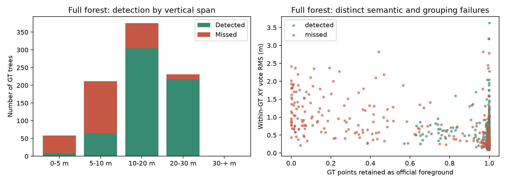
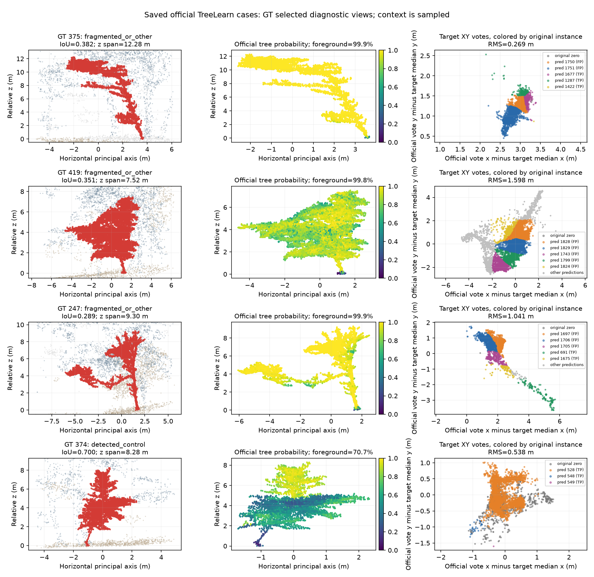
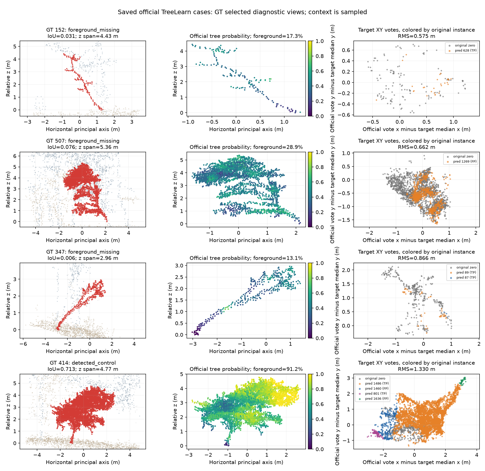
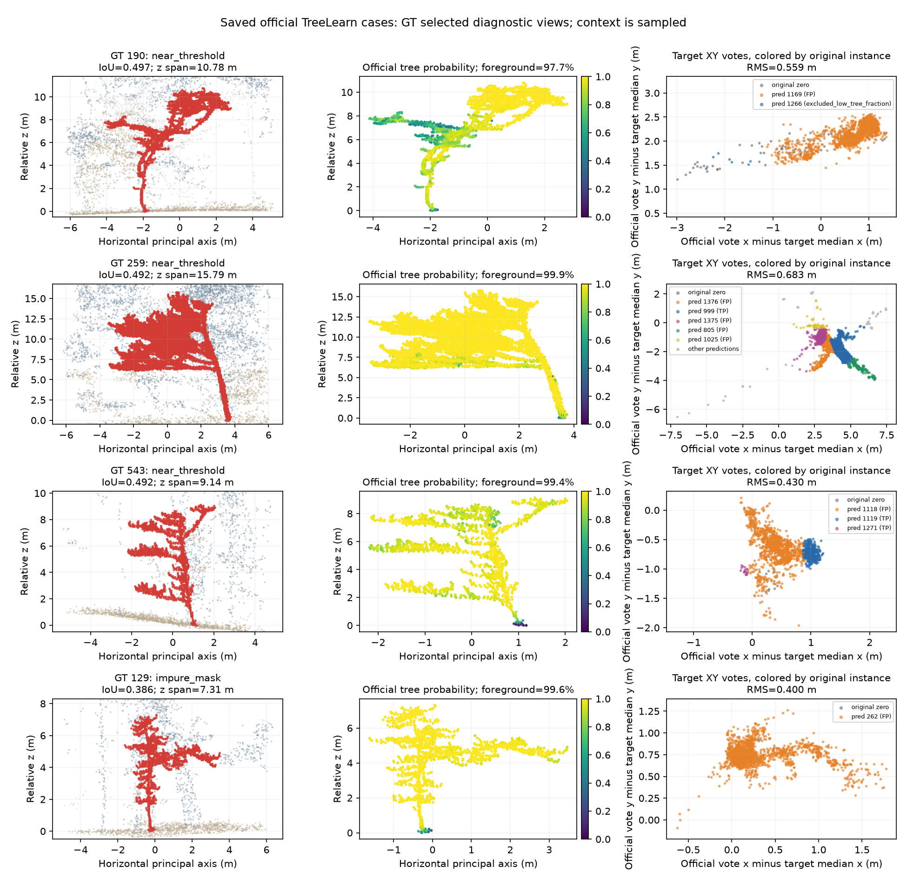

# 官方 TreeLearn 的 Wytham 漏检实例：实际案例与修复设计

日期：2026-10-22。读取用户回传的 `casepack.zip`、独立 `summary.json`，完成全林 CSV 统计和 16 例已有点云、概率、XY 投票分析。本轮没有运行模型、训练、推理或单元测试，没有改动正在运行的结构投票训练。

后续结构投票 3,000 步已完成：全林恢复 5 棵、丢失 3 棵，下列六个碎片实例中只有 629 恢复。实际变化和更具体的修复边界见[逐树诊断结论](structure_voting_case_conclusion_20261022_zh.md)。本文保留官方案例与 GT 辅助修复机会，不能把这些机会当作已实现的自动分数。

**已找到具体修复机会。第一步建议做冻结官方模型的局部实例关系修复，先识别同一棵树的两个碎片；第二步单独做原 0 点的小树前景补漏。二者不能用同一种 XY 收紧损失代替。**

## 1. 数据与口径核对

- ZIP 的 36 个成员通过 CRC 检查；包内、包外 summary 完全一致。
- 全林表有 877 棵 GT，原预测实例表有 1,862 个实例，另有 16 个 GT 选例。负 GT 忽略，不作为背景。
- 复核表中的检测、错误类别、误检数，以及逐 GT IoU / precision / recall 的均值；与官方缓存基线一致：TP=596、FP=222、FN=281、F1=70.3245%。
- 所有选例的已有树概率、XY 投票有限，原始全局点索引在每例内不重复；所有抽样点都满足 `(tree_probability >= 0.5) == (baseline > 0)`。导出器在全林扫描中也记录了 0 个不一致点。
- 全林统计使用 37,264,001 点的服务器缓存。上下文点最多抽样 38,000；目标最多 12,000。419、611 的目标被抽样，其余 14 例目标完整。抽样图不能重算全林指标或估计局部真实前景比例。
- 此处 GT ID 是过滤后缓存 ID，没有把原始 LAZ 的 ID 强行关联进来。

输入 ZIP SHA256：`3b9676909bc53860d3309ebb5bf1b9ed67061f2d544fceed6ed2f4bd7feebdb1`。

完整机器统计：[analysis_summary.json](assets/wytham_official_cases_20261022/analysis_summary.json)。

## 2. 不是一种漏检：全林出现了两类主要问题

| 原版漏检类别 | 数量 | 组内每树平均树概率的中位数 | 每树前景保留率的中位数 | 主要修复对象 |
| --- | ---: | ---: | ---: | --- |
| 多数点未分配到树实例 | 118 | 30.61% | 11.21% | 小树前景补漏 |
| 没有任何点分配到树实例 | 11 | 11.35% | 0% | 小树前景补漏，难度更高 |
| 高召回、低纯度 | 117 | 98.73% | 99.70% | 邻树混入、错误实例归属 |
| 散落在多个预测中 | 15 | 87.12% | 96.77% | 同树碎片关系 |
| 其他 IoU 不足 | 20 | 97.60% | 99.37% | 逐例区分混合与碎裂 |

原版漏检共 281 棵，其中 196 棵的 z 跨度不足 10 m，占 69.75%。但“小树”并不等于“语义漏检”：短跨度漏检中也有合并和碎裂。

| GT 的 z 跨度 | 总数 | 已检出 | 漏检 | 其中前景缺失漏检 |
| --- | ---: | ---: | ---: | ---: |
| <5 m | 58 | 9 | 49 | 39 |
| 5–10 m | 212 | 65 | 147 | 90 |
| 10–20 m | 375 | 304 | 71 | 0 |
| 20–30 m | 231 | 217 | 14 | 0 |
| ≥30 m | 1 | 1 | 0 | 0 |

**129 棵前景缺失漏检全部集中在 z 跨度不足 10 m 的实例中。** 这是本轮最明确的结构尺度关联。z 跨度不是地形归一化树高，不能据此声称模型存在显式的“10 m 阈值”。



当前冻结官方语义、只改 XY 的分支，在保持同一前景集合的前提下，无法检出上述 129 棵树中的任何一棵：对它们有 `|GT ∩ foreground| / |GT| < 0.5`，因此任意新归属实例的 `IoU <= |GT ∩ foreground| / |GT| < 0.5`。重新排列已有前景不能补回被判为背景的点。这是分支能力边界，并非训练时长问题。

另外，117 棵低纯度漏检的 GT 内 XY 投票 RMS 中位数约 0.323 m，原正确实例对应中位数约 0.332 m。**组内投票紧凑本身不能区分成功与失败**；一棵树的点可以投得很紧，仍被错误种子或邻树实例接收。当前包没有中间特征、实际 seed 掩码、verticality 和 offset-z，不能从这些数值宣称“特征坍缩”，也不能认定某一 HDBSCAN 参数就是根因。

## 3. 第一批最清楚的机会：两个同树碎片

先检查完整目标样本，发现 375、259 的两个原预测碎片合并即可超过检测阈值。然后利用全林预测表进一步核对，找到下列 **6 棵具体的双碎片机会**。

| GT ID | 原最佳 IoU | 原预测编号 | 合并后的 GT IoU |
| --- | ---: | --- | ---: |
| 375 | 0.3823 | 1750 + 1751 | **0.6599** |
| 419 | 0.3512 | 1828 + 1829 | **0.6217** |
| 259 | 0.4916 | 1375 + 1376 | **0.5695** |
| 629 | 0.4624 | 1549 + 1550 | **0.6684** |
| 720 | 0.4706 | 1025 + 1026 | **0.8070** |
| 801 | 0.2850 | 1080 + 1324 | **0.5144** |

这些数值不是抽样估计：原实例互不重叠，union 的已知点数等于两个实例已知点数之和；二者的主要 GT 都是同一个目标，完整交集点数可由全林表的 `dominant_gt_precision × known_points` 还原为整数。程序检查了还原误差，并在完整目标选例上与实际 NPZ 交集相互核对。

例如 375 的两个碎片合并后，目标交集 4,042 点，已知预测点 5,382，GT 共 4,785 点：`IoU = 4042 / (4785 + 5382 - 4042) = 0.659918`。

419 的目标图被抽样到 12,000 点，所以没有拿图中交集比例当作完整交集。表中的 0.6217 来自全林精确计数。629、720、801 没有本轮 NPZ 视图，只能确认计数上的机会，不能判断其局部几何是否易分辨。

这 12 个原预测在基线中均为 FP，没有匹配到原 TP。因此这 6 个**指定的、GT 辅助挑选的合并操作**不会修改原 TP 的点集。这不意味着部署程序可以知道谁是 FP，也不意味着已实现自动修复。合并策略必须不读取 GT；全林最终匹配、lost/recovered、FP 仍需重新计算。

搜索只覆盖“两实例的主要 GT 相同、原本均未匹配”的保守子集，6 不是所有合并机会的总数，也不是理论上限。不能将 GT 条件直接写入推理或把这些反事实 IoU 当作模型新分数。



375 的目标前景保留率为 99.92%，平均树概率为 99.79%，GT 内投票 RMS 仅 0.269 m，却被拆到多个实例中。最好的单碎片只覆盖 40.36% 的目标，另一个碎片覆盖 44.12%。这比“网络没认出这棵树”更明确地指向实例构建阶段。具体是 seed 选择、种子聚类还是剩余点归属，需要完整 seed 信息才能继续区分。

## 4. 第二类机会：已有结构，但树概率不足

| GT ID | z 跨度 | GT 点数 | 原前景保留率 | 平均树概率 | 原 0 点且 p≥0.3 的目标点 / 全部 GT |
| --- | ---: | ---: | ---: | ---: | ---: |
| 152 | 4.43 m | 156 | 17.31% | 40.32% | 69.23% |
| 507 | 5.36 m | 2,964 | 28.95% | 43.97% | 60.22% |
| 347 | 2.96 m | 375 | 13.07% | 36.06% | 60.00% |

图中 152、347 呈稀疏细长结构；507 有较明显的干冠形态。原概率并非全为零，但原前景不足以检出。它们是补漏的具体诊断对象，不能只凭有连续细杆就保证是容易识别的树。

如果能从原 0 点里完美挑出属于这三棵树且 p≥0.3 的点，新实例的纯 GT IoU 上界分别为 0.6923、0.6022、0.6000。实际必然混入一些点：在完整保留这些目标点的前提下，152、507、347 分别最多允许 59、605、74 个已知外来点，才能保持严格 IoU>0.5。这说明需要对象级结构和纯度判断。



**不能把“129 棵允许只用原 0 点恢复”解释成“降一点阈值就能找回 129 棵”。** 以下是假设能完美去掉所有杂点、只新增原 0 点掩码的单树支持上界：

| 新实例允许用的原 0 点 | 有超过半棵 GT 支持的漏检数 |
| --- | ---: |
| 不限制原概率 | 129 |
| p≥0.1 | 108 |
| p≥0.2 | 57 |
| p≥0.3 | 10 |
| p≥0.4 | 0 |

p≥0.3 的十棵为：114、118、152、342、347、443、507、519、774、808。其中仅 152、347、507 有本轮点云选例。

在整片森林所有原 0 点中，放宽到 p≥0.3 还会暴露 123,849 个 GT 树点、187,237 个已知背景点、295,373 个未知点；p≥0.2 对应 206,671、396,078、492,337。未知点不能当作负例，也不能计入“已证明是树”的数量。概率只适合作候选入口的信号，不能直接当作新增实例的接受规则。

## 5. 接近 0.5 的漏检也不全是轻微边界噪声

- 190：IoU=0.4969，目标召回 97.44%，预测纯度只有 50.34%，44.53% 的已知预测点来自别的树。移除任意 37 个已知外来点，或补入 19 个缺失目标点即可跨阈值，是 GT 辅助的最小编辑预算；并不表示有已实现的规则能选对这些点。
- 259：接近阈值，同时有同树碎片合并的明确机会。
- 543：IoU=0.4920，原最佳预测混入 42.24% 的其他树点；有 398 个目标点位于原 TP 掩码中。不能为了补少量点就从已正确实例中任意抢点。
- 129：前景保留率 99.59%、平均树概率 98.49%，但最佳预测只有 38.67% 目标纯度。它需要剔除邻树、重新分组或拆分，继续提高树概率或继续合并会用错方向。

全林 best IoU 恰好等于 0.5 的漏检数为 0。18 棵位于 [0.45,0.5]，其中 16 棵的最佳预测不是原 TP。把 `>` 改成 `>=` 不会改变本轮结果。



另外两例低纯度树 157、370 以及正确实例 48、611 的视图见[补充案例图](assets/wytham_official_cases_20261022/additional_impure_cases_and_controls.png)。48 的少部分目标点落在其他已正确检出的树里，不能整体合并周围预测；611 的已匹配预测也包含其他 GT，说明“掩码含多个 GT”不能直接等同于这个实例应该被删除。

## 6. 针对性修复：先关系，再补漏

### 第一轮：冻结官方输出，增加“保持 / 合并”的实例关系头

首轮只解决 375、419、259 这一类同树碎片。先不同时做拆分、新语义或 U-Net 微调。

1. **候选来源不使用 GT。** 从原实例的邻近关系生成候选对。读取已有 coords、baseline、probability、XY votes；需要时再加冻结特征。使用原聚类 seed 的空间关系作为补充；当前包没有 seed，应明确区分“尚未验证”与“原理假设”。
2. **比较多个高度层的关系。** 对每个实例按高度均衡抽样，计算两实例的 3D 接触关系、投票分布、下部结构延续性、是否存在两条可分离的下部主轴。用小型关系网络判断 same-tree / keep。投票中心接近不能单独触发合并，因为相邻真树也可能很近。
3. **训练明确加入邻树反例。** 同一 GT 被原聚类拆成的候选是正例；空间接近但不同 GT、两个完整相邻树是重要负例。未知 GT 不当负例。训练采用实例对均衡和高度分层，冻结官方网络与原概率。
4. **默认保持，不做连通分量式连锁吞并。** 只接受相互优先、具有独立结构证据的高置信候选对，一轮内实例最多参与一次合并，防止 A–B、B–C 的链式错误扩大。
5. **原正确实例的保护要通过完整评价验证。** 训练可对破坏原正确实例的候选加重惩罚；部署只能用预测出的稳定性与结构证据，不能用 TP 标记。记录每个被编辑实例，评估最终 TP/FP/FN、lost/recovered 和 point coverage。第一轮目标是先找到可重复的少量净恢复，保持基线正确树不丢；不是预先保证大幅提升。

这 6 棵是关系修复的可解释正例，仍需邻近真树负例才能形成可用规则。当前包不足以训练并验证一个可靠的自动合并器。本轮不把“知道正确答案后的合并”包装成已获得增益。

### 第二轮：结构引导的小树补漏，仅向原 0 点新增实例

这条支路针对 129 棵前景缺失：保持全部原正实例点集不变，在原 0 点中生成结构候选。使用局部连通、跨层一致性、细干/干冠形态及原概率、XY 投票，训练“是否存在新树、哪些点属于它”的独立分支。

先从 152、347、507 这类有中等分数支持的候选检查；不能把全林概率阈值直接降低。加入原本已检出但仍有低分零点的树作反例，例如 374：已经检出，仍有 29.31% 的点为原 0 点。补漏支路必须识别“已有实例的一部分”，避免再造一棵重复树。

“只向原 0 点新增编号”可以按构造保持原实例点集；新增误检、全局匹配和计分仍需验证，不能保证 F1 上升。训练还需要覆盖真实低矮、细杆和小冠形态；不能指望把大树等比例缩小就覆盖这些形态。

Wytham 案例已用于本轮设计，后续若继续据此调参，应把它视为开发分析；若用 Wytham GT 训练，另留空间隔离的验证区域，不能再称为未见域测试。

### 对正在运行实验的安排

当前结构投票流程照常完成 3,000 步，不需要中断。得到已有保存结果后，先比较这批 ID：

- 同树碎片：259、375、419、629、720、801；
- 前景缺失对照：152、347、507，检查前景不变的约束是否按设计成立；
- 混合实例：129、190、543；
- 原正确对照：414、374、48、611，同时统计全林原 596 棵正确树的 lost/recovered，不能只检查四个对照。

先确认现有 XY 分支到底恢复了哪种树，再决定关系修复的训练输入。下一步独立模块从候选关系特征和“保持 / 合并”验证开始；不要直接启动又一套完整架构。

## 7. 本轮产物与复核方式

- [16 例完整统计](assets/wytham_official_cases_20261022/selected_case_statistics.json)
- [逐 GT 与原预测交集清单](assets/wytham_official_cases_20261022/target_prediction_fragments.csv)
- [6 棵全林精确双碎片反事实](assets/wytham_official_cases_20261022/full_forest_same_dominant_gt_pair_oracles.csv)
- [组间统计](assets/wytham_official_cases_20261022/cohort_statistics.csv)
- 分析脚本：`tools/diagnostics/analyze_wytham_baseline_casepack.py`。

脚本只读取 ZIP 内的 CSV/JSON/NPZ，不执行压缩包中的代码，不解压到原数据目录，不读取网络和 checkpoint，不申请 GPU 或训练锁。输出要求使用新目录。复核需要 NumPy，绘图还需 matplotlib；不绘图可加 `--no-plots`。

```bash
python -u tools/diagnostics/analyze_wytham_baseline_casepack.py \
  --casepack /path/to/casepack.zip \
  --summary /path/to/summary.json \
  --output /path/to/new_analysis_directory
```

本轮已在开发机对用户回传的真实包完成 CPU 分析、统计交叉核对与图像检查；没有运行项目测试或任何模型。本提交只新增分析工具、统计和报告，不改正在运行的训练代码、配置、缓存或权重。原始 NPZ 与 ZIP 未提交到 Git。
